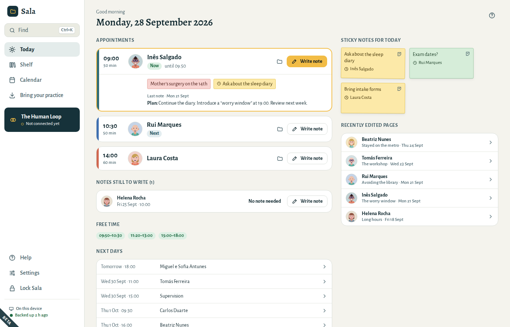
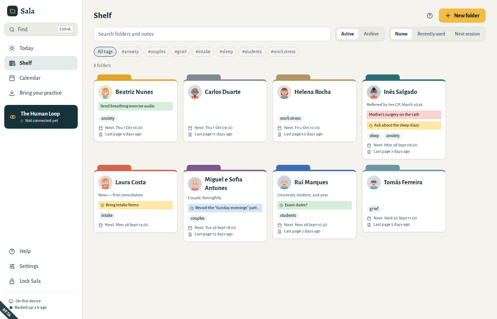
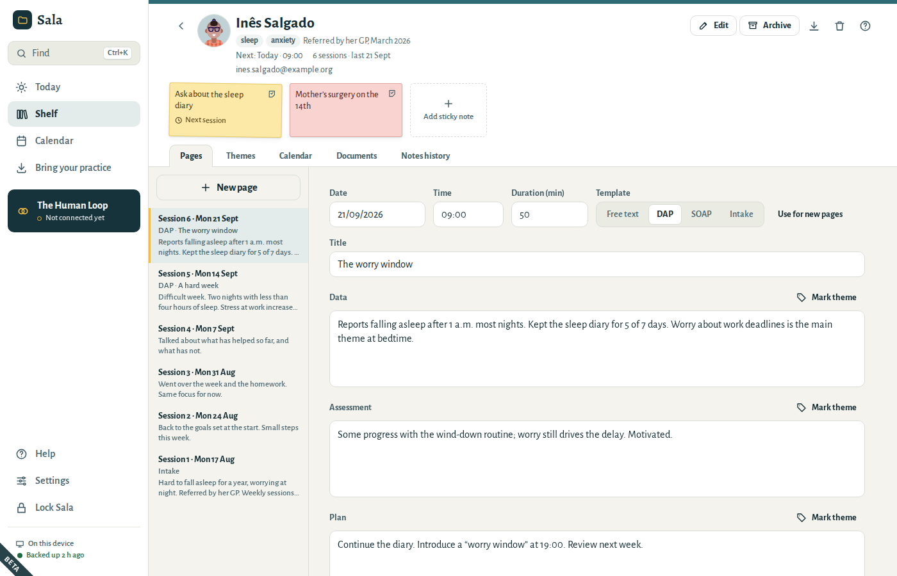
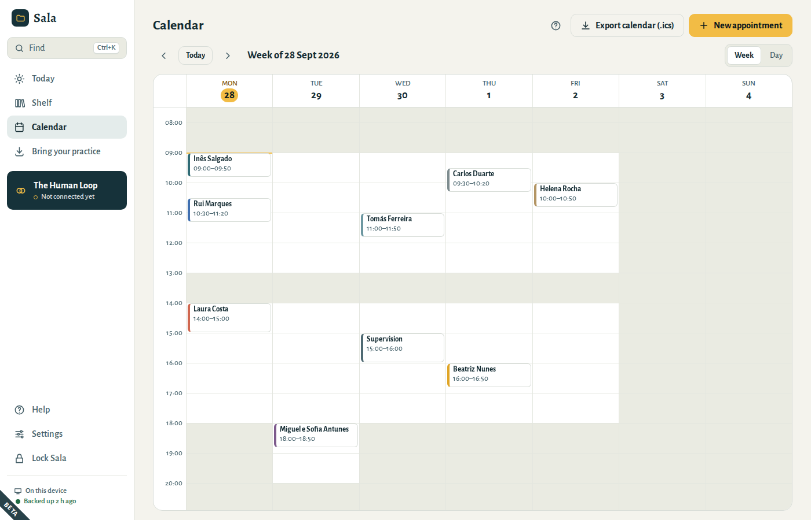

# Sala

**Your practice, on your computer.** Sala is a free, open-source practice app for psychologists and psychotherapists: a folder for each patient, a page for each session, sticky notes on the cover for “ask about this next time”, and a calendar — all kept on your own computer, encrypted. It works with no account and no internet connection.

[English](#english) · [Português](#português) · [Español](#español)

| | |
|---|---|
|  |  |
|  |  |

> Sala is at an early stage. Desktop builds for **Windows**, **Linux** and **macOS** are test builds; phone and tablet versions will follow.


## English

**What it does**

- **Folders, pages and sticky notes.** One folder per patient with a coloured tab. Session pages in free text, DAP or SOAP, with a private process note kept apart from the record. Sticky notes on the cover or on a page; mark one “next session” and it appears on the day of that patient’s next appointment.
- **Today and the calendar.** Weekly and fortnightly appointments, working hours, days off, appointment types, free time at a glance, and export to Google Calendar, Outlook or Apple Calendar (initials only, by default).
- **Encrypted, on your computer.** The practice is encrypted with a key only your passphrase — or your 12-word recovery phrase — can unlock. Sala locks itself when you step away.
- **Backups you control.** An encrypted backup every day to a folder you choose: a USB drive, or your own cloud-drive folder.
- **Leaving is easy.** One `.sala` file holds everything in open formats (Markdown, FHIR, iCalendar) that other programs can read. See [the format](docs/spec/export-v1.md).
- **Bring your practice with you.** Import folders of Word, OpenDocument, text and PDF files, photos and scans of paper notes (text is recognised on your computer), patient lists and calendars.
- **Nothing leaves silently.** On its own, Sala makes no internet connections at all. [What leaves this device](PRIVACY.md) lists every way data can leave your computer — each only when you choose it.

**Languages:** English, Português (Portugal), Español (España).

**Help:** the manual is built into the app (Help) and in [docs/manual](docs/manual).

## Português

O **Sala** é uma aplicação gratuita e de código aberto para psicólogos e psicoterapeutas: uma pasta para cada paciente, uma página para cada sessão, notas adesivas na capa para “perguntar na próxima sessão” e um calendário — tudo guardado no seu computador, cifrado. Funciona sem conta e sem ligação à Internet. Faz cópias de segurança cifradas para uma pasta à sua escolha e exporta tudo num único ficheiro, em formatos abertos. Disponível em português (Portugal), espanhol (Espanha) e inglês. O manual está na própria aplicação (Ajuda) e em [docs/manual/pt](docs/manual/pt).

## Español

**Sala** es una aplicación gratuita y de código abierto para psicólogos y psicoterapeutas: una carpeta para cada paciente, una página para cada sesión, notas adhesivas en la portada para “preguntar en la próxima sesión” y un calendario — todo guardado en su ordenador, cifrado. Funciona sin cuenta y sin conexión a Internet. Hace copias de seguridad cifradas en una carpeta que usted elige y exporta todo en un único archivo, en formatos abiertos. Disponible en español (España), portugués (Portugal) e inglés. El manual está en la propia aplicación (Ayuda) y en [docs/manual/es](docs/manual/es).

## Install

This is the open-source edition of Sala. Each [release](https://github.com/feiteira/thehumanloop-sala/releases) has its source and a Linux build; or build Sala from source (below). The installers are not yet code-signed, so Windows SmartScreen will warn before installing one you build yourself.

Sala as published on [sala.thehumanloop.eu](https://sala.thehumanloop.eu) is the same app with one addition: an optional connection to The Human Loop, a service for therapists, which is not part of this repository.

## Build from source

Requirements: Node.js 22.12+, Rust (stable), and on Linux `libwebkit2gtk-4.1-dev libgtk-3-dev libsoup-3.0-dev librsvg2-dev libayatana-appindicator3-dev patchelf`.

```bash
npm install
npm run dev              # run the desktop app
npm run dev:web          # or: a browser demo with a fictional practice, in memory only
npm run build:desktop    # installers for your operating system
```

Developer guide: [AGENTS.md](AGENTS.md). Contributing: [CONTRIBUTING.md](CONTRIBUTING.md). Security: [SECURITY.md](SECURITY.md).

## Licence

The code is licensed under the [Mozilla Public License 2.0](LICENSE). The names and logos “Sala” and “The Human Loop” are not covered by that licence — see [TRADEMARKS.md](TRADEMARKS.md).

The Alegreya and Alegreya Sans fonts in `app/src/ui/fonts/` are by Huerta Tipográfica, under the SIL Open Font License 1.1 (licence files alongside them).

The folder drawings are [“Personas”](https://personas.draftbit.com/) by Draftbit, under [CC BY 4.0](https://creativecommons.org/licenses/by/4.0/), drawn on the device by [DiceBear](https://www.dicebear.com/) (MIT). Sala uses a selection of their parts and colours.
