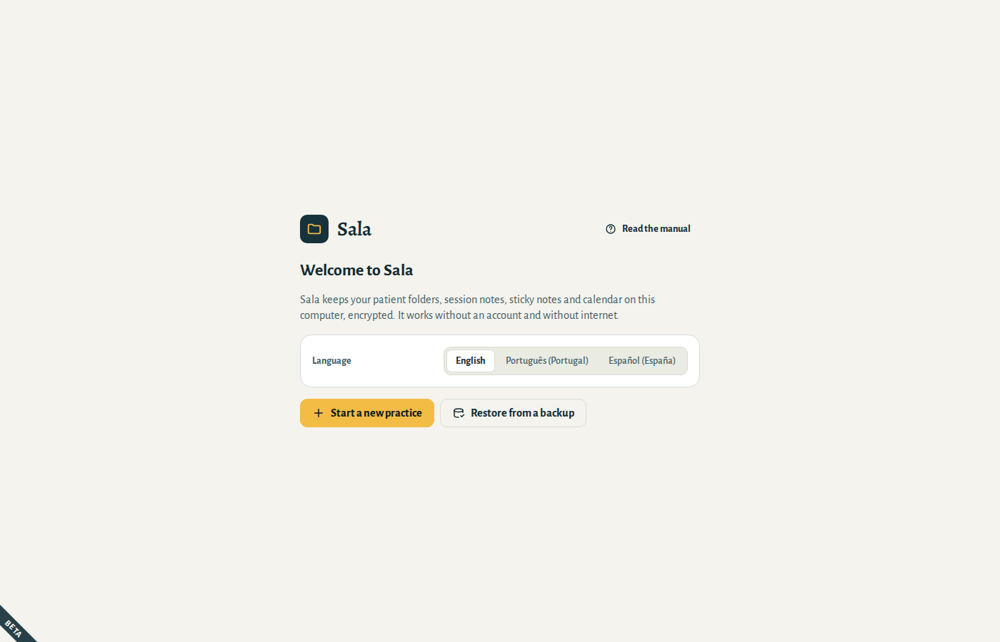
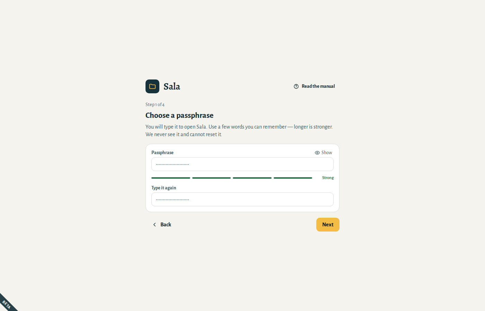
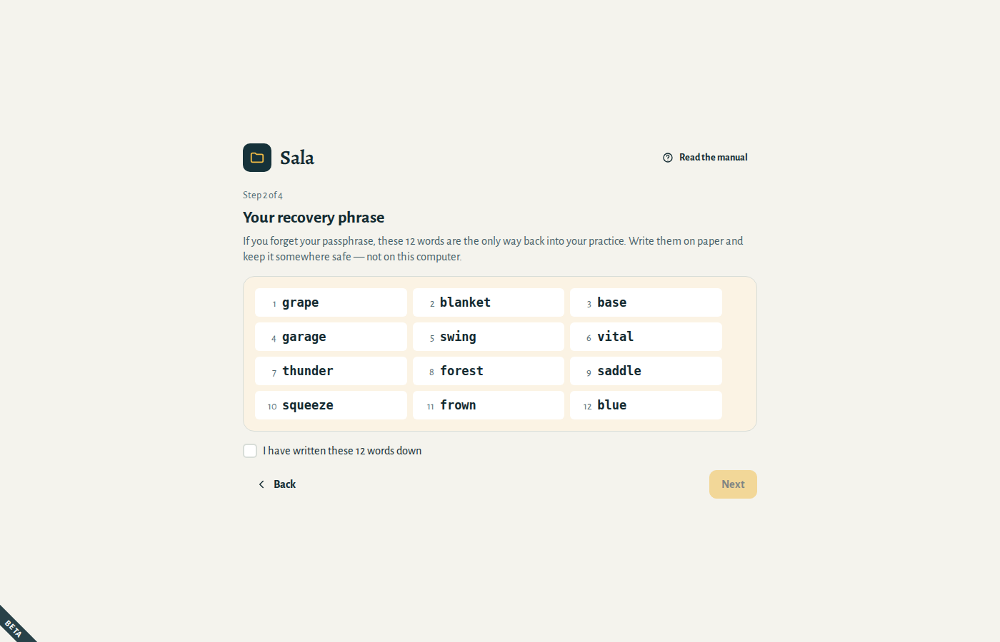
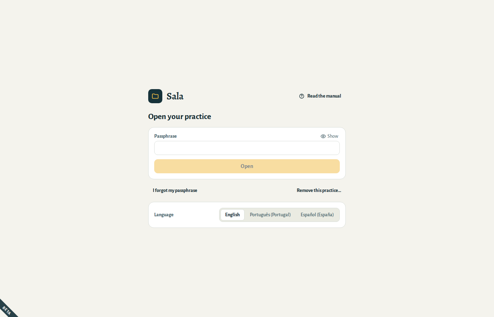
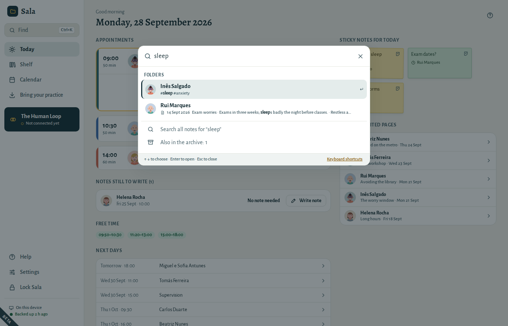

# Getting started

## Install Sala

**Windows:** open the Sala installer (`.exe`) and follow the steps. If Windows shows “Windows protected your PC”, choose **More info → Run anyway** — test versions of Sala are not yet signed.

**Mac:** download the `.zip` and open it — your Mac unpacks it into **Sala**. Drag **Sala** into your **Applications** folder, then open it. The first time, your Mac asks whether to open an app downloaded from the internet: choose **Open**.

**Linux:** use the `.deb` package on Ubuntu or Debian, the `.rpm` on Fedora, or the `.AppImage` on any distribution (make it executable, then open it).

## Try Sala with the example practice

Installing Sala also adds **Sala (example)** to your menu (the Start menu on Windows). It opens a practice filled with fictional people, appointments and notes, so you can try everything without touching your own practice.

- Its passphrase is **sala**.
- It starts afresh every time: whatever you change is erased when you close it. Never write real notes in it.
- Your own practice opens from **Sala**, as usual.

## Open Sala for the first time

1. Choose your language. You can change it later in **Settings → General**.
2. Choose **Start a new practice**. (Moving from another computer? Choose **Restore from a backup** — see [Your data](05-your-data.md#restore).)

## Choose a passphrase

You type your passphrase each time you open Sala. It protects everything in your practice.

- Use **a few words you can remember**, like `violet river morning tea`. Longer is stronger; it must have at least 10 characters.
- The bar under the field shows how strong it is.
- Nobody can reset it for you — not even us. That is what the recovery phrase is for.

## Write down your recovery phrase

Sala shows 12 words. **They are the only way back into your practice if you forget your passphrase.**

1. Write the 12 words on paper, in order.
2. Keep the paper somewhere safe — not on this computer, and not in a photo on your phone.
3. Tick **I have written these 12 words down** and continue.
4. Sala asks for three of the words, to check you wrote them correctly.

## Choose where backups go

Sala saves an encrypted backup once a day and when you lock or close it, whenever something changed, to a folder you choose:

- a **USB drive** you keep somewhere safe, or
- a folder of **your own cloud drive** (iCloud Drive, Google Drive, OneDrive) — the backup is encrypted before it gets there.

You can choose **Remind me later**, but until you choose a folder, Sala reminds you on the Today screen: without backups, a broken or lost computer means losing your notes.

## Opening and locking Sala

- Each time you open Sala, type your passphrase.
- Sala **locks itself** after 10 minutes without use. Change this in **Settings → General → Lock Sala after**. Unlock it on the same day and you are back where you were: the same folder, the same page.
- To lock it yourself, choose **Lock Sala** at the bottom left, or press **Ctrl+L**. Sala first saves what you were writing on a page. Next time, it opens on **Today**.

Forgot your passphrase? Choose **I forgot my passphrase**, type your 12-word recovery phrase and choose a new passphrase.

## Keyboard shortcuts

On a Mac, use **⌘** where this list says **Ctrl**.

| Press | To |
|---|---|
| **Ctrl+K** or **Ctrl+F** | Find a folder, a note or an action |
| **Ctrl+1** | Go to Today |
| **Ctrl+2** | Go to the shelf |
| **Ctrl+3** | Go to the calendar |
| **Ctrl+L** | Lock Sala |
| **F1** | Open this manual at the part about the screen you are on |
| **Alt+←**, or the back button of your mouse | Go back |
| **Ctrl+Enter** | Save or confirm in a window that asks |
| **Ctrl+Z** | Undo, while the message with **Undo** shows |
| **Esc** | Close a window |

### Find

Press **Ctrl+K**, or choose **Find** at the top of the menu, and start typing:

- a patient’s name, a word from your notes, a phone number or an email address;
- or what you want to do, like *new appointment* or *back up*.

Use **↑** and **↓** to choose, and **Enter** to open. With nothing typed, Find shows today’s sessions, the folders you used last, and everything you can do from it.
