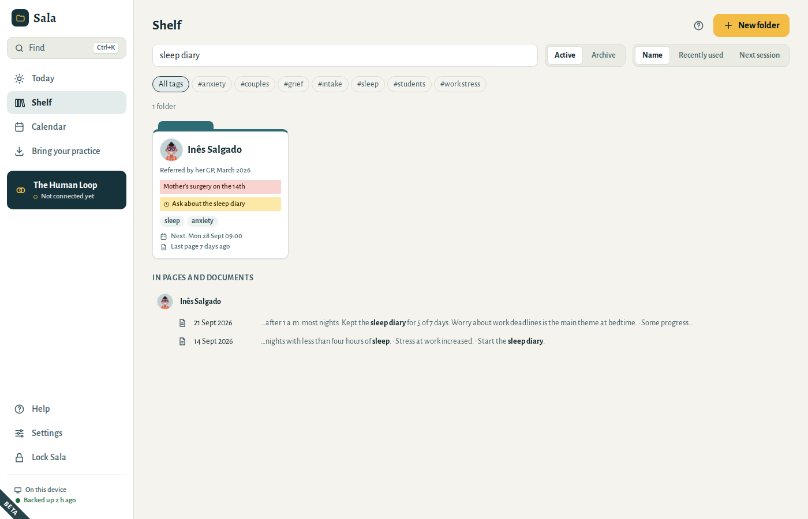
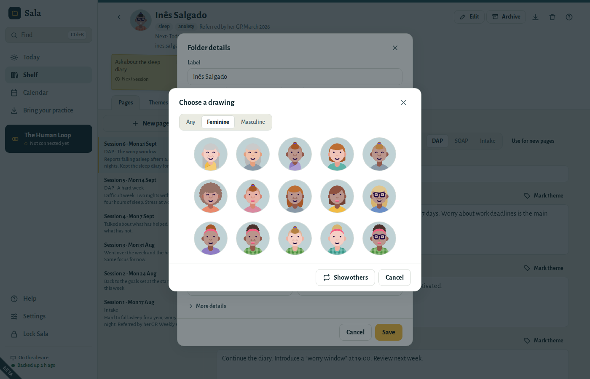
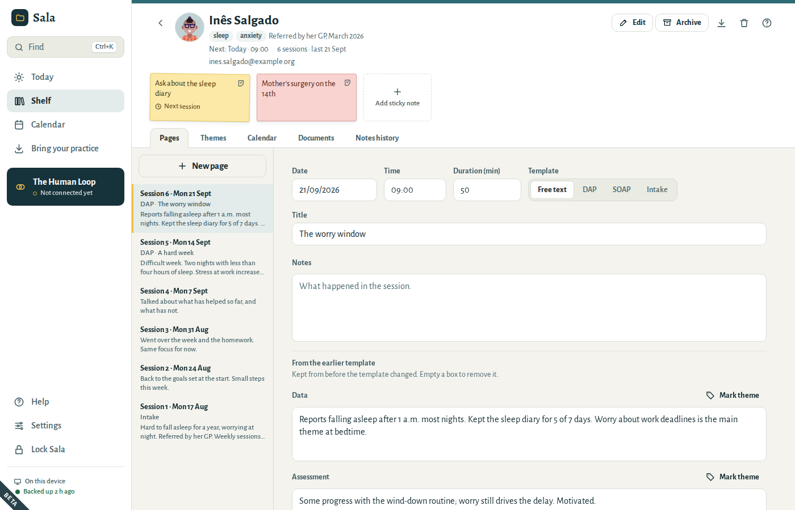
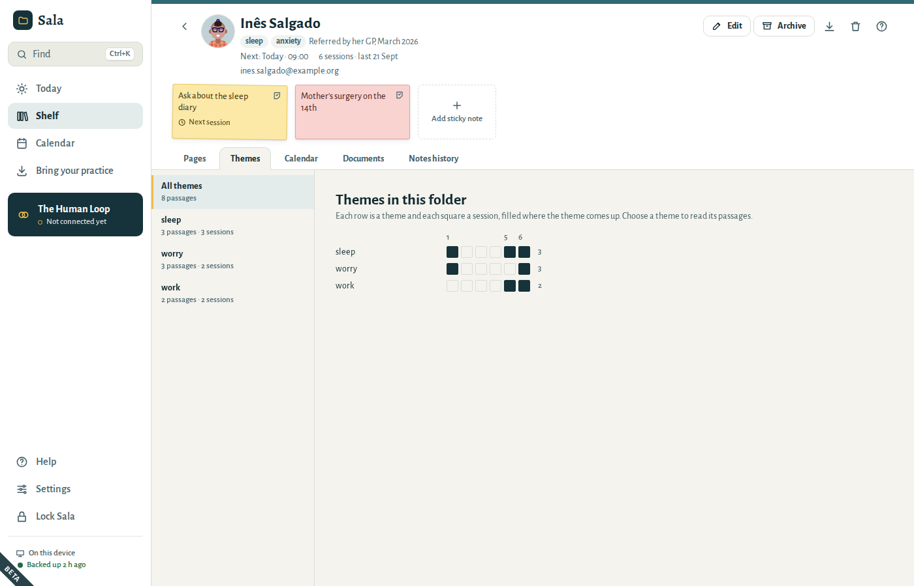
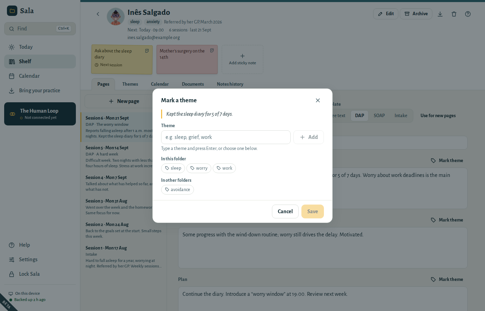
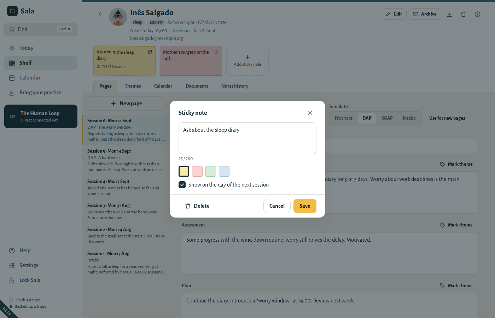
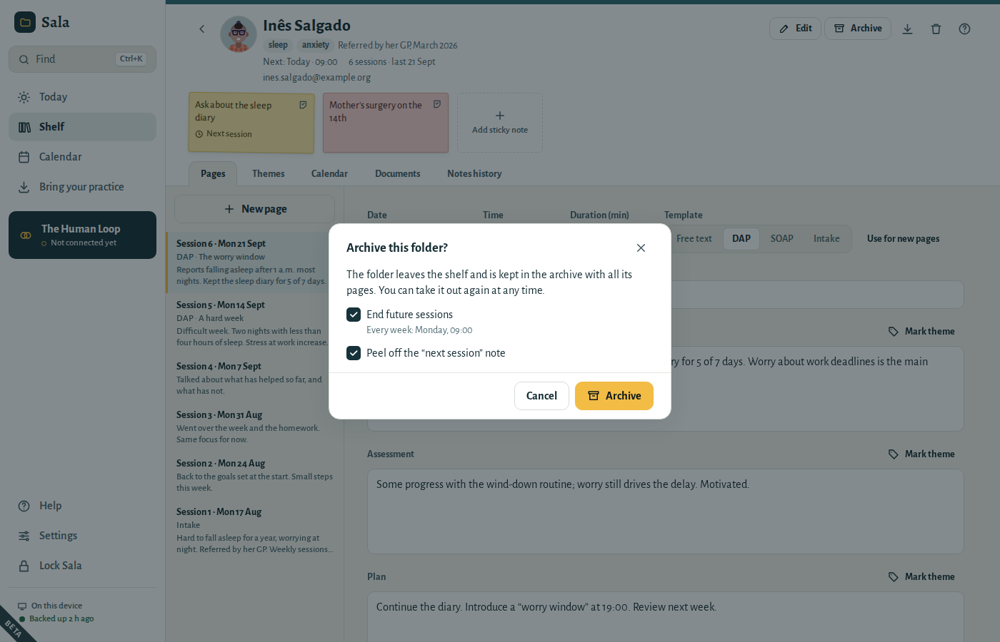

# Folders, pages and sticky notes

Sala works like the paper folders on your desk: one **folder** per patient, one **page** per session, and **sticky notes** for the things you want to remember.

## The shelf

The shelf shows all your folders. Each folder shows its sticky notes on the cover, the patient’s next session, and the date of its latest session page, as in “Last page 7 days ago”.

- **Search** finds folders by name, tag, cover note, sticky note, email or phone number, and pages and documents that contain the words you type — scans too, by the text Sala read from them.
  - Every word must be there, in any order: *ana sleep* finds Ana’s pages about sleep. Accents and capital letters do not matter.
  - Pages and documents that match are listed under the patient’s name, with your words in bold.
  - Folders whose name holds your words come first. Press **Enter** to open the first one.
  - When folders in the archive match too, choose **Also in the archive** to see them.
- **Tags** (like *anxiety* or *couples*) filter the shelf.
- **Sort** by name, recently used (the folders you last wrote in) or next session. Sala remembers your choice.
- **Archive** shows folders you have closed.

Open a folder and go back: the shelf is as you left it, with the same search and tag. To find something from any screen, press **Ctrl+K** (see [Keyboard shortcuts](01-getting-started.md#shortcuts)).

## Create a folder

1. On the shelf, choose **New folder**.
2. Type a **label** — the name you use for this patient in your records, e.g. “Inês S.”. Keep it to 120 characters.
3. Choose a **colour tab**. If you like, add tags, a cover note, an email address and a phone number.
4. Choose **Create folder**.

The patient’s language and time zone are under **More details**. Fill them in only when they differ from yours.

## A picture for each person

Every folder has a small picture, so you can find the person at a glance on the shelf, on **Today** and in their folder. Sala starts each folder with a drawing of its own.

To change it, select the picture at the top of the folder (or choose **Edit**):

- The arrows beside the picture go through drawings one at a time: **›** shows another, **‹** goes back to the one before. This works when you create a folder too.
- **Choose a drawing** shows a set of drawings. Choose **Feminine** or **Masculine** to narrow them, or **Show others** for more, then select one.
- **Use a photo…** uses a photo from your computer. Sala keeps a small square copy, encrypted in your practice. **Remove photo** goes back to a drawing.

The drawings are made on this computer; nothing is downloaded. A photo is part of the folder, so it is included in backups and exports.

## The folder cover

The top of a folder shows what you need before a session:

- the tags and the cover note;
- **Next:** with the date and time of the next session. When nothing is booked, choose **Book**: Sala suggests the same weekday, time and length as the last session (after a first consultation, your usual session type);
- how many session pages there are, and the date of the last one, e.g. “14 sessions · last 21 Sept”;
- the phone number and email address. Select them to copy them;
- the sticky notes on the cover.

Below the cover are the dividers: **Pages**, **Themes**, **Calendar**, **Documents** and **Notes history**.

To give the patient a copy of their folder, choose the **Export this folder…** button (the arrow pointing down). See [Give a patient a copy of their folder](05-your-data.md#folder-export).

## Write a session page

1. Open the folder and choose **New page**. (From **Today**, the button next to an appointment opens that session’s page with the date and time filled in.)
2. Choose a **template**:
   - **Free text** — one box for your notes.
   - **DAP** — Data, Assessment, Plan.
   - **SOAP** — Subjective, Objective, Assessment, Plan.
   - **Intake** — for a first session: Reason for referral, History, Observations, Initial formulation, Plan.
3. Type your notes. The boxes grow as you write.

The first page of a folder starts as **Intake**. Later pages start with the template you use most: choose **Use for new pages** next to the template, and every new page starts with it.

Pages are listed newest first and numbered by date: “Session 14 · Mon 21 Sept”. The number is counted from the first page, so it stays right when you add a page for an earlier date.

Type the date the way you write it, e.g. 21/09/2026. The **↑** and **↓** keys move it a day at a time. A date that does not exist, such as 30/02, is marked and not saved.

### Sala saves as you type

There is no save button. Under the page, Sala shows **Saving…** and then **Saved** with the time. If a page could not be saved, it says **Not saved**: choose **Try again**. What you typed stays on the screen until it is saved.

Sala also saves when you leave a box, when it locks and when you close it.

If you choose **New page** by mistake and leave the page without writing anything, Sala removes it.

### Changing the template

Changing the template never loses text. Anything written in a section that the new template does not have appears under **From the earlier template**, where you can still read and change it. It is kept in exports too. To remove it, empty the box.

### The private process note

Under the page, **Show private process note** opens a separate box for your own reflections. It is kept apart from the record and is **left out of exports** unless you choose to include it.

### Attach files to a page

Choose **Attach file** to add a scan, a letter or a form to the page. You can choose several files at once; a file can be up to 200 MB. When Sala is done, it tells you how many files were attached and how many could not be added.

Attached files are encrypted like everything else. To look at one, choose it: images open inside Sala; other files can be saved as a copy where you choose.

## Themes

A theme is a word or two for something that keeps coming up in therapy, such as *sleep*, *work* or *grief*. Mark the words of your notes where it comes up, and the folder’s **Themes** divider gathers them, session by session.

### Mark words with a theme

1. On a page, select some words of your note, as you would to copy them.
2. Choose **Mark theme**, above the box.
3. Type a theme and press **Enter**, or choose one you have used before: this folder’s themes come first, then those of your other folders. The same words can have several themes.
4. Choose **Save**.

The marked words are listed under the note, in **Themes on this page**. Choose one to select its words in the note. Its pencil button changes its themes, or removes the mark with **Remove mark**.

Marks stay on their words as you write. Text you add before or after marked words does not change the mark; words you add in the middle of them become part of it. If you delete all the marked words, the mark goes too. Marking never changes the text of your note.

Themes are your own words: Sala never suggests them and never marks anything by itself. Capital letters and accents do not matter, so *Sleep* and *sleep* are the same theme. Words in the private process note cannot be marked.

### The Themes divider

**All themes** shows each theme as a row and each session as a square, filled where the theme comes up, so you see at a glance what came up when. Choose a theme to read its passages, session by session, with the date of each. Choose a passage to open its page with the words selected.

- **Rename** changes a theme’s name on every page of this folder. If a theme here already has the new name, the two become one.
- **Remove** takes the theme off every page of this folder. The words of your notes stay as they are.

Both show **Undo** for a few seconds.

Themes belong to their pages: they are in backups and exports, and the readable notes of an export list them under each page.

## Sticky notes

Sticky notes are short reminders — up to 280 characters — on a folder’s **cover** or on a **page**.

- Choose **Add sticky note** to write one. Pick a colour.
- Tick **Show on the day of the next session** and the note appears on the **Today** screen on the day of that patient’s next appointment.
- When you are done with a note, **peel it off** (the small button in its corner). Peeled notes move to the folder’s **Notes history**, where you can stick them back.
- To delete a note, open it and choose **Delete**.

After you peel off or delete a note, **Undo** appears at the bottom of the window for a few seconds.

## Documents

The **Documents** section of a folder holds everything that is not a session page: referral letters, consent forms, reports, scans. It also lists the files attached to pages, with the session they belong to.

- Choose **Add document** to add files.
- Choose a file’s eye button to look at it, or its arrow to save a copy.
- Choose its bin button to delete it. **Undo** brings it back.

## Archive, restore, delete

**Archive** closes a folder when therapy ends. The folder leaves the shelf but is kept with everything in it; find it under **Archive** on the shelf.

When you archive a folder, Sala asks about what is still to come:

- **End future sessions** stops a repeating appointment after its last past date and cancels single appointments still to come. A repeating appointment with no past sessions is deleted instead; it stays in **Recently deleted** for 30 days. Past sessions are never changed. This choice appears only when sessions are booked, and it is ticked.
- **Peel off the “next session” note** clears notes meant for a session that will not happen.

Choose **Archive**. If you change your mind straight away, choose **Undo**.

To bring a folder back, open it from the archive and choose **Take out of archive**. Sessions that were ended stay ended; book new ones from the cover.

**Delete folder** (the bin button) removes the folder and everything in it: pages, sticky notes, appointments and documents. Consider archiving instead — you may have a duty to keep records. Right after a delete, **Undo** brings everything back. For 30 days after that, you can still restore it from **Settings → Your data → Recently deleted**.

### Delete a page

**Delete page** at the bottom of a page deletes it with its sticky notes. Files attached to the page are not deleted: they move to the folder’s **Documents**. **Undo** brings the page back as it was.
