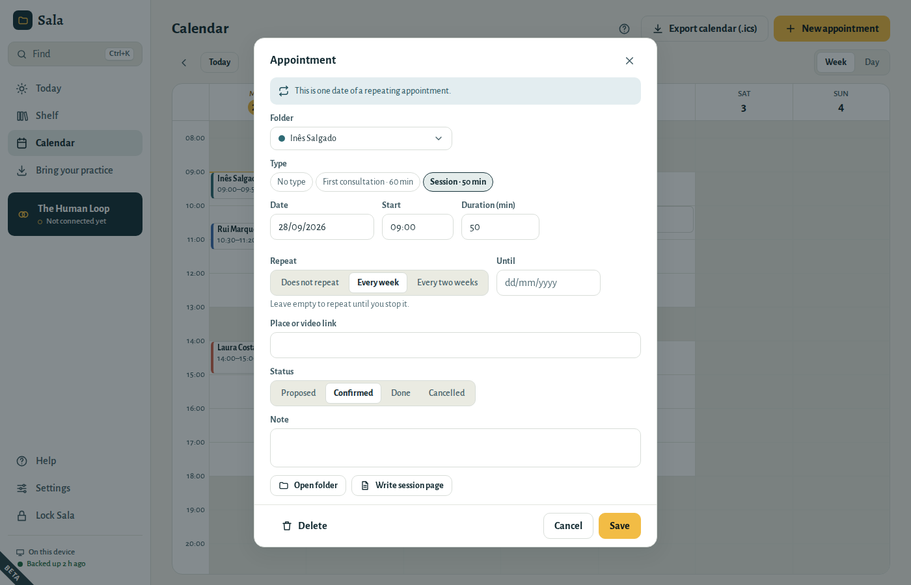
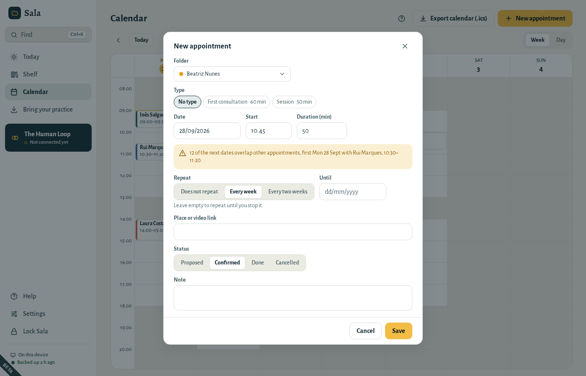
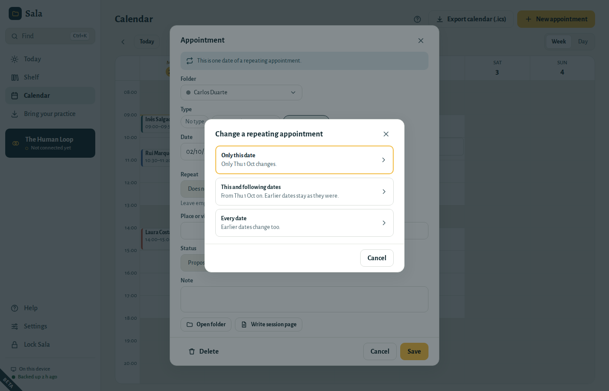
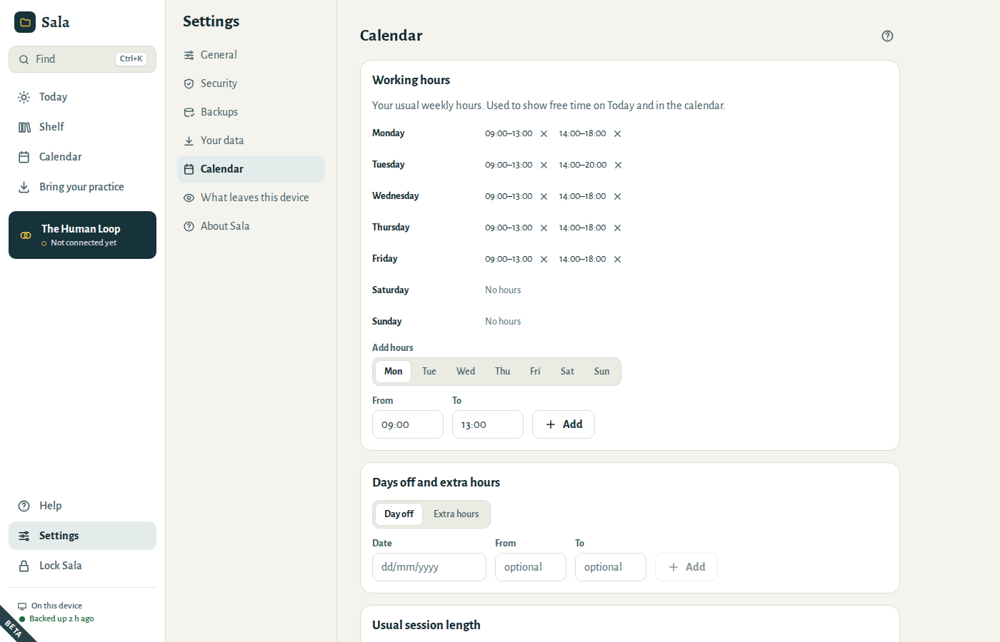

# Your calendar

## Today

Today is where each day starts: your appointments in order, and what still needs a note.

### Before a session

The session that is on now, or the next one, opens up on its card. You see the sticky notes on the patient's folder and a few lines of the last note in that folder: its plan, or where the note ended. Click those lines to open that page.

Each card says where the day is: **Now**, **Next** or **Ended**. Click the time or the name to open the appointment, for example to move it. The folder button opens the patient's folder.

### Write the session note

Choose **Write note** on the appointment. Sala opens the folder on a new page with the date and time filled in. Once the page exists, the card shows **✓ Note written** and the button reads **Open note**, so you never make the same page twice.

### Book the next session

When a session is on now or over, and nothing is booked yet for that patient, the card shows **Book next**. It opens a new appointment on the same weekday, at the same time, of the same type and length: one week later, or two for a session every two weeks. After a first consultation, it picks your usual session type instead. Check the date and choose **Save**.

### Notes still to write

Sessions of the last two weeks that ended without a page are listed under **Notes still to write**. Choose **Write note**, or **No note needed** when there is nothing to record (for example, the patient did not come). Today's sessions are not repeated there: they have their own **Write note** button. When everything is written, the list disappears.

### Sticky notes, free time and the next days

- **Sticky notes for today** are the notes marked “next session” for the patients you see today. Click one to open its folder, or the page it is stuck to. When you no longer need it, peel it off with the button in its corner; **Undo** sticks it back.
- **Free time** is what is left of your working hours today. Without working hours, Today offers a link to set them in **Settings → Calendar**.
- **Next days** lists the coming appointments; click one to open it.
- **Recently edited pages** take you back to the pages you worked on last.

## The calendar

- Switch between **Week** and **Day**. Use the arrows to move, **Today** to come back.
- The calendar opens at the current time. Grey hours are outside your working hours.
- **Click an empty time** to create an appointment there, or choose **New appointment**.
- A cancelled session is crossed out and says **Cancelled**. A date you moved on its own says **Moved**.

## Create an appointment

1. Choose the **folder** (or **No folder** for supervision, meetings and other time).
2. Optionally choose an **appointment type** — it fills in the duration. Without a type, the appointment takes your usual session length.
3. Set the **date**, **start** and **duration**. Type the date as you write it, for example 28/09/2026.
4. For regular sessions, choose **Every week** or **Every two weeks**, and optionally an end date.
5. Add a place or video link, and a status: **Proposed**, **Confirmed**, **Done** or **Cancelled**.

If the time overlaps another appointment, or falls outside your working hours, a yellow note under the date says so. For a repeating appointment it checks the next twelve dates. You can still save.

Sessions keep their time when the clocks change in March and October: a 09:00 session stays at 09:00.

### Book the next session

Open the patient’s folder and its **Calendar** divider. **New appointment** starts from the next session at the usual rhythm: the same weekday, time, length and type as the last one, one week later (two for a fortnightly series). After a first consultation, it picks your usual session type instead. When nothing is booked yet, **Book next** shows that date: one click opens it, ready to save. While a series is still running, **New appointment** starts tomorrow at the usual time instead, for an extra session.

The Calendar divider lists the coming sessions and every past one, with the year for older dates.

### Change one date of a repeating appointment

Open that date in the calendar or in the folder’s Calendar divider, make the change and choose **Save**. Sala asks which dates it is for:

- **Only this date** — for example, this week’s Thursday session moves to Friday.
- **This and following dates** — for example, from now on the sessions are at 18:00. Earlier sessions stay as they were.
- **Every date** — earlier dates change too.

To mark one session **Done** or **Cancelled**, choose the status, **Save** and **Only this date**. The other dates keep their status.

To give the sessions to another patient, change **Folder**. With **This and following dates**, every session from that date on goes to the new patient, also those you had changed from a later date, and their series starts afresh: the dates the first patient moved or cancelled stay with them. With **Every date**, the whole series moves, with its moved, done and cancelled dates. On the first date of sessions you had changed from a date on, **Every date** gives that date and the later ones: the earlier sessions stay with the first patient, and Sala says so before you choose. **Undo** appears for a few seconds. Use it if you chose the wrong folder: changing the folder back would bring back, as booked sessions, the dates the first patient had moved or cancelled.

To stop repeating from a date on, open that date, choose **Does not repeat** and **Save**. That date stays as a single appointment and the dates after it are removed. **Undo** appears for a few seconds.

To remove dates, choose **Delete**:

- **Only this date** — for a holiday or a session that will not happen.
- **This and following dates** — when therapy ends or pauses. Past sessions stay in the folder.
- **Every date, past ones too** — for a series made by mistake.

After a delete, **Undo** appears at the bottom of the window for a few seconds. A series deleted with **Every date, past ones too** goes to **Recently deleted**, like any other appointment. With **Only this date** and **This and following dates** the series stays and skips those dates, so they do not go to Recently deleted: **Undo** is the only way to bring them back. With **This and following dates**, dates you had moved on their own, and later sessions you had changed from a date on, are deleted whole instead: those do go to Recently deleted.

## Working hours and appointment types

In **Settings → Calendar**:

- **Working hours** — your usual weekly hours, for example Monday 09:00–13:00 and 14:00–18:00. They define the free time shown on Today.
- **Days off and extra hours** — holidays, or an extra Saturday morning.
- **Usual session length** — the length a new appointment starts with, for example 50 minutes.
- **Appointment types** — for example “First consultation · 60 min” and “Session · 50 min”.

Removed something by mistake? Choose **Undo** at the bottom of the window.

## Use your calendar in other apps

In the calendar, **Export calendar (.ics)** creates a file you can open in Google Calendar, Outlook or Apple Calendar. Choose how appointments are named there — by default only initials (“Appointment · I.S.”), so a shared or synchronised calendar reveals as little as possible. Cancelled sessions and removed dates are left out, and dates you changed on their own appear on their new day.
