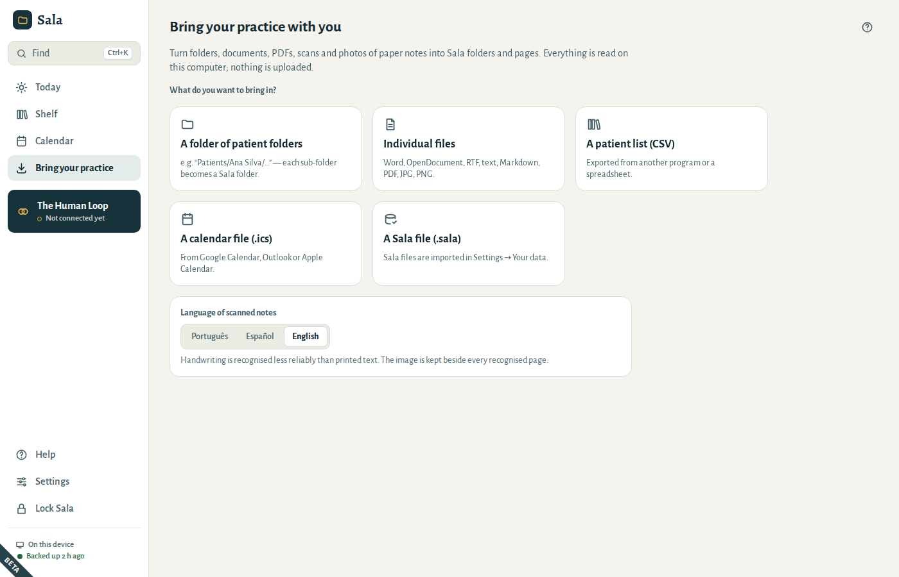
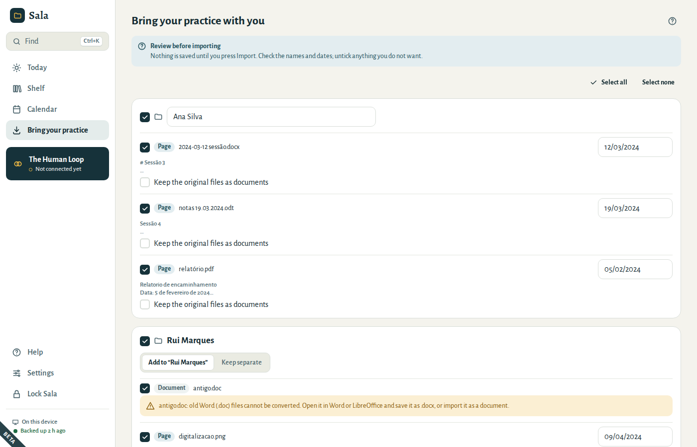
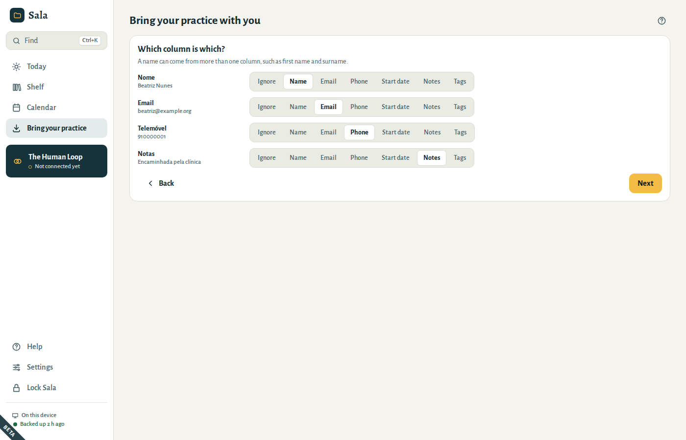
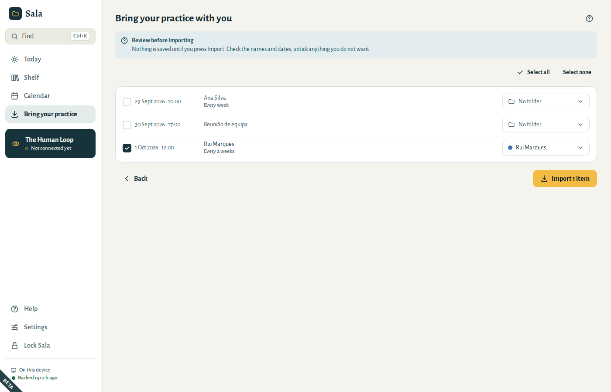

# Bringing your practice with you

Most practices do not start empty. Sala can turn what you already have into folders and pages in one sitting. **Everything is read on this computer — nothing is uploaded.**

Open **Bring your practice** in the menu and choose what you have. If your notes include scans or photos, first choose the **Language of scanned notes** at the bottom of the screen: Sala reads the files as soon as you pick them.

## A folder of patient folders

If your computer has a folder like `Patients/Ana Silva/…`, choose **A folder of patient folders** and select the top folder (`Patients`). Each sub-folder becomes a Sala folder; the files inside become pages or documents:

| You have | Sala makes |
|---|---|
| Word (`.docx`), OpenDocument (`.odt`), RTF, text and Markdown files | pages, with headings, lists and emphasis kept |
| PDFs with text | pages |
| Scanned PDFs, photos and scans (JPG, PNG) | pages with the recognised text, and the image kept beside it |
| Old Word files (`.doc`), spreadsheets | documents (save a `.doc` as `.docx` to turn it into a page) |

Files larger than 200 MB are listed, but they are too large to bring in.

## Individual files

Choose **Individual files** to bring in a few documents. At the review step, choose where they go: **New folder** (type its name) or **Existing folder**.

## Review before importing

Nothing is saved until you choose **Import**. Check:

- **Folder names.** A folder with exactly the same name as one you already have (“Silva, Ana” and “Ana Silva”) is added to it. A name that only looks like one (“Ana S.” and “Ana Silva”) is marked *Looks like the existing folder “Ana Silva”*: choose **Add to “Ana Silva”** or **Keep separate**. Sala never puts two people together on its own when their names differ, even by one initial. Every new folder needs a name.
- **Dates.** Sala takes each page’s date from the file name, then from the text, then from the file’s own date. Dates taken from the file’s own date are marked — check them. Type a date the way you usually write it, such as 12/03/2024.
- **What to keep.** Untick anything you do not want, or a whole folder. **Select all** and **Select none** are at the top. Tick **Keep the original files as documents** to keep the Word or PDF file too.

When something needs a look — a folder without a name, a date that does not exist — Sala marks it in red and imports nothing until it is fixed.

At the end, Sala shows what came in: new folders, pages, documents and appointments. If a file could not be read (for example, because the USB drive was unplugged), it is listed with the reason and everything else is imported anyway. Choose **Go back to these items** to try them again, or come back to them later: they stay waiting under **Continue import**.

If the import is interrupted — Sala was closed or locked, for example — the next time you open **Bring your practice** Sala offers **Continue import**. You see what is still to come in, with the choices you had made, and can check it before you go on. Sala does not lock itself while it reads or imports; if you lock it yourself, the import stops safely after the file in hand.

## Paper notes: photos and scans

Scan your paper notes (or photograph them flat, in good light) and import the images. Sala recognises the text on this computer.

1. First choose the **Language of scanned notes**, at the bottom of **Bring your practice**.
2. Then choose the folder or the files.

- Printed and typed text is recognised well. **Handwriting is recognised less reliably** — the image is always kept beside the text, labelled *Text recognised from a scan — check it against the image*, with the recognition confidence.
- HEIC photos (from an iPhone) cannot be read here. Export them as JPG first.

## A patient list (CSV)

Export the patient list from your previous program or spreadsheet as CSV. Each row becomes a folder.

- Sala shows each column and guesses which is which: name, email, phone, start date, notes, tags. Correct it if needed.
- A name can come from more than one column: choose **Name** for both the first-name column and the surname column.
- A date of birth is never taken for the start date.
- Lists saved by Excel on Windows are read correctly, accents included.

In the review, a patient who already has a folder with the same name is unticked. Tick them to add the list’s details to that folder. Sala adds and never erases: a phone number or email replaces the one in the folder only when the list has one, tags are added, and the notes and the start date are added to the cover note (for example *Started: 10 Jan 2025*).

## A calendar file (.ics)

Export your calendar from Google Calendar, Outlook or Apple Calendar as `.ics` and import it.

- An appointment whose title is exactly a folder’s name goes into that folder.
- The others are unticked and show **No folder**. Choose a folder for each one, or accept the one Sala suggests (**Put it in “Ana Silva”**). Once you choose a folder for one appointment, the others with the same title suggest that folder too (*Another “Session” event went to “Ana Silva”*), one click each: a title such as “Session” may stand for several people, so Sala never puts them in a folder on its own. A repeating appointment and its moved dates always go into the same folder. An appointment you tick without a folder keeps its title, like a meeting.
- Weekly and fortnightly appointments come in with their last date, the dates that were skipped and the dates that were moved.
- Cancelled appointments and all-day events are left out.
- Other repeats (daily, monthly, or on several days a week) are marked: only their first date would come in. Create those in Sala instead.

When the import is done, choose **Open the calendar** to see the appointments.
