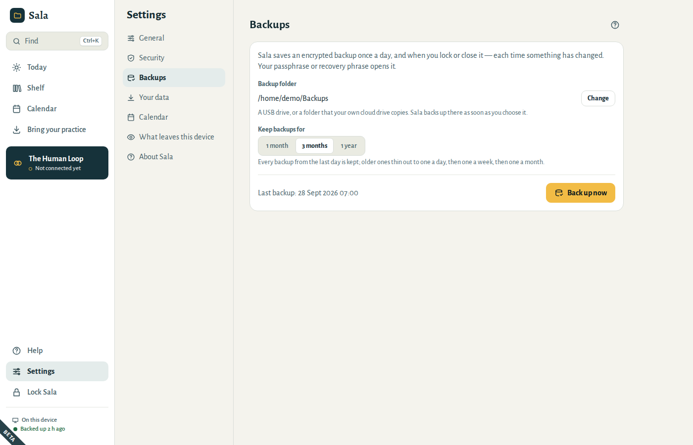
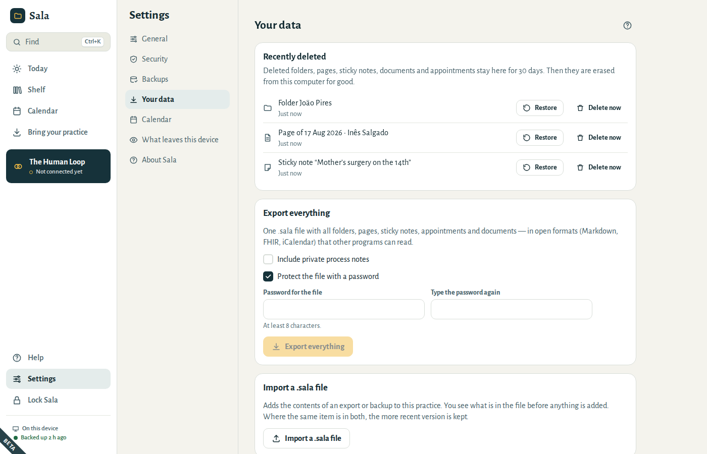
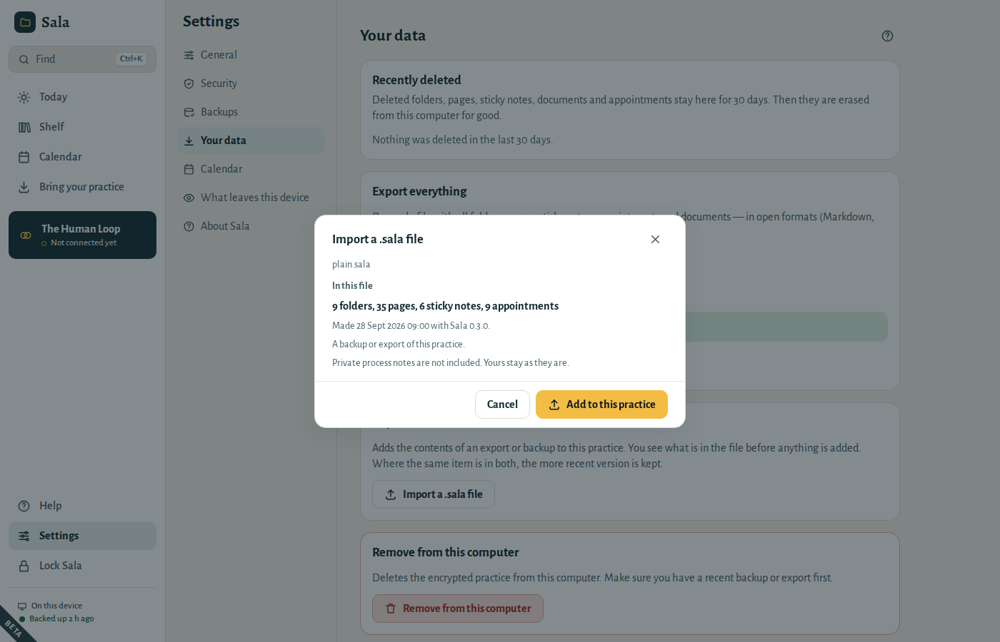
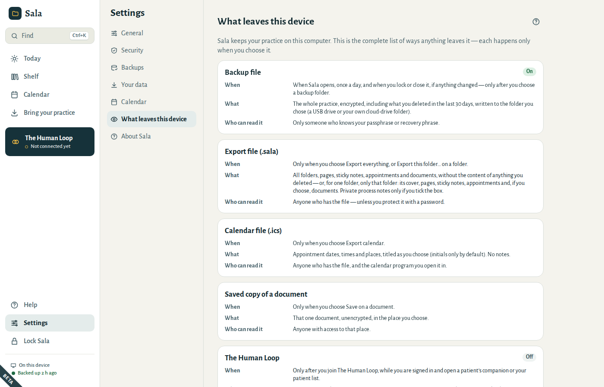
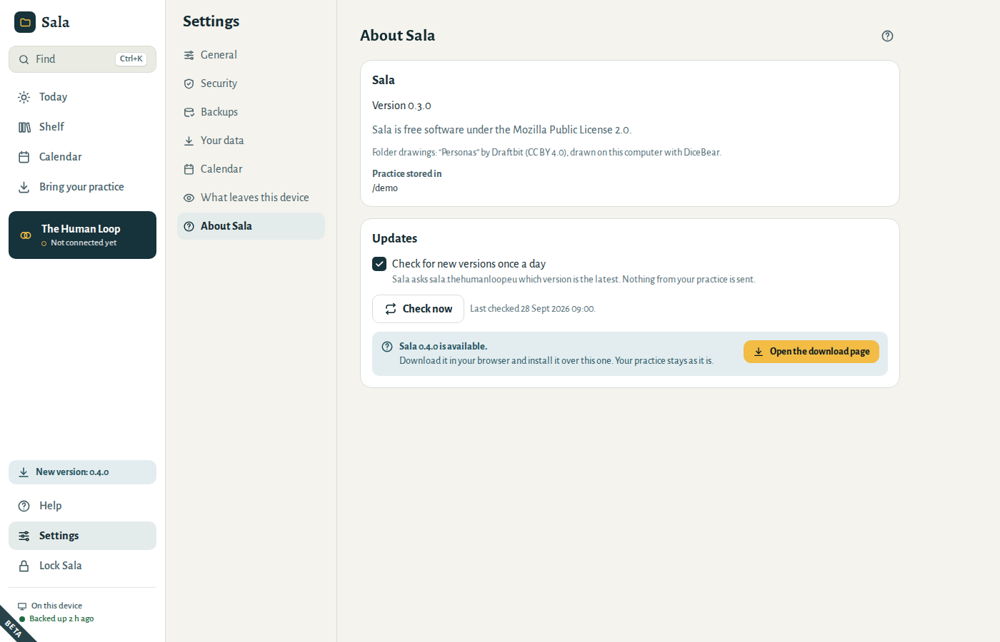
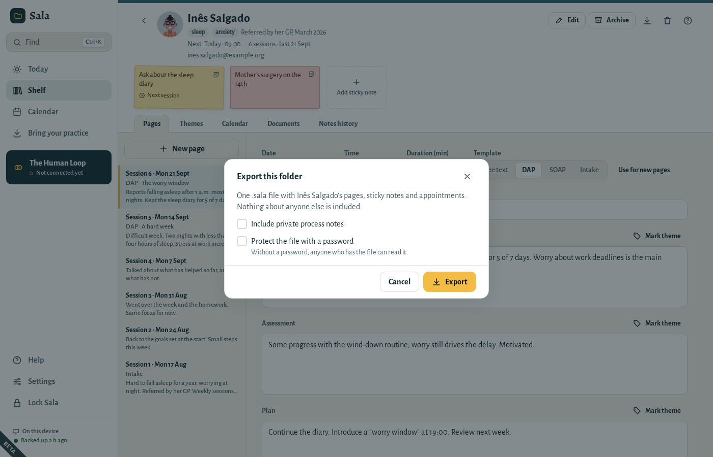

# Your data

## Backups

Sala keeps an **encrypted backup** of your practice in a folder you choose: a USB drive, or a folder that your own cloud drive copies. It backs up once a day, and when you lock or close it, each time something has changed. The foot of the menu shows when the last backup was made.

- To choose or change the folder, go to **Settings → Backups** and choose **Choose…** (or **Change**, once a folder is set). Sala backs up there straight away.
- **Back up now** makes one immediately.
- **Keep backups for** sets how far back your backups go: 1 month, 3 months or 1 year. Every backup from the last day is kept; older ones thin out to one a day, then one a week, then one a month, so the folder does not fill up.
- A backup opens with your passphrase or your recovery phrase. Nobody else can read it. When you change your passphrase, Sala makes a new backup at once; older backups still open with the old passphrase.
- Two computers can share one backup folder: each practice only ever tidies up its own backups, once both computers have this version of Sala.
- The example practice is never backed up.

When a backup fails (for example, the USB drive is not plugged in), **Today** tells you why and offers **Back up now** and **Choose another folder**. Today also reminds you when the last good backup is more than three days old. See [“Last backup failed”](06-questions.md#backup-failed).

## Recently deleted

When you delete a folder, page, sticky note, document or appointment, Sala keeps it for 30 days in **Settings → Your data → Recently deleted**. Things deleted together, such as a folder with its pages, stay together.

- **Restore** brings it back as it was. If the folder it was in has since been erased with **Delete now**, it cannot come back, and it is erased too.
- **Delete now** erases it from this computer straight away. Sala asks first.
- After 30 days, deleted items are erased for good, without you doing anything.

Right after you delete something, **Undo** at the bottom of the window brings it back too.

Removing dates of a repeating appointment (**Only this date**, or **This and following dates**) is different: the series stays and skips those dates, so those dates do not go to Recently deleted. **Undo** brings them back right after. With **This and following dates**, dates you had moved on their own, and later sessions you had changed from a date on, are deleted whole instead and do go to Recently deleted. Later, book the date again, or open an earlier date, clear **Until** and save it for **Every date**.

Backups made before an item was erased still contain it, until Sala removes those backups as they get older. To erase something everywhere at once (for example when a patient asks you to), choose **Delete now**, then **Back up now** in **Settings → Backups**, and delete the older backup files from your backup folder.

## Export everything

**Settings → Your data → Export everything** creates one `.sala` file with all your folders, pages, sticky notes, appointments and documents, in open formats that other programs can read (Markdown text, FHIR health records, iCalendar).

- **Include private process notes** is off unless you tick it.
- Things you have deleted are left out, even those still in **Recently deleted**.
- **Protect the file with a password** is on by default. Type the password twice; it needs at least 8 characters. Without a password, anyone who has the file can read it.

## Move to a new computer

1. Install Sala on the new computer.
2. On the welcome screen, choose **Restore from a backup** and pick your latest backup (`Sala backup … .sala`).
3. Type the passphrase you used on the old computer — or your recovery phrase.

Your passphrase and recovery phrase stay the same after restoring.

To add the contents of a `.sala` file to a practice you already have, use **Settings → Your data → Import a .sala file**. Sala first shows what is in the file: how many folders and pages, when it was made, and whether it holds private process notes. Nothing is added until you choose **Add to this practice**.

- Your own backups open without asking for the passphrase.
- Where the same item is in both, the more recent version is kept.
- Something deleted in the file is deleted here too. For 30 days you can bring it back from **Recently deleted**.
- If the file was made without private process notes, your own process notes stay as they are.

## What leaves this device

**Settings → What leaves this device** lists every way anything can leave your computer: backup files, exports, calendar files and saved copies of documents. Each happens only when you choose it. Sala connects to the internet only when you turn on the check for new versions or press **Check now**. There are never any analytics, telemetry or crash reports.

## Remove the practice from this computer

**Settings → Your data → Remove from this computer** deletes the encrypted practice from this computer (for example before giving the computer away). Backups in your backup folder are not touched. The window shows when the last backup was made and offers **Back up now** first, so you can bring the practice back later.

## New versions

Sala can tell you when a new version is out. **Today** asks you once whether it may check; you can change your answer at any time in **Settings → About Sala**:

- **Check for new versions once a day** asks Sala’s website, sala.thehumanloop.eu, which version is the latest. Nothing from your practice is sent.
- **Check now** asks once, whenever you like.

When there is a new version, **New version** appears in the menu. Choose **Open the download page**, download it in your browser and install it over the one you have. Your practice, backups and settings stay as they are.

## Give a patient a copy of their folder

When a patient asks for a copy of their record, or you hand their care over to a colleague, export only their folder:

1. Open the patient’s folder and choose **Export this folder…**.
2. Choose what goes in:
   - **Include private process notes** is off unless you tick it.
   - **Include its documents** is on. It appears when the folder has documents.
   - **Protect the file with a password** is off.
3. Choose **Export**, then where to save the file. It is named after the folder and the date, for example `Ana Silva 2026-10-01.sala`.

The file holds that patient’s pages, sticky notes and appointments, and nothing about anyone else, in the same open formats as **Export everything** (Markdown text, FHIR health records, iCalendar).

- **For the patient:** leave the password off. The file is an ordinary ZIP archive: on a computer without Sala, change the end of its name from `.sala` to `.zip` and open it. Anyone who has the file can read it, so hand it over in person or on a USB drive rather than by email.
- **For a colleague who uses Sala:** tick the password and give it to them separately, by phone for example. They add the file to their practice with **Settings → Your data → Import a .sala file**.
