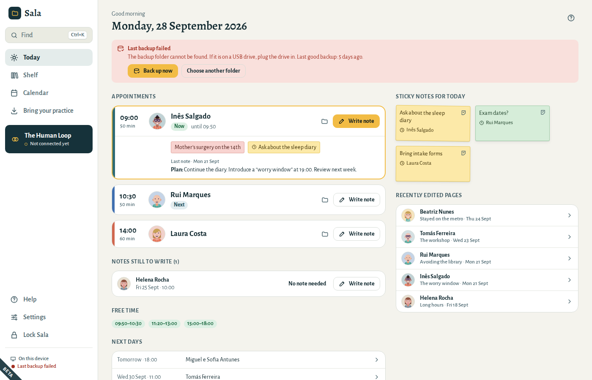

# Questions and troubleshooting

### I forgot my passphrase

First check that Caps Lock is off and that the keyboard is in its usual language. **Show**, beside the passphrase, lets you see what you typed.

If it still does not open:

1. On the opening screen, choose **I forgot my passphrase**.
2. Type your 12-word recovery phrase, from your paper.
3. Choose a new passphrase and type it again.
4. Choose **Open**.

From then on, Sala opens with the new passphrase. Backups made before still open with the old passphrase, or with your recovery phrase, which does not change.

### I lost my passphrase and my recovery phrase

Nobody can open the practice — not even us. This is what keeps your notes private. If you have a **password-protected export**, start a new practice and import it with that password.

### “This practice cannot be opened”

Sala shows this when the practice on this computer has lost its key file, most often because restoring a backup was stopped half-way (the computer was switched off, for example). Neither your passphrase nor your recovery phrase can open it. Sala never removes it by itself: choose **Remove this practice…**, then restore your backup again (see [Move to a new computer](05-your-data.md#restore)).

### My computer broke or was stolen

Install Sala on another computer and **restore from your latest backup** (see [Move to a new computer](05-your-data.md#restore)). The practice on the lost computer is encrypted.

### “Last backup failed”

The foot of the menu tells you when a backup could not be made, and **Today** tells you why:

- **The backup folder cannot be found.** Usually a USB drive that is not plugged in, or a cloud folder that was moved or renamed. Plug the drive in and choose **Back up now**.
- **Sala is not allowed to save in the backup folder.** Choose **Choose another folder** and pick a folder of your own.
- **The backup drive is full.** Delete some files from it, or choose another folder. Sala removes its own older backups as they age.

Sala tries again by itself every hour and when you lock or close it. Meanwhile your notes are safe on this computer.

### Recognised text from a scan has mistakes

Correct it on the page; the original image is kept as a document of that page so you can compare. Handwriting is recognised less reliably than printed text.

### A Word file (.doc) was imported as a document, not a page

Old `.doc` files cannot be converted. Open the file in Word or LibreOffice, save it as `.docx`, and import that file.

### Appointment times look wrong

Check **Settings → General → Your time zone**. Each appointment keeps its own time zone, so sessions keep their time when clocks change.

### Sala locked itself

Sala locks after a period without use to protect your notes. Change the time in **Settings → General → Lock Sala after**.

What you were typing was saved before Sala locked. Type your passphrase: on the same day, Sala opens where you were, in the same folder and page.

Sala does not lock itself while it exports, imports or adds documents, but it does if the window for choosing documents, or for saving an export, is left open. If it locks before such work is finished, the screen to open Sala says what was left undone and what to do again, such as exporting again. A new passphrase or recovery phrase that was being saved as Sala locked is saved first, and that screen says so. If a new passphrase could not be saved, for example because the current passphrase was typed wrong, that screen says so too: open Sala with your old passphrase and change it again.
