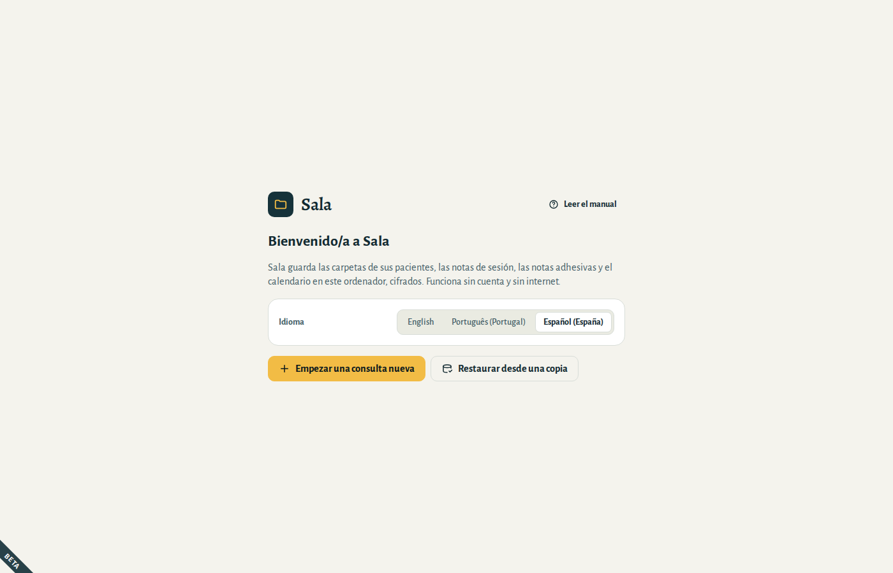
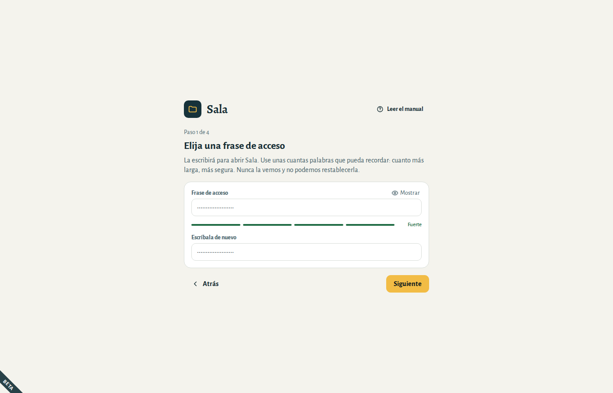
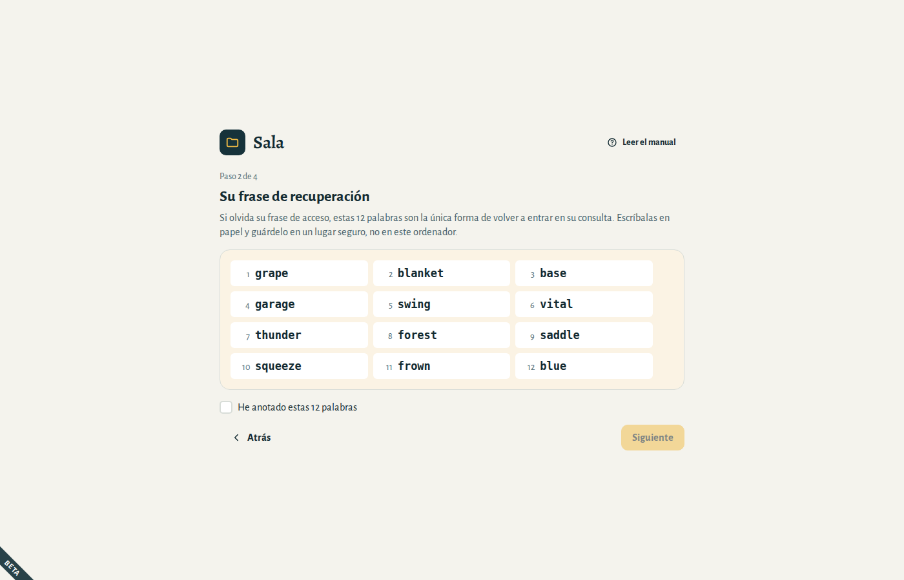
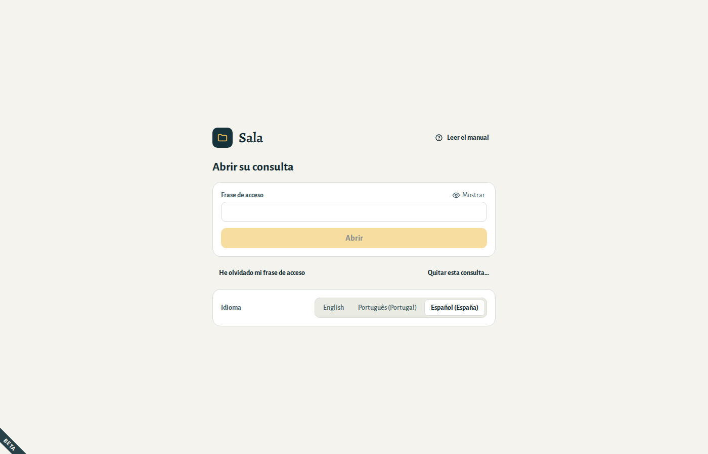
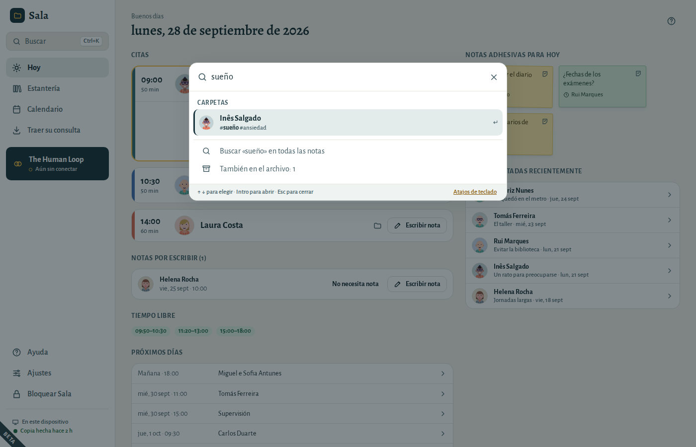

# Primeros pasos

## Instalar Sala

**Windows:** abra el instalador de Sala (`.exe`) y siga los pasos. Si Windows muestra «Windows protegió su PC», elija **Más información → Ejecutar de todas formas**. Las versiones de prueba de Sala aún no están firmadas.

**Mac:** descargue el `.zip` y ábralo: el Mac lo descomprime y aparece **Sala**. Arrastre **Sala** a la carpeta **Aplicaciones** y después ábralo. La primera vez, el Mac le pregunta si quiere abrir una aplicación descargada de internet: elija **Abrir**.

**Linux:** use el paquete `.deb` en Ubuntu o Debian, el `.rpm` en Fedora, o el `.AppImage` en cualquier distribución (hágalo ejecutable y luego ábralo).

## Pruebe Sala con la consulta de ejemplo

Al instalar Sala, también aparece **Sala (ejemplo)** en el menú (el menú Inicio, en Windows). Abre una consulta con personas, citas y notas ficticias, para que pueda probarlo todo sin tocar su propia consulta.

- Su frase de acceso es **sala**.
- Empieza de cero cada vez: lo que cambie se borra al cerrarla. No escriba nunca notas reales en ella.
- Su propia consulta se abre desde **Sala**, como siempre.

## Abrir Sala por primera vez

1. Elija su idioma. Puede cambiarlo más tarde en **Ajustes → General**.
2. Elija **Empezar una consulta nueva**. (¿Viene de otro ordenador? Elija **Restaurar desde una copia**; consulte [Sus datos](05-your-data.md#restore).)

## Elija una frase de acceso

Escribirá su frase de acceso cada vez que abra Sala. Protege todo lo que hay en su consulta.

- Use **unas cuantas palabras que pueda recordar**, como `violeta río mañana té`. Cuanto más larga, más segura. Debe tener al menos 10 caracteres.
- La barra bajo el campo muestra lo segura que es.
- Nadie puede restablecerla por usted, ni siquiera nosotros. Para eso está la frase de recuperación.

## Anote su frase de recuperación

Sala muestra 12 palabras. **Son la única forma de volver a entrar en su consulta si olvida su frase de acceso.**

1. Escriba las 12 palabras en papel, en orden.
2. Guarde el papel en un lugar seguro: no en este ordenador, ni en una foto en su móvil.
3. Marque **He anotado estas 12 palabras** y continúe.
4. Sala le pide tres de las palabras, para comprobar que las ha anotado bien.

## Elija dónde se guardan las copias de seguridad

Sala guarda una copia de seguridad cifrada una vez al día y al bloquearlo o cerrarlo, siempre que algo haya cambiado, en la carpeta que usted elija:

- un **USB** que guarde en un lugar seguro, o
- una carpeta de **su propia nube** (iCloud Drive, Google Drive, OneDrive). La copia se cifra antes de llegar allí.

Puede elegir **Recordármelo más tarde**, pero hasta que elija una carpeta, Sala se lo recordará en la pantalla Hoy: sin copias de seguridad, un ordenador averiado o perdido significa perder sus notas.

## Abrir y bloquear Sala

- Cada vez que abra Sala, escriba su frase de acceso.
- Sala **se bloquea automáticamente** tras 10 minutos sin uso. Puede cambiarlo en **Ajustes → General → Bloquear Sala tras**. Si lo desbloquea el mismo día, vuelve a donde estaba: la misma carpeta, la misma página.
- Para bloquearlo usted, elija **Bloquear Sala** abajo a la izquierda, o pulse **Ctrl+L**. Sala guarda antes lo que estaba escribiendo en una página. La próxima vez se abre en **Hoy**.

¿Ha olvidado su frase de acceso? Elija **He olvidado mi frase de acceso**, escriba su frase de recuperación de 12 palabras y elija una nueva frase de acceso.

## Atajos de teclado

En un Mac, use **⌘** donde esta lista dice **Ctrl**.

| Pulse | Para |
|---|---|
| **Ctrl+K** o **Ctrl+F** | Buscar una carpeta, una nota o una acción |
| **Ctrl+1** | Ir a Hoy |
| **Ctrl+2** | Ir a la estantería |
| **Ctrl+3** | Ir al calendario |
| **Ctrl+L** | Bloquear Sala |
| **F1** | Abrir este manual en la parte sobre la pantalla en la que está |
| **Alt+←**, o el botón de retroceso del ratón | Volver atrás |
| **Ctrl+Intro** | Guardar o confirmar en una ventana que pregunta |
| **Ctrl+Z** | Deshacer, mientras se vea el mensaje con **Deshacer** |
| **Esc** | Cerrar una ventana |

### Buscar

Pulse **Ctrl+K**, o elija **Buscar** arriba del menú, y empiece a escribir:

- el nombre de un paciente, una palabra de sus notas, un teléfono o un correo electrónico;
- o lo que quiere hacer, como *nueva cita* o *copia*.

Use **↑** y **↓** para elegir e **Intro** para abrir. Sin nada escrito, Buscar muestra las citas de hoy, las carpetas que usó por última vez y todo lo que puede hacer desde ahí.
