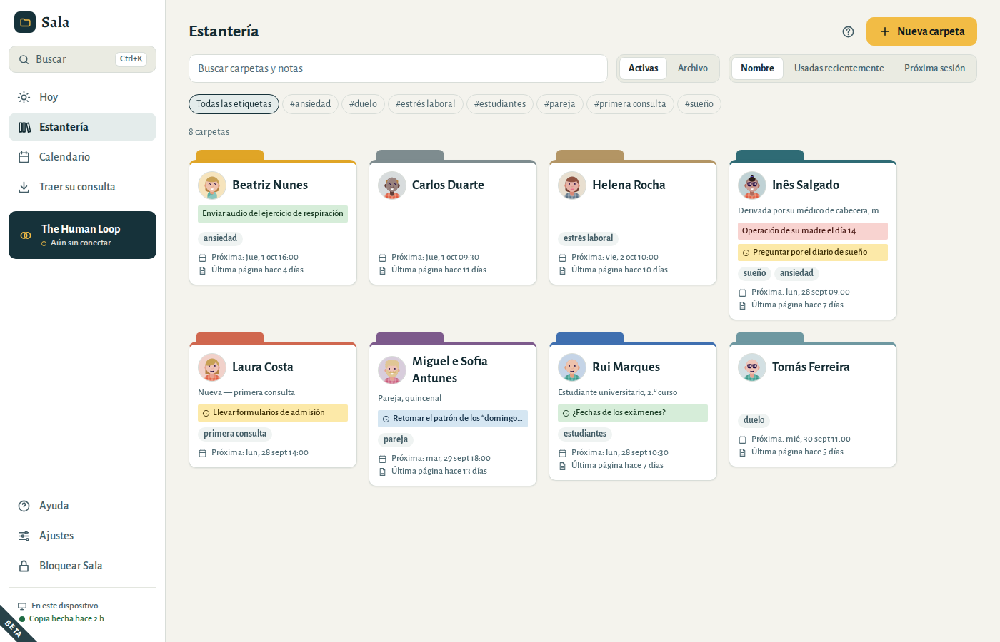
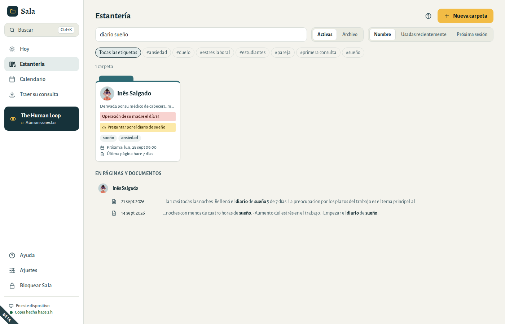
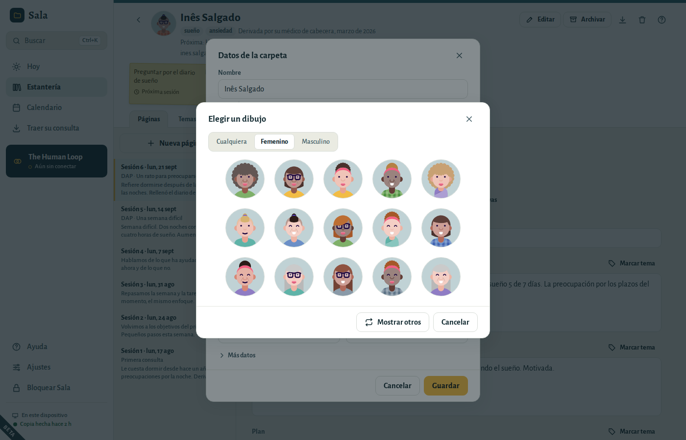
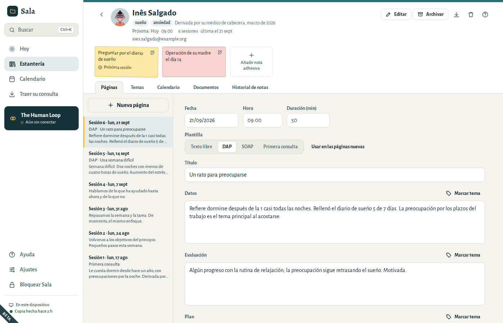
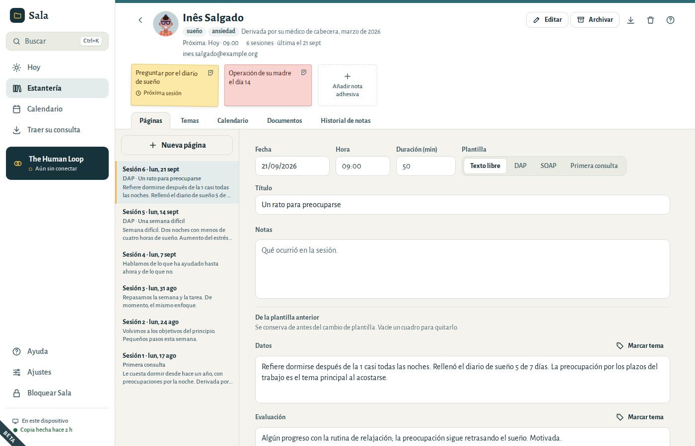
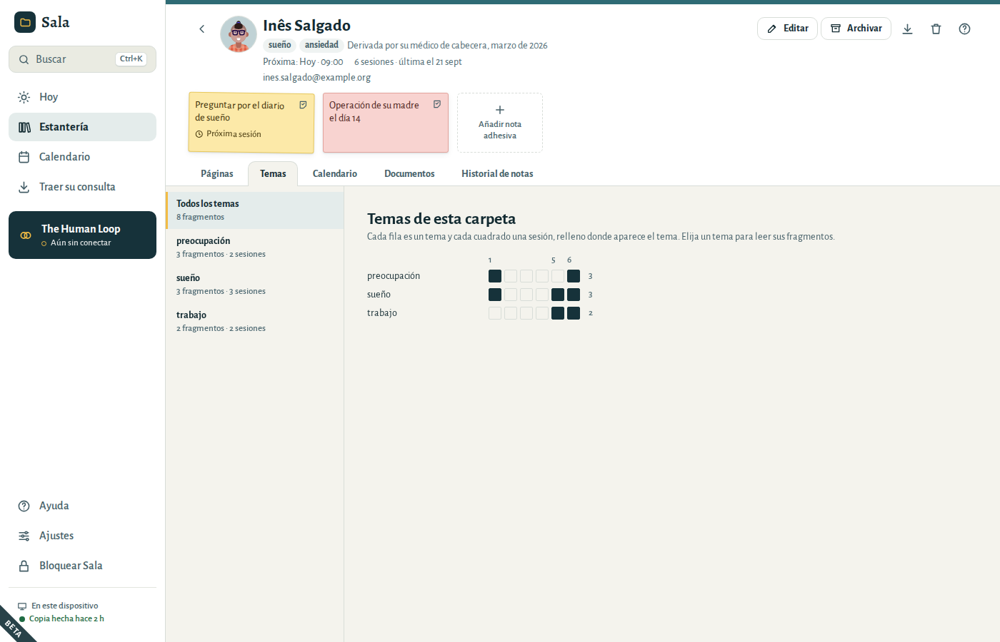
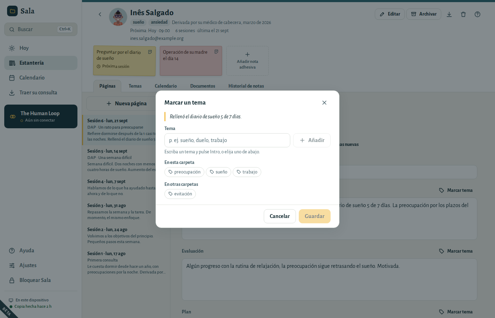
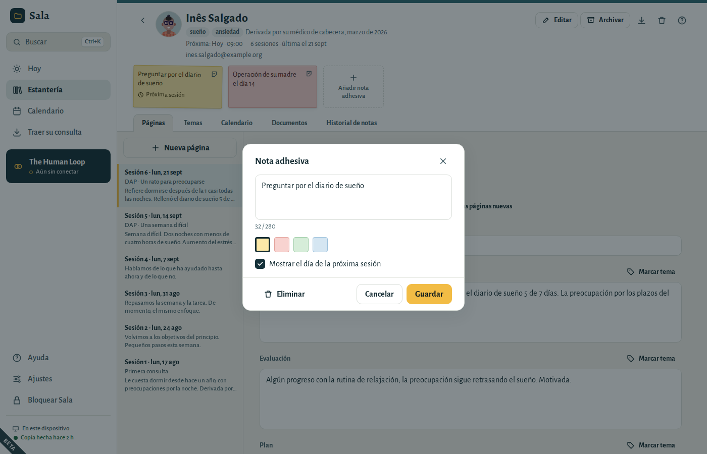
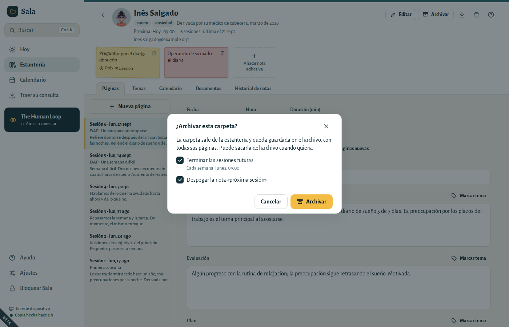

# Carpetas, páginas y notas adhesivas

Sala funciona como las carpetas de papel de su mesa: una **carpeta** por paciente, una **página** por sesión y **notas adhesivas** para lo que quiera recordar.

## La estantería

La estantería muestra todas sus carpetas. Cada carpeta muestra en la portada sus notas adhesivas, la próxima sesión del paciente y la fecha de la página de sesión más reciente, como en «Última página hace 7 días».

- **Buscar** encuentra carpetas por nombre, etiqueta, nota de portada, nota adhesiva, correo electrónico o teléfono, y páginas y documentos que contienen las palabras que escriba — también escaneos, por el texto que Sala leyó en ellos.
  - Todas las palabras tienen que estar, en cualquier orden: *ana sueño* encuentra las páginas de Ana sobre el sueño. Da igual que use acentos o mayúsculas.
  - Las páginas y los documentos encontrados aparecen bajo el nombre del paciente, con sus palabras en negrita.
  - Las carpetas con sus palabras en el nombre aparecen primero. Pulse **Intro** para abrir la primera.
  - Cuando también hay carpetas del archivo que coinciden, elija **También en el archivo** para verlas.
- Las **Etiquetas** (como *ansiedad* o *pareja*) filtran la estantería.
- **Ordenar** por nombre, por uso reciente (las carpetas en las que escribió por última vez) o por próxima sesión. Sala recuerda su elección.
- **Archivo** muestra las carpetas que ha cerrado.

Abra una carpeta y vuelva atrás: la estantería está como la dejó, con la misma búsqueda y etiqueta. Para encontrar algo desde cualquier pantalla, pulse **Ctrl+K** (consulte [Atajos de teclado](01-getting-started.md#shortcuts)).

## Crear una carpeta

1. En la estantería, elija **Nueva carpeta**.
2. Escriba un **Nombre**: el que usa para este paciente en sus registros, p. ej. «Inés S.». Use como máximo 120 caracteres.
3. Elija un **Color de la pestaña**. Si quiere, añada etiquetas, una nota de portada, un correo electrónico y un teléfono.
4. Elija **Crear carpeta**.

El idioma y la zona horaria del paciente están en **Más datos**. Rellénelos solo cuando sean distintos de los suyos.

## Una imagen para cada persona

Cada carpeta tiene una pequeña imagen, para encontrar a la persona de un vistazo en la estantería, en **Hoy** y en su carpeta. Sala empieza cada carpeta con un dibujo propio.

Para cambiarla, seleccione la imagen en la parte superior de la carpeta (o elija **Editar**):

- Las flechas junto a la imagen recorren los dibujos uno a uno: **›** muestra otro y **‹** vuelve al anterior. También funciona al crear una carpeta.
- **Elegir un dibujo** muestra un conjunto de dibujos. Elija **Femenino** o **Masculino** para filtrarlos, o **Mostrar otros** para ver más, y seleccione uno.
- **Usar una foto…** usa una foto de su ordenador. Sala guarda una pequeña copia cuadrada, cifrada en su consulta. **Quitar foto** vuelve a un dibujo.

Los dibujos se hacen en este ordenador; no se descarga nada. Una foto forma parte de la carpeta, así que se incluye en las copias de seguridad y en las exportaciones.

## La portada de la carpeta

La parte superior de una carpeta muestra lo que necesita antes de una sesión:

- las etiquetas y la nota de portada;
- **Próxima:** con la fecha y la hora de la próxima sesión. Si no hay próxima cita, elija **Dar cita**: Sala propone el mismo día de la semana, la misma hora y la misma duración que la última sesión (después de una primera consulta, su tipo de sesión habitual);
- cuántas páginas de sesión hay y la fecha de la última, p. ej. «14 sesiones · última el 21 sept»;
- el teléfono y el correo electrónico. Selecciónelos para copiarlos;
- las notas adhesivas de la portada.

Debajo de la portada están los separadores: **Páginas**, **Temas**, **Calendario**, **Documentos** e **Historial de notas**.

Para dar al paciente una copia de su carpeta, elija el botón **Exportar esta carpeta…** (la flecha hacia abajo). Consulte [Dar a un paciente una copia de su carpeta](05-your-data.md#folder-export).

## Escribir una página de sesión

1. Abra la carpeta y elija **Nueva página**. (Desde **Hoy**, el botón junto a una cita abre la página de esa sesión con la fecha y la hora ya rellenas.)
2. Elija una **Plantilla**:
   - **Texto libre**: un solo recuadro para sus notas.
   - **DAP**: Datos, Evaluación, Plan.
   - **SOAP**: Subjetivo, Objetivo, Evaluación, Plan.
   - **Primera consulta**: Motivo de consulta, Historia, Observaciones, Formulación inicial, Plan.
3. Escriba sus notas. Los recuadros crecen a medida que escribe.

La primera página de una carpeta empieza con la plantilla **Primera consulta**. Las siguientes empiezan con la plantilla que más usa: elija **Usar en las páginas nuevas** junto a la plantilla y todas las páginas nuevas empezarán con ella.

Las páginas aparecen de la más reciente a la más antigua y se numeran por fecha: «Sesión 14 · lun, 21 sept». El número se cuenta desde la primera página, así que sigue siendo correcto cuando añade una página con una fecha anterior.

Escriba la fecha como suele hacerlo, p. ej. 21/09/2026. Las teclas **↑** y **↓** la cambian de día en día. Una fecha que no existe, como el 30/02, queda señalada y no se guarda.

### Sala guarda mientras escribe

No hay botón de guardar. Debajo de la página, Sala muestra **Guardando…** y después **Guardado** con la hora. Si una página no se ha podido guardar, aparece **No guardado**: elija **Reintentar**. Lo que ha escrito sigue en la pantalla hasta que se guarda.

Sala también guarda cuando sale de un recuadro, cuando se bloquea y cuando lo cierra.

Si elige **Nueva página** por error y sale de la página sin escribir nada, Sala la quita.

### Cambiar de plantilla

Cambiar de plantilla nunca hace perder texto. Lo escrito en una sección que la nueva plantilla no tiene aparece en **De la plantilla anterior**, donde puede seguir leyéndolo y cambiándolo. También se conserva en las exportaciones. Para quitarlo, vacíe el recuadro.

### La nota de proceso privada

Bajo la página, **Mostrar nota de proceso privada** abre un recuadro aparte para sus propias reflexiones. Se guarda separada del registro y **no se incluye en las exportaciones**, salvo que usted decida incluirla.

### Adjuntar archivos a una página

Elija **Adjuntar archivo** para añadir a la página un escaneo, una carta o un formulario. Puede elegir varios archivos a la vez; cada archivo puede ocupar hasta 200 MB. Al terminar, Sala le dice cuántos archivos se han adjuntado y cuántos no se han podido añadir.

Los archivos adjuntos se cifran como todo lo demás. Para ver uno, elíjalo: las imágenes se abren dentro de Sala; los demás archivos se pueden guardar como copia donde usted elija.

## Temas

Un tema es una o dos palabras para algo que va apareciendo en la terapia, como *sueño*, *trabajo* o *duelo*. Marque las palabras de sus notas donde aparece, y el separador **Temas** de la carpeta las reúne, sesión a sesión.

### Marcar palabras con un tema

1. En una página, seleccione algunas palabras de su nota, como haría para copiarlas.
2. Elija **Marcar tema**, encima del recuadro.
3. Escriba un tema y pulse **Intro**, o elija uno que ya haya usado: primero los temas de esta carpeta, después los de sus otras carpetas. Las mismas palabras pueden tener varios temas.
4. Elija **Guardar**.

Las palabras marcadas aparecen debajo de la nota, en **Temas en esta página**. Elija una para seleccionar sus palabras en la nota. El botón del lápiz cambia sus temas, o quita la marca con **Quitar marca**.

Las marcas siguen a sus palabras mientras escribe. El texto que añade antes o después de las palabras marcadas no cambia la marca; las palabras que añade en medio pasan a formar parte de ella. Si borra todas las palabras marcadas, la marca también desaparece. Marcar nunca cambia el texto de su nota.

Los temas son palabras suyas: Sala nunca los sugiere ni marca nada por su cuenta. Las mayúsculas y los acentos no cuentan, así que *Sueño* y *sueño* son el mismo tema. Las palabras de la nota de proceso privada no se pueden marcar.

### El separador Temas

**Todos los temas** muestra cada tema en una fila y cada sesión en un cuadrado, relleno donde aparece el tema: ve de un vistazo qué apareció y cuándo. Elija un tema para leer sus fragmentos, sesión a sesión, con la fecha de cada una. Elija un fragmento para abrir su página con las palabras seleccionadas.

- **Cambiar nombre** cambia el nombre de un tema en todas las páginas de esta carpeta. Si aquí ya hay un tema con el nuevo nombre, los dos pasan a ser uno.
- **Quitar** quita el tema de todas las páginas de esta carpeta. Las palabras de sus notas se quedan como están.

Los dos muestran **Deshacer** durante unos segundos.

Los temas forman parte de sus páginas: están en las copias de seguridad y en las exportaciones, y las notas legibles de una exportación los enumeran al final de cada página.

## Notas adhesivas

Las notas adhesivas son recordatorios breves, de hasta 280 caracteres, en la **portada** de una carpeta o en una **página**.

- Elija **Añadir nota adhesiva** para escribir una. Elija un color.
- Marque **Mostrar el día de la próxima sesión** y la nota aparecerá en la pantalla **Hoy** el día de la próxima cita de ese paciente.
- Cuando ya no necesite una nota, **despéguela** (el pequeño botón de su esquina). Las notas despegadas pasan al **Historial de notas** de la carpeta, donde puede volver a pegarlas.
- Para eliminar una nota, ábrala y elija **Eliminar**.

Después de despegar o eliminar una nota, aparece **Deshacer** en la parte inferior de la ventana durante unos segundos.

## Documentos

La sección **Documentos** de una carpeta reúne todo lo que no es una página de sesión: cartas de derivación, consentimientos, informes, escaneos. También muestra los archivos adjuntos a las páginas, con la sesión a la que pertenecen.

- Elija **Añadir documento** para añadir archivos.
- Elija el botón del ojo de un archivo para verlo, o la flecha para guardar una copia.
- Elija el botón de la papelera para eliminarlo. **Deshacer** lo recupera.

## Archivar, recuperar, eliminar

**Archivar** cierra una carpeta cuando termina la terapia. La carpeta sale de la estantería, pero se conserva con todo su contenido: la encontrará en **Archivo**, en la estantería.

Al archivar una carpeta, Sala pregunta por lo que aún está por venir:

- **Terminar las sesiones futuras** termina una cita que se repite después de su última fecha pasada y cancela las citas sueltas que aún están por venir. Una cita que se repite y aún no ha tenido ninguna sesión se elimina; se queda en **Eliminados recientemente** durante 30 días. Las sesiones pasadas nunca cambian. Esta opción solo aparece cuando hay sesiones citadas, y viene marcada.
- **Despegar la nota «próxima sesión»** quita las notas pensadas para una sesión que ya no tendrá lugar.

Elija **Archivar**. Si cambia de opinión enseguida, elija **Deshacer**.

Para recuperar una carpeta, ábrala desde el archivo y elija **Sacar del archivo**. Las sesiones terminadas siguen terminadas; dé nuevas citas desde la portada.

**Eliminar carpeta** (el botón de la papelera) borra la carpeta y todo su contenido: páginas, notas adhesivas, citas y documentos. Piense en archivarla: puede que tenga la obligación de conservar los registros. Justo después de eliminarla, **Deshacer** lo recupera todo. Durante los 30 días siguientes, aún puede restaurarla desde **Ajustes → Sus datos → Eliminados recientemente**.

### Eliminar una página

**Eliminar página**, al final de una página, la elimina junto con sus notas adhesivas. Los archivos adjuntos a la página no se eliminan: pasan a los **Documentos** de la carpeta. **Deshacer** recupera la página tal como estaba.
