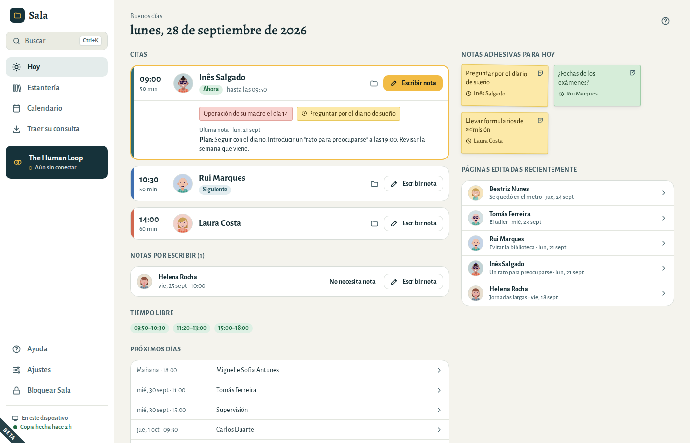
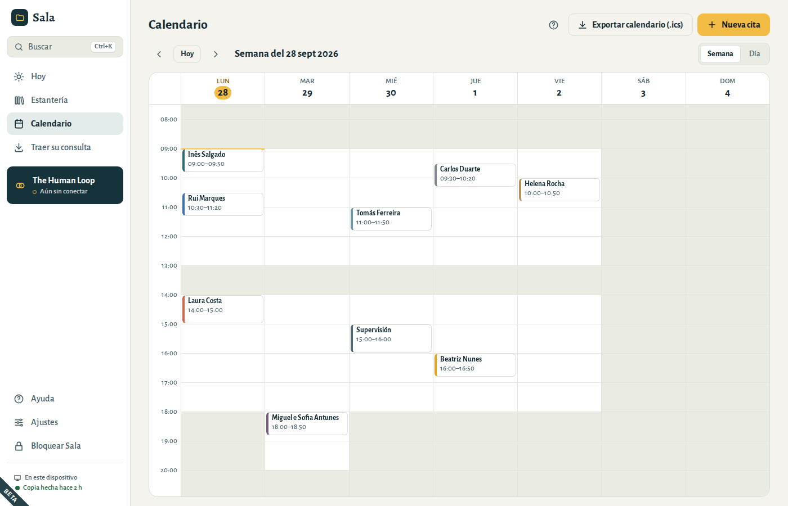
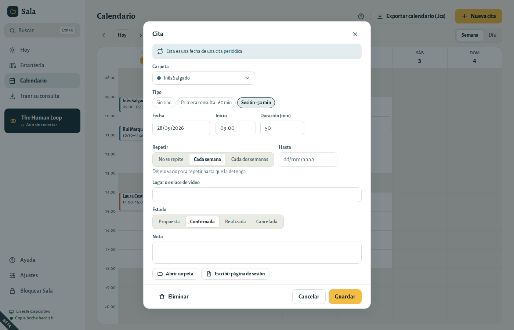
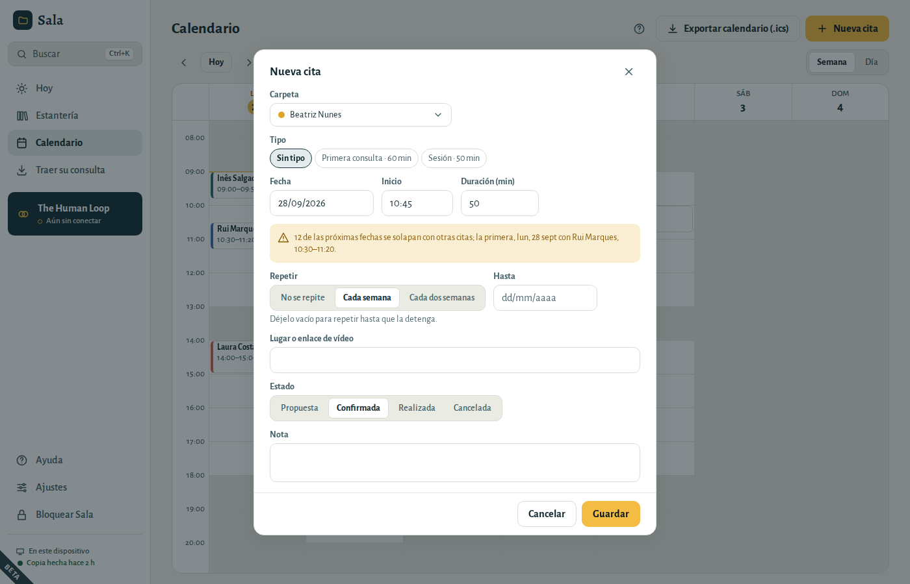
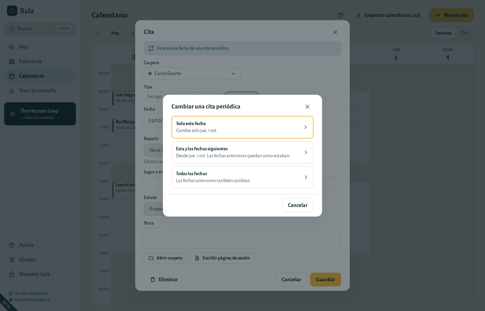
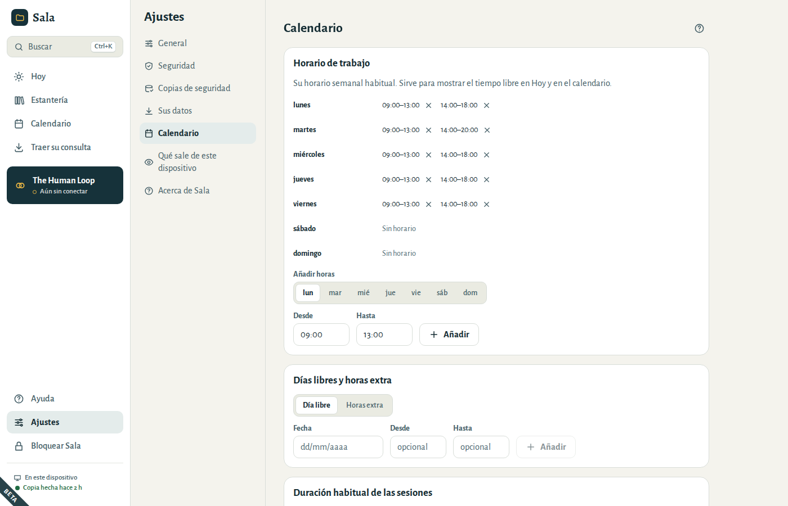

# Su calendario

## Hoy

La pantalla Hoy es donde empieza cada día: las citas del día por orden y lo que aún necesita nota.

### Antes de una sesión

La sesión que está en curso, o la siguiente, se abre en su tarjeta. Verá las notas adhesivas de la carpeta del paciente y unas líneas de la última nota de esa carpeta: el plan, o el final de la nota. Haga clic en esas líneas para abrir esa página.

Cada tarjeta indica en qué punto está el día: **Ahora**, **Siguiente** o **Terminada**. Haga clic en la hora o en el nombre para abrir la cita, por ejemplo para cambiarla. El botón de la carpeta abre la carpeta del paciente.

### Escribir la nota de la sesión

Elija **Escribir nota** en la cita. Sala abre la carpeta en una página nueva, con la fecha y la hora ya puestas. Cuando la página ya existe, la tarjeta muestra **✓ Nota escrita** y el botón pasa a **Abrir nota**, así nunca crea la misma página dos veces.

### Dar la próxima cita

Cuando una sesión está en curso o ya ha terminado, y ese paciente aún no tiene próxima cita, la tarjeta muestra **Dar la próxima cita**. Abre una cita nueva el mismo día de la semana, a la misma hora, del mismo tipo y con la misma duración: una semana después, o dos para las sesiones cada dos semanas. Después de una primera consulta, elige en su lugar su tipo de sesión habitual. Compruebe la fecha y elija **Guardar**.

### Notas por escribir

Las sesiones de las dos últimas semanas que terminaron sin página aparecen en **Notas por escribir**. Elija **Escribir nota**, o **No necesita nota** cuando no hay nada que anotar (por ejemplo, el paciente no vino). Las sesiones de hoy no se repiten ahí: tienen su propio botón **Escribir nota**. Cuando todo está escrito, la lista desaparece.

### Notas adhesivas, tiempo libre y próximos días

- **Notas adhesivas para hoy** son las notas marcadas para la «próxima sesión» de los pacientes que ve hoy. Haga clic en una para abrir la carpeta, o la página donde está pegada. Cuando ya no la necesite, despéguela con el botón de su esquina; **Deshacer** la vuelve a pegar.
- **Tiempo libre** es lo que queda de su horario de trabajo hoy. Sin horario de trabajo, la pantalla Hoy ofrece un enlace para configurarlo en **Ajustes → Calendario**.
- **Próximos días** muestra las citas siguientes; haga clic en una para abrirla.
- **Páginas editadas recientemente** le llevan de vuelta a las páginas en las que trabajó por última vez.

## El calendario

- Cambie entre **Semana** y **Día**. Use las flechas para moverse y **Hoy** para volver.
- El calendario se abre en la hora actual. Las horas en gris están fuera de su horario de trabajo.
- **Haga clic en una hora libre** para crear allí una cita, o elija **Nueva cita**.
- Una sesión cancelada aparece tachada y dice **Cancelada**. Una fecha que cambió por separado dice **Cambiada**.

## Crear una cita

1. Elija la **Carpeta** (o **Sin carpeta** para supervisión, reuniones y otros compromisos).
2. Si quiere, elija un **Tipo** de cita: rellena la duración. Sin tipo, la cita toma la duración habitual de sus sesiones.
3. Indique la **Fecha**, el **Inicio** y la **Duración**. Escriba la fecha como la escribe siempre, por ejemplo 28/09/2026.
4. Para sesiones regulares, elija **Cada semana** o **Cada dos semanas** y, si quiere, una fecha de fin.
5. Añada un lugar o un enlace de vídeo, y un estado: **Propuesta**, **Confirmada**, **Realizada** o **Cancelada**.

Si la hora se solapa con otra cita, o queda fuera de su horario de trabajo, aparece un aviso amarillo debajo de la fecha. En una cita periódica, el aviso revisa las doce fechas siguientes. Puede guardarla igualmente.

Las sesiones mantienen su hora cuando cambia la hora en marzo y octubre: una sesión a las 09:00 sigue a las 09:00.

### Dar la próxima cita

Abra la carpeta del paciente y su separador **Calendario**. **Nueva cita** empieza por la próxima sesión al ritmo habitual: el mismo día de la semana, hora, duración y tipo que la última, una semana después (dos, en una serie cada dos semanas). Después de una primera consulta, elige en su lugar su tipo de sesión habitual. Cuando todavía no hay próxima cita, **Dar la próxima cita** muestra esa fecha: un clic la abre, lista para guardar. Mientras una serie sigue en curso, **Nueva cita** empieza mañana a la hora habitual, para una sesión extra.

El separador Calendario muestra las próximas sesiones y todas las anteriores, con el año en las fechas más antiguas.

### Cambiar una fecha de una cita que se repite

Abra esa fecha en el calendario o en el separador Calendario de la carpeta, haga el cambio y elija **Guardar**. Sala le pregunta a qué fechas se aplica:

- **Solo esta fecha**: por ejemplo, la sesión del jueves pasa al viernes solo esta semana.
- **Esta y las fechas siguientes**: por ejemplo, a partir de ahora las sesiones son a las 18:00. Las sesiones anteriores quedan como estaban.
- **Todas las fechas**: las fechas anteriores también cambian.

Para marcar una sesión como **Realizada** o **Cancelada**, elija el estado, **Guardar** y **Solo esta fecha**. Las demás fechas mantienen su estado.

Para pasar las sesiones a otro paciente, cambie la **Carpeta**. Con **Esta y las fechas siguientes**, todas las sesiones a partir de esa fecha pasan al nuevo paciente, también las que había cambiado a partir de una fecha posterior, y su serie empieza de cero: las fechas que el primer paciente movió o canceló se quedan con él. Con **Todas las fechas**, la serie entera cambia de carpeta, con sus fechas movidas, realizadas y canceladas. En la primera fecha de las sesiones que había cambiado a partir de una fecha, **Todas las fechas** pasa esa fecha y las siguientes: las sesiones anteriores se quedan con el primer paciente, y Sala lo indica antes de elegir. Aparece **Deshacer** durante unos segundos. Úselo si eligió la carpeta equivocada: volver a cambiar la carpeta devolvería, como sesiones previstas, las fechas que el primer paciente había movido o cancelado.

Para que deje de repetirse a partir de una fecha, abra esa fecha, elija **No se repite** y **Guardar**. Esa fecha queda como una cita única y se quitan las fechas siguientes. Aparece **Deshacer** durante unos segundos.

Para quitar fechas, elija **Eliminar**:

- **Solo esta fecha**: para un festivo o una sesión que no se va a hacer.
- **Esta y las fechas siguientes**: cuando la terapia termina o hace una pausa. Las sesiones pasadas se quedan en la carpeta.
- **Todas las fechas, también las pasadas**: para una serie creada por error.

Después de eliminar, aparece **Deshacer** en la parte inferior de la ventana durante unos segundos. Una serie eliminada con **Todas las fechas, también las pasadas** va a **Eliminados recientemente**, como cualquier otra cita. Con **Solo esta fecha** y **Esta y las fechas siguientes**, la serie sigue y se salta esas fechas, así que no van a Eliminados recientemente: **Deshacer** es la única forma de recuperarlas. Con **Esta y las fechas siguientes**, las fechas que había cambiado por separado, y las sesiones siguientes que había cambiado a partir de una fecha, se eliminan enteras: esas sí van a Eliminados recientemente.

## Horario de trabajo y tipos de cita

En **Ajustes → Calendario**:

- **Horario de trabajo**: su horario semanal habitual, por ejemplo lunes de 09:00 a 13:00 y de 14:00 a 18:00. Define el tiempo libre que aparece en Hoy.
- **Días libres y horas extra**: vacaciones o festivos, o un sábado por la mañana extra.
- **Duración habitual de las sesiones**: la duración con la que empieza una cita nueva, por ejemplo 50 minutos.
- **Tipos de cita**: por ejemplo «Primera consulta · 60 min» y «Sesión · 50 min».

¿Ha quitado algo por error? Elija **Deshacer** en la parte inferior de la ventana.

## Usar su calendario en otras aplicaciones

En el calendario, **Exportar calendario (.ics)** crea un archivo que puede abrir en Google Calendar, Outlook o Calendario de Apple. Elija cómo se llamarán allí las citas. Por defecto, solo con las iniciales («Cita · I.S.»), para que un calendario compartido o sincronizado revele lo mínimo posible. Las sesiones canceladas y las fechas quitadas no se incluyen, y las fechas que cambió por separado aparecen en su nuevo día.
