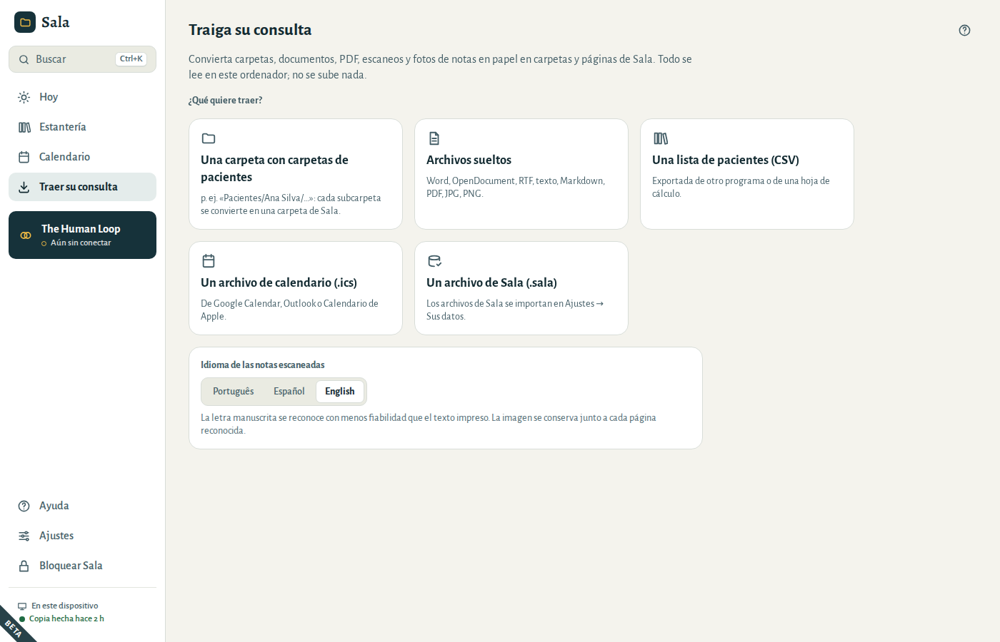
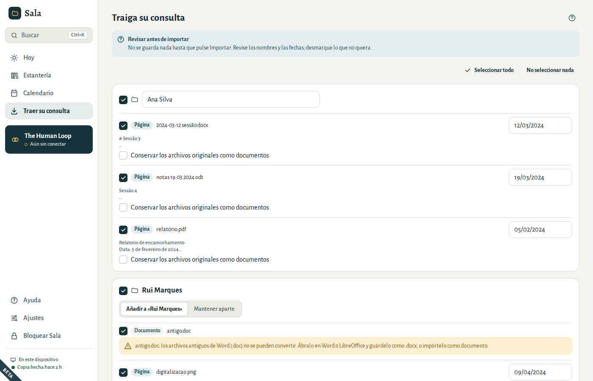
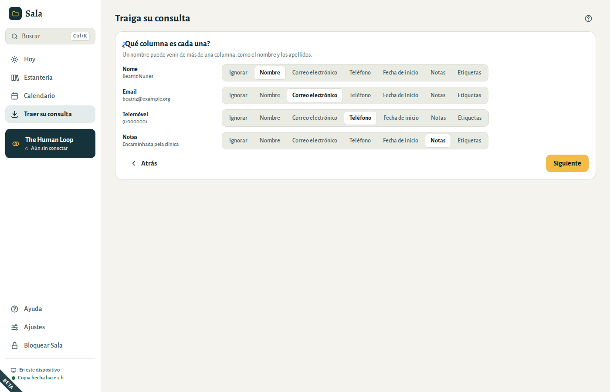
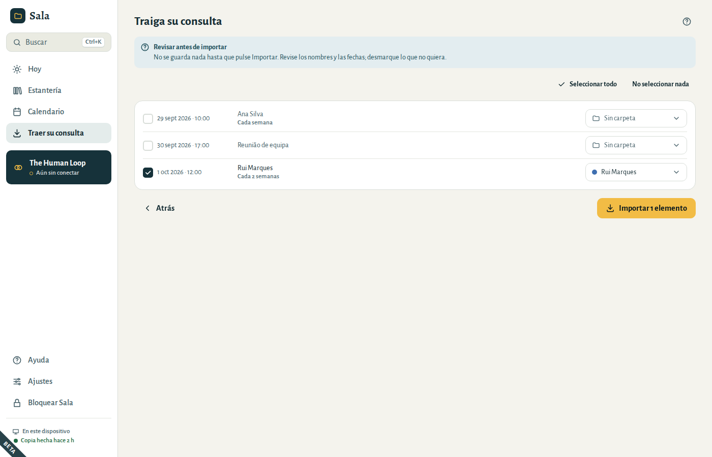

# Traer su consulta

La mayoría de las consultas no empiezan de cero. Sala puede convertir lo que ya tiene en carpetas y páginas de una sola vez. **Todo se lee en este ordenador: no se sube nada.**

Abra **Traer su consulta** en el menú y elija lo que tiene. Si sus notas incluyen escaneos o fotos, elija primero el **Idioma de las notas escaneadas**, al final de la pantalla: Sala lee los archivos en cuanto los elige.

## Una carpeta con carpetas de pacientes

Si en su ordenador tiene una carpeta como `Pacientes/Ana Silva/…`, elija **Una carpeta con carpetas de pacientes** y seleccione la carpeta principal (`Pacientes`). Cada subcarpeta se convierte en una carpeta de Sala; los archivos que contiene se convierten en páginas o documentos:

| Usted tiene | Sala crea |
|---|---|
| Archivos de Word (`.docx`), OpenDocument (`.odt`), RTF, texto y Markdown | páginas, conservando títulos, listas y énfasis |
| PDF con texto | páginas |
| PDF escaneados, fotos y escaneos (JPG, PNG) | páginas con el texto reconocido, conservando la imagen al lado |
| Archivos antiguos de Word (`.doc`), hojas de cálculo | documentos (guarde un `.doc` como `.docx` para convertirlo en página) |

Los archivos de más de 200 MB aparecen en la lista, pero son demasiado grandes para importarlos.

## Archivos sueltos

Elija **Archivos sueltos** para traer unos pocos documentos. En el paso de revisión, elija adónde van: **Nueva carpeta** (escriba su nombre) o **Carpeta existente**.

## Revisar antes de importar

No se guarda nada hasta que elija **Importar**. Compruebe:

- **Los nombres de las carpetas.** Una carpeta con exactamente el mismo nombre que otra que ya tiene («Silva, Ana» y «Ana Silva») se añade a esa. Un nombre que solo se parece a otro («Ana S.» y «Ana Silva») aparece marcado *Parece la carpeta existente «Ana Silva»*: elija **Añadir a «Ana Silva»** o **Mantener aparte**. Sala nunca junta por su cuenta a dos personas cuyos nombres son distintos, aunque solo sea en una inicial. Cada carpeta nueva necesita un nombre.
- **Las fechas.** Sala toma la fecha de cada página del nombre del archivo; si no, del texto; y si no, de la fecha del propio archivo. Las fechas tomadas de la fecha del archivo aparecen marcadas: compruébelas. Escriba las fechas como suele hacerlo, por ejemplo 12/03/2024.
- **Qué conservar.** Desmarque lo que no quiera, o una carpeta entera. **Seleccionar todo** y **No seleccionar nada** están arriba. Marque **Conservar los archivos originales como documentos** para conservar también el archivo de Word o PDF.

Cuando algo necesita revisión (una carpeta sin nombre, una fecha que no existe), Sala lo marca en rojo y no importa nada hasta que se corrija.

Al final, Sala muestra lo que ha entrado: carpetas nuevas, páginas, documentos y citas. Si no pudo leer un archivo (por ejemplo, porque se desconectó el USB), aparece en una lista con el motivo y todo lo demás se importa igualmente. Elija **Volver a estos elementos** para intentarlo de nuevo, o vuelva a ellos más tarde: quedan a la espera en **Continuar la importación**.

Si la importación se interrumpe (por ejemplo, porque se cerró o se bloqueó Sala), la próxima vez que abra **Traer su consulta** Sala le ofrecerá **Continuar la importación**. Verá lo que falta por importar, con las decisiones que había tomado, y podrá revisarlo antes de seguir. Sala no se bloquea solo mientras lee o importa; si lo bloquea usted, la importación se detiene sin riesgo después del archivo en curso.

## Notas en papel: fotos y escaneos

Escanee sus notas en papel (o fotografíelas planas y con buena luz) e importe las imágenes. Sala reconoce el texto en este ordenador.

1. Elija primero el **Idioma de las notas escaneadas**, al final de **Traer su consulta**.
2. Después elija la carpeta o los archivos.

- El texto impreso o mecanografiado se reconoce bien. **La letra manuscrita se reconoce con menos fiabilidad**: la imagen se conserva siempre junto al texto, con la indicación *Texto reconocido de un escaneo: compárelo con la imagen* y la fiabilidad del reconocimiento.
- Las fotos HEIC (del iPhone) no se pueden leer aquí. Expórtelas antes como JPG.

## Una lista de pacientes (CSV)

Exporte la lista de pacientes de su programa anterior o de su hoja de cálculo como CSV. Cada fila se convierte en una carpeta.

- Sala muestra cada columna y deduce qué es cada una: nombre, correo electrónico, teléfono, fecha de inicio, notas, etiquetas. Corríjalo si hace falta.
- Un nombre puede venir de más de una columna: elija **Nombre** tanto para la columna del nombre como para la de los apellidos.
- Una fecha de nacimiento nunca se toma como fecha de inicio.
- Las listas guardadas por Excel en Windows se leen correctamente, con sus acentos.

En la revisión, un paciente que ya tiene una carpeta con el mismo nombre aparece desmarcado. Márquelo para añadir los datos de la lista a esa carpeta. Sala añade y nunca borra: un teléfono o un correo solo sustituye al de la carpeta cuando la lista trae uno, las etiquetas se añaden, y las notas y la fecha de inicio se añaden a la nota de portada (por ejemplo *Inicio: 10 ene 2025*).

## Un archivo de calendario (.ics)

Exporte su calendario de Google Calendar, Outlook o Calendario de Apple como `.ics` e impórtelo.

- Una cita cuyo título es exactamente el nombre de una carpeta va a esa carpeta.
- Las demás aparecen desmarcadas y con **Sin carpeta**. Elija una carpeta para cada una, o acepte la que Sala le sugiere (**Ponerla en «Ana Silva»**). Después de elegir una carpeta para una cita, las demás con el mismo título sugieren esa carpeta (*Otro evento «Sesión» fue a «Ana Silva»*), con un clic cada una: un título como «Sesión» puede ser de varias personas, así que Sala nunca las pone en una carpeta por su cuenta. Una cita que se repite y sus fechas cambiadas van siempre a la misma carpeta. Una cita que marque sin carpeta conserva su título, como una reunión.
- Las citas semanales y quincenales entran con su última fecha, las fechas que se saltaron y las fechas que se cambiaron.
- Las citas canceladas y los eventos de día completo se dejan fuera.
- Otras repeticiones (a diario, cada mes o varios días a la semana) aparecen marcadas: solo entraría su primera fecha. Créelas directamente en Sala.

Al terminar la importación, elija **Abrir el calendario** para ver las citas.
