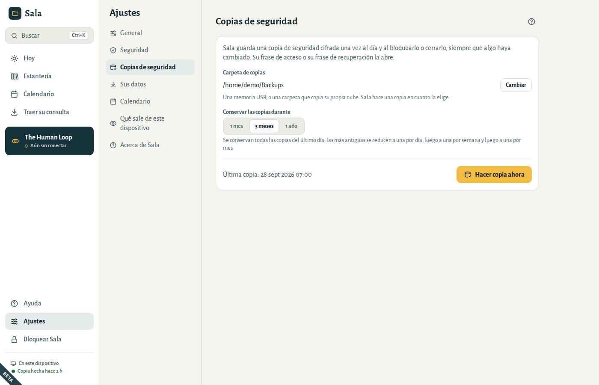
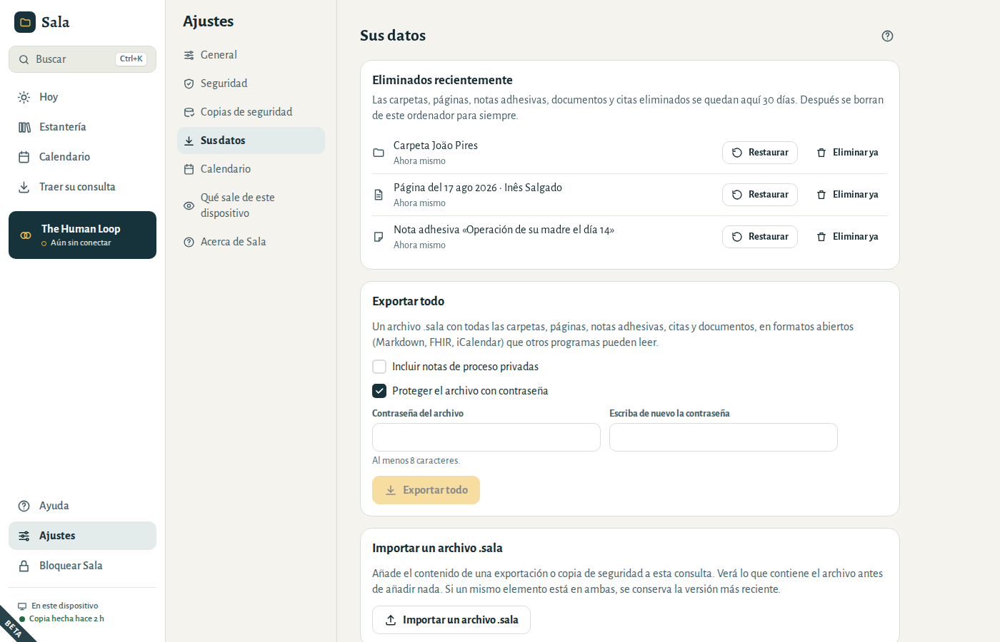
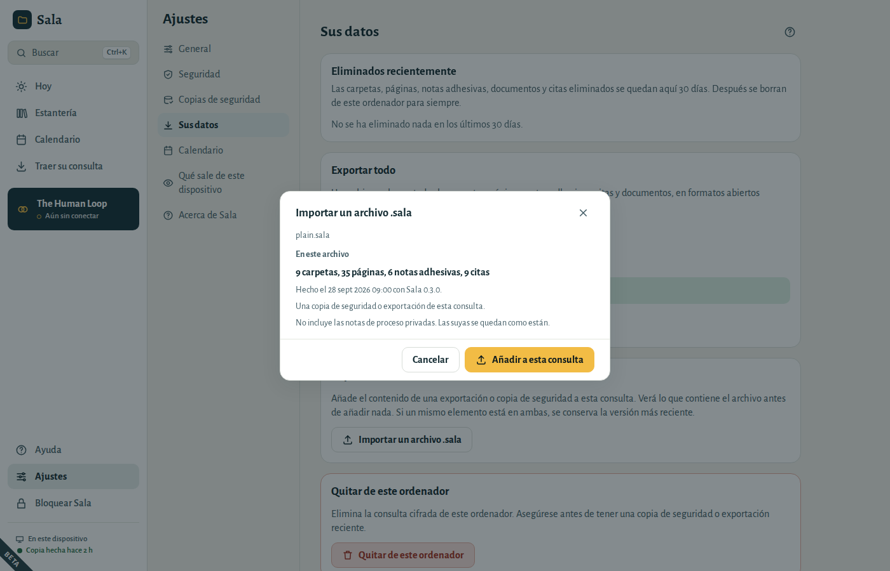
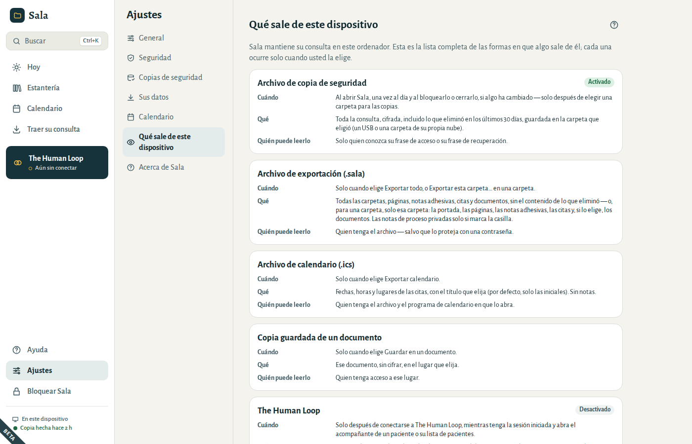
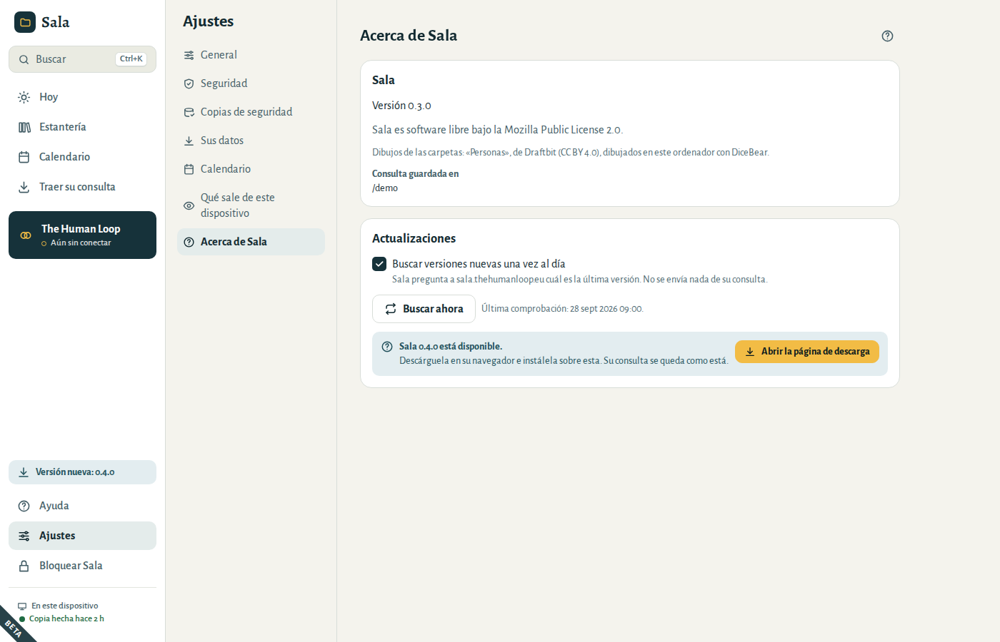
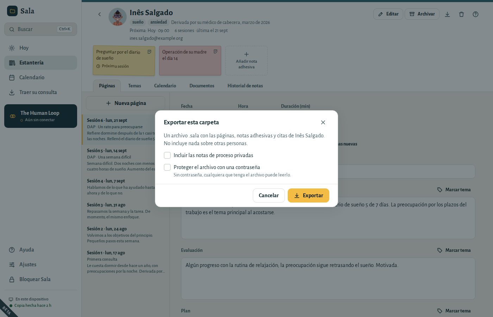

# Sus datos

## Copias de seguridad

Sala guarda una **copia de seguridad cifrada** de su consulta en la carpeta que usted elija: una memoria USB, o una carpeta que copia su propia nube. Hace una copia una vez al día y al bloquearlo o cerrarlo, siempre que algo haya cambiado. La parte inferior del menú muestra cuándo se hizo la última copia.

- Para elegir o cambiar la carpeta, vaya a **Ajustes → Copias de seguridad** y elija **Elegir…** (o **Cambiar**, si ya tiene una carpeta). Sala hace una copia allí en ese momento.
- **Hacer copia ahora** hace una al instante.
- **Conservar las copias durante** fija hasta dónde llegan sus copias: 1 mes, 3 meses o 1 año. Se conservan todas las copias del último día; las más antiguas se reducen a una por día, luego a una por semana y luego a una por mes, para que la carpeta no se llene.
- Una copia se abre con su frase de acceso o con su frase de recuperación. Nadie más puede leerla. Cuando cambia su frase de acceso, Sala hace una copia nueva al momento; las copias anteriores se siguen abriendo con la frase de acceso anterior.
- Dos ordenadores pueden compartir una misma carpeta de copias: cada consulta solo ordena sus propias copias, siempre que los dos ordenadores tengan esta versión de Sala.
- La consulta de ejemplo nunca tiene copias de seguridad.

Cuando una copia falla (por ejemplo, porque la memoria USB no está conectada), **Hoy** le dice por qué y le ofrece **Hacer copia ahora** y **Elegir otra carpeta**. También le avisa cuando la última copia correcta tiene más de tres días. Consulte [«La última copia falló»](06-questions.md#backup-failed).

## Eliminados recientemente

Cuando elimina una carpeta, página, nota adhesiva, documento o cita, Sala lo guarda 30 días en **Ajustes → Sus datos → Eliminados recientemente**. Lo que se eliminó junto, como una carpeta con sus páginas, sigue junto.

- **Restaurar** lo devuelve tal como estaba. Si la carpeta donde estaba ya se borró con **Eliminar ya**, no puede volver y se borra también.
- **Eliminar ya** lo borra de este ordenador en ese momento. Sala pregunta antes.
- Pasados 30 días, los elementos eliminados se borran para siempre, sin que tenga que hacer nada.

Justo después de eliminar algo, **Deshacer**, en la parte inferior de la ventana, también lo devuelve.

Quitar fechas de una cita que se repite (**Solo esta fecha**, o **Esta y las fechas siguientes**) es distinto: la serie sigue y se salta esas fechas, así que esas fechas no van a Eliminados recientemente. **Deshacer** las devuelve justo después. Con **Esta y las fechas siguientes**, las fechas que había cambiado por separado, y las sesiones siguientes que había cambiado a partir de una fecha, se eliminan enteras y sí van a Eliminados recientemente. Más tarde, vuelva a dar la cita, o abra una fecha anterior, borre **Hasta** y guarde para **Todas las fechas**.

Las copias de seguridad hechas antes de borrar un elemento lo siguen conteniendo, hasta que Sala retira esas copias al hacerse antiguas. Para borrar algo de todas partes a la vez (por ejemplo, cuando un paciente se lo pide), elija **Eliminar ya**, luego **Hacer copia ahora** en **Ajustes → Copias de seguridad**, y borre las copias anteriores de su carpeta de copias.

## Exportar todo

**Ajustes → Sus datos → Exportar todo** crea un archivo `.sala` con todas sus carpetas, páginas, notas adhesivas, citas y documentos, en formatos abiertos que otros programas pueden leer (texto Markdown, registros de salud FHIR, iCalendar).

- **Incluir notas de proceso privadas** está desactivado salvo que lo marque.
- Lo que ha eliminado queda fuera, incluso lo que sigue en **Eliminados recientemente**.
- **Proteger el archivo con contraseña** está activado por defecto. Escriba la contraseña dos veces; necesita al menos 8 caracteres. Sin contraseña, cualquiera que tenga el archivo puede leerlo.

## Pasar a un ordenador nuevo

1. Instale Sala en el ordenador nuevo.
2. En la pantalla de bienvenida, elija **Restaurar desde una copia** y seleccione su copia de seguridad más reciente (`Sala backup … .sala`).
3. Escriba la frase de acceso que usaba en el ordenador anterior, o su frase de recuperación.

Su frase de acceso y su frase de recuperación siguen siendo las mismas después de restaurar.

Para añadir el contenido de un archivo `.sala` a una consulta que ya tiene, use **Ajustes → Sus datos → Importar un archivo .sala**. Sala le muestra primero lo que contiene el archivo: cuántas carpetas y páginas, cuándo se hizo y si incluye notas de proceso privadas. No se añade nada hasta que elija **Añadir a esta consulta**.

- Sus propias copias de seguridad se abren sin pedir la frase de acceso.
- Si un mismo elemento está en ambas, se conserva la versión más reciente.
- Lo que se eliminó en el archivo también se elimina aquí. Durante 30 días puede recuperarlo en **Eliminados recientemente**.
- Si el archivo se hizo sin las notas de proceso privadas, las suyas se quedan como están.

## Qué sale de este dispositivo

**Ajustes → Qué sale de este dispositivo** enumera todas las formas en que algo puede salir de su ordenador: archivos de copia de seguridad, exportaciones, archivos de calendario y copias guardadas de documentos. Cada una ocurre solo cuando usted la elige. Sala solo se conecta a Internet si activa la búsqueda de versiones nuevas o pulsa **Buscar ahora**. Nunca hay estadísticas, telemetría ni informes de errores.

## Quitar la consulta de este ordenador

**Ajustes → Sus datos → Quitar de este ordenador** elimina la consulta cifrada de este ordenador (por ejemplo, antes de regalarlo o venderlo). Las copias de su carpeta de copias de seguridad no se tocan. La ventana muestra cuándo se hizo la última copia y le ofrece antes **Hacer copia ahora**, para que pueda recuperar la consulta más adelante.

## Versiones nuevas

Sala puede avisarle cuando hay una versión nueva. **Hoy** le pregunta una vez si puede buscarlas; puede cambiar la respuesta cuando quiera en **Ajustes → Acerca de Sala**:

- **Buscar versiones nuevas una vez al día** pregunta al sitio web de Sala, sala.thehumanloop.eu, cuál es la última versión. No se envía nada de su consulta.
- **Buscar ahora** pregunta una vez, cuando quiera.

Cuando hay una versión nueva, aparece **Versión nueva** en el menú. Elija **Abrir la página de descarga**, descárguela en su navegador e instálela sobre la que tiene. Su consulta, sus copias de seguridad y sus ajustes se quedan como están.

## Dar a un paciente una copia de su carpeta

Cuando un paciente le pide una copia de su historia, o cuando deriva su atención a un colega, exporte solo la carpeta de esa persona:

1. Abra la carpeta del paciente y elija **Exportar esta carpeta…**.
2. Elija qué va en el archivo:
   - **Incluir las notas de proceso privadas** está desactivado, salvo que lo marque.
   - **Incluir los documentos** está activado. Aparece cuando la carpeta tiene documentos.
   - **Proteger el archivo con una contraseña** está desactivado.
3. Elija **Exportar** y después dónde guardar el archivo. Su nombre es el de la carpeta seguido de la fecha, por ejemplo `Ana Silva 2026-10-01.sala`.

El archivo contiene las páginas, las notas adhesivas y las citas de ese paciente, y nada sobre otras personas, en los mismos formatos abiertos que **Exportar todo** (texto Markdown, registros de salud FHIR, iCalendar).

- **Para el paciente:** deje la contraseña desactivada. El archivo es un archivo ZIP normal: en un ordenador sin Sala, cambie el final de su nombre de `.sala` a `.zip` y ábralo. Cualquiera que tenga el archivo puede leerlo, así que entréguelo en mano o en un USB en lugar de enviarlo por correo electrónico.
- **Para un colega que usa Sala:** marque la contraseña y comuníquesela por separado, por ejemplo por teléfono. Su colega añade el archivo a su consulta en **Ajustes → Sus datos → Importar un archivo .sala**.
