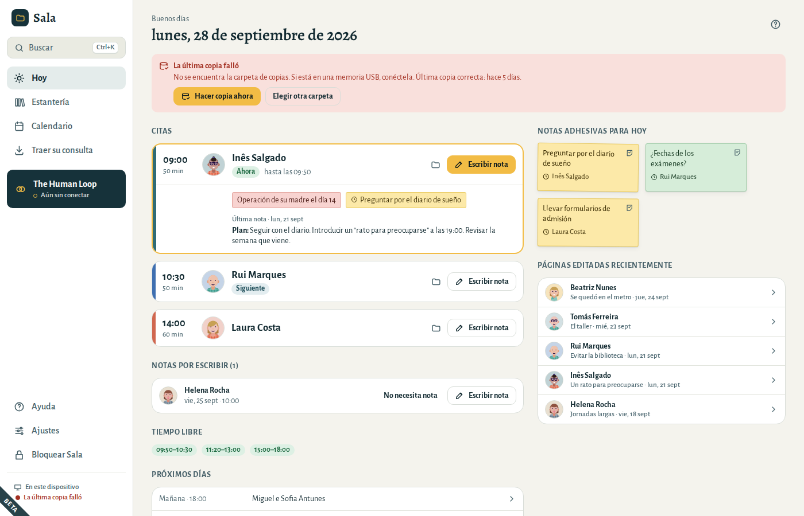

# Preguntas y solución de problemas

### He olvidado mi frase de acceso

Compruebe primero que la tecla Bloq Mayús no está activada y que el teclado está en el idioma de siempre. **Mostrar**, junto a la frase de acceso, le permite ver lo que ha escrito.

Si aun así no se abre:

1. En la pantalla de apertura, elija **He olvidado mi frase de acceso**.
2. Escriba su frase de recuperación de 12 palabras, a partir de su papel.
3. Elija una nueva frase de acceso y escríbala de nuevo.
4. Elija **Abrir**.

A partir de entonces, Sala se abre con la nueva frase de acceso. Las copias de seguridad hechas antes se siguen abriendo con la frase de acceso anterior o con su frase de recuperación, que no cambia.

### He perdido mi frase de acceso y mi frase de recuperación

Nadie puede abrir la consulta, ni siquiera nosotros. Eso es lo que mantiene privadas sus notas. Si tiene una **exportación protegida con contraseña**, empiece una consulta nueva e impórtela con esa contraseña.

### «No se puede abrir esta consulta»

Sala muestra este mensaje cuando la consulta de este ordenador ha perdido su archivo de claves, casi siempre porque la restauración de una copia de seguridad se detuvo a medias (por ejemplo, se apagó el ordenador). Ni su frase de acceso ni su frase de recuperación pueden abrirla. Sala nunca la quita por su cuenta: elija **Quitar esta consulta…** y vuelva a restaurar la copia de seguridad (consulte [Pasar a un ordenador nuevo](05-your-data.md#restore)).

### Mi ordenador se ha averiado o me lo han robado

Instale Sala en otro ordenador y **restaure su copia de seguridad más reciente** (consulte [Pasar a un ordenador nuevo](05-your-data.md#restore)). La consulta del ordenador perdido está cifrada.

### «La última copia falló»

La parte inferior del menú le avisa cuando no se ha podido hacer una copia, y **Hoy** le dice por qué:

- **No se encuentra la carpeta de copias.** Normalmente, una memoria USB que no está conectada, o una carpeta de la nube que se movió o cambió de nombre. Conecte la memoria y elija **Hacer copia ahora**.
- **Sala no tiene permiso para guardar en la carpeta de copias.** Elija **Elegir otra carpeta** e indique una carpeta suya.
- **El disco de las copias está lleno.** Borre algunos archivos de él, o elija otra carpeta. Sala retira por sí mismo sus copias más antiguas a medida que envejecen.

Sala vuelve a intentarlo por sí mismo cada hora y al bloquearlo o cerrarlo. Mientras tanto, sus notas están seguras en este ordenador.

### El texto reconocido de un escaneo tiene errores

Corríjalo en la página. La imagen original se conserva como documento de esa página para que pueda compararlos. La letra manuscrita se reconoce con menos fiabilidad que el texto impreso.

### Un archivo de Word (.doc) se importó como documento, no como página

Los archivos `.doc` antiguos no se pueden convertir. Abra el archivo en Word o LibreOffice, guárdelo como `.docx` e importe ese archivo.

### Las horas de las citas parecen incorrectas

Compruebe **Ajustes → General → Su zona horaria**. Cada cita conserva su propia zona horaria, así que las sesiones mantienen su hora cuando cambia la hora.

### Sala se ha bloqueado

Sala se bloquea tras un tiempo sin uso para proteger sus notas. Cambie ese tiempo en **Ajustes → General → Bloquear Sala tras**.

Lo que estaba escribiendo se guardó antes de que Sala se bloqueara. Escriba su frase de acceso: el mismo día, Sala se abre donde estaba, en la misma carpeta y la misma página.

Sala no se bloquea por sí solo mientras exporta, importa o añade documentos, pero sí si deja abierta la ventana para elegir documentos, o para guardar una exportación. Si se bloquea antes de que ese trabajo termine, la pantalla para abrir Sala dice qué quedó sin hacer y qué hacer de nuevo, por ejemplo exportar otra vez. Una nueva frase de acceso o frase de recuperación que se estaba guardando cuando Sala se bloqueó se guarda antes, y esa pantalla lo dice. Si una nueva frase de acceso no se pudo guardar, por ejemplo porque la frase de acceso actual se escribió mal, esa pantalla también lo dice: abra Sala con su frase de acceso anterior y vuelva a cambiarla.
