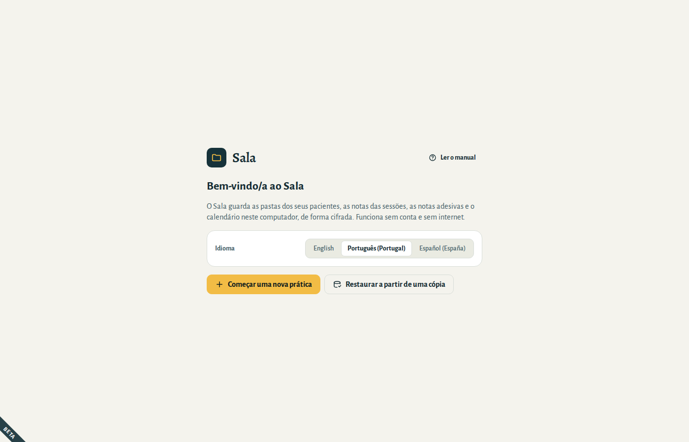
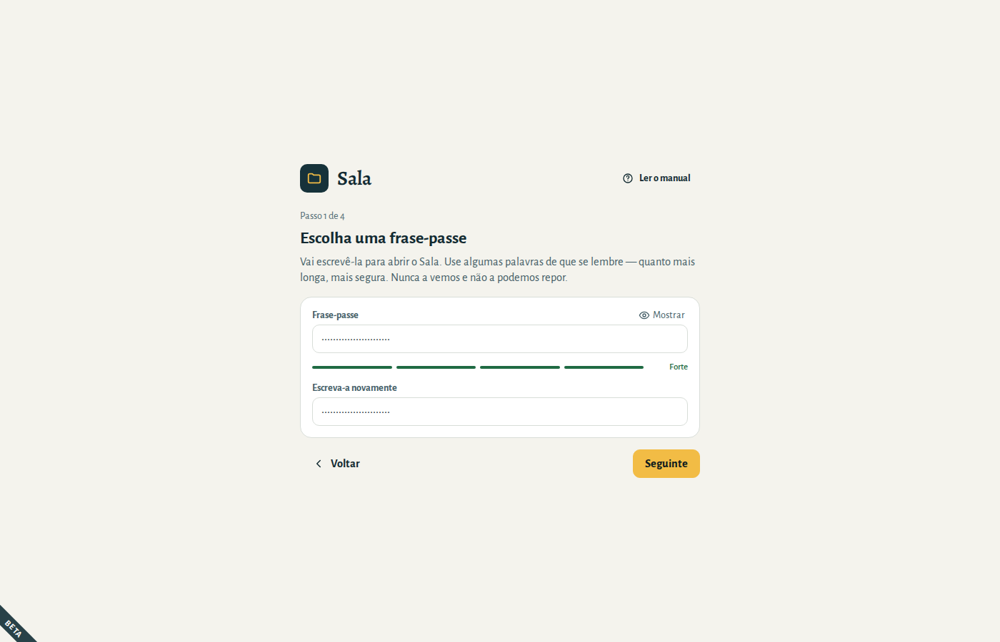
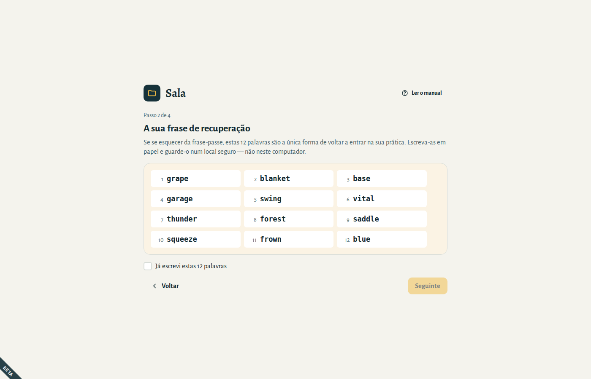
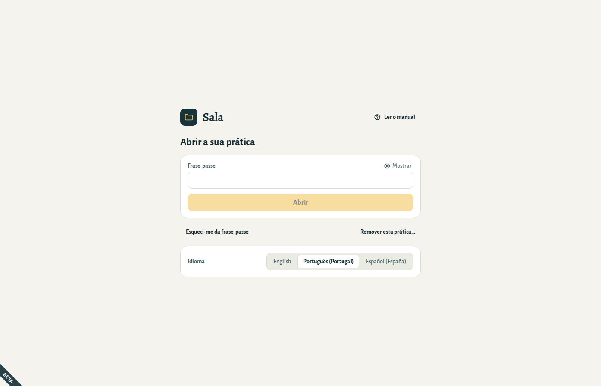
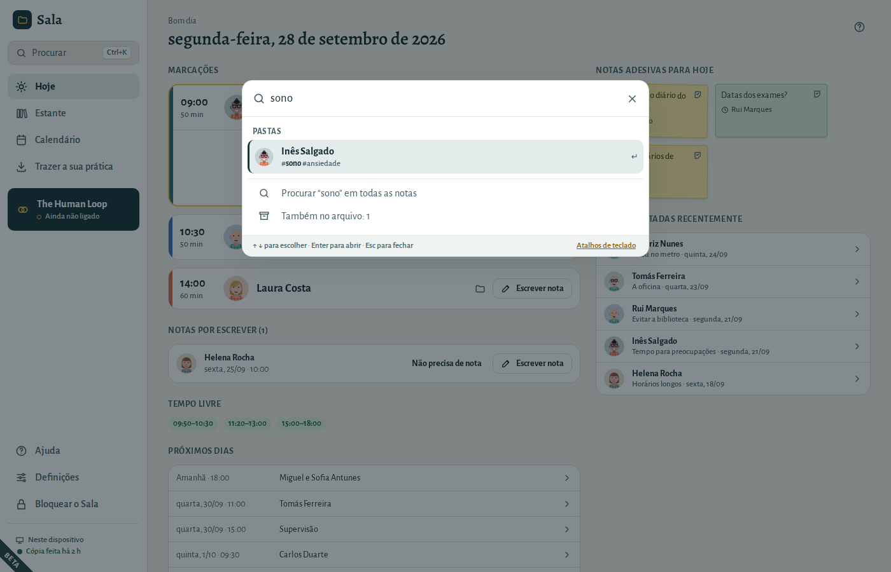

# Primeiros passos

## Instalar o Sala

**Windows:** abra o instalador do Sala (`.exe`) e siga os passos. Se o Windows mostrar “O Windows protegeu o seu PC”, escolha **Mais informações → Executar mesmo assim** — as versões de teste do Sala ainda não estão assinadas.

**Mac:** descarregue o `.zip` e abra-o — o Mac descompacta-o e aparece o **Sala**. Arraste o **Sala** para a pasta **Aplicações** e depois abra-o. Da primeira vez, o Mac pergunta se quer abrir uma aplicação descarregada da internet: escolha **Abrir**.

**Linux:** utilize o pacote `.deb` em Ubuntu ou Debian, o `.rpm` em Fedora, ou o `.AppImage` em qualquer distribuição (torne-o executável e depois abra-o).

## Experimente o Sala com a prática de exemplo

Ao instalar o Sala, aparece também **Sala (exemplo)** no menu (no menu Iniciar, no Windows). Abre uma prática com pessoas, marcações e notas fictícias, para experimentar tudo sem mexer na sua prática.

- A frase-passe é **sala**.
- Recomeça sempre do início: o que alterar é apagado quando a fechar. Nunca escreva notas reais nela.
- A sua prática abre-se em **Sala**, como sempre.

## Abrir o Sala pela primeira vez

1. Escolha o seu idioma. Pode alterá-lo mais tarde em **Definições → Geral**.
2. Escolha **Começar uma nova prática**. (Vem de outro computador? Escolha **Restaurar a partir de uma cópia** — consulte [Os seus dados](05-your-data.md#restore).)

## Escolha uma frase-passe

Escreve a sua frase-passe sempre que abre o Sala. Ela protege tudo o que está na sua prática.

- Use **algumas palavras de que se lembre**, como `rio violeta chá da manhã`. Quanto mais longa, mais segura; tem de ter pelo menos 10 caracteres.
- A barra por baixo do campo mostra o quão segura é.
- Ninguém a pode repor por si — nem nós. É para isso que serve a frase de recuperação.

## Anote a sua frase de recuperação

O Sala mostra 12 palavras. **São a única forma de voltar a entrar na sua prática se se esquecer da frase-passe.**

1. Escreva as 12 palavras em papel, pela ordem certa.
2. Guarde o papel num local seguro — não neste computador, nem numa fotografia no seu telemóvel.
3. Marque **Já escrevi estas 12 palavras** e continue.
4. O Sala pede três das palavras, para confirmar que as escreveu corretamente.

## Escolha onde ficam as cópias de segurança

O Sala grava uma cópia de segurança cifrada uma vez por dia e quando o bloqueia ou fecha, sempre que algo tenha mudado, numa pasta à sua escolha:

- uma **pen USB** que guarde num local seguro, ou
- uma pasta da **sua própria nuvem** (iCloud Drive, Google Drive, OneDrive) — a cópia é cifrada antes de lá chegar.

Pode escolher **Lembrar-me mais tarde**, mas enquanto não escolher uma pasta, o Sala mostra um lembrete no ecrã Hoje: sem cópias de segurança, um computador avariado ou perdido significa perder as suas notas.

## Abrir e bloquear o Sala

- Sempre que abrir o Sala, escreva a sua frase-passe.
- O Sala **bloqueia-se sozinho** após 10 minutos sem utilização. Pode alterar isto em **Definições → Geral → Bloquear o Sala após**. Se o desbloquear no mesmo dia, volta ao sítio onde estava: a mesma pasta, a mesma página.
- Para o bloquear, escolha **Bloquear o Sala** no canto inferior esquerdo, ou prima **Ctrl+L**. O Sala guarda primeiro o que estava a escrever numa página. Da próxima vez, abre no ecrã **Hoje**.

Esqueceu-se da frase-passe? Escolha **Esqueci-me da frase-passe**, escreva a sua frase de recuperação de 12 palavras e escolha uma nova frase-passe.

## Atalhos de teclado

Num Mac, use **⌘** onde esta lista diz **Ctrl**.

| Prima | Para |
|---|---|
| **Ctrl+K** ou **Ctrl+F** | Procurar uma pasta, uma nota ou uma ação |
| **Ctrl+1** | Ir para Hoje |
| **Ctrl+2** | Ir para a estante |
| **Ctrl+3** | Ir para o calendário |
| **Ctrl+L** | Bloquear o Sala |
| **F1** | Abrir este manual na parte sobre o ecrã em que está |
| **Alt+←**, ou o botão de recuar do rato | Voltar atrás |
| **Ctrl+Enter** | Guardar ou confirmar numa janela que pergunta |
| **Ctrl+Z** | Anular, enquanto a mensagem com **Anular** estiver visível |
| **Esc** | Fechar uma janela |

### Procurar

Prima **Ctrl+K**, ou escolha **Procurar** no topo do menu, e comece a escrever:

- o nome de um paciente, uma palavra das suas notas, um número de telefone ou um endereço de email;
- ou o que quer fazer, como *nova marcação* ou *cópia*.

Use **↑** e **↓** para escolher e **Enter** para abrir. Sem nada escrito, Procurar mostra as sessões de hoje, as pastas que usou por último e tudo o que pode fazer a partir dali.
