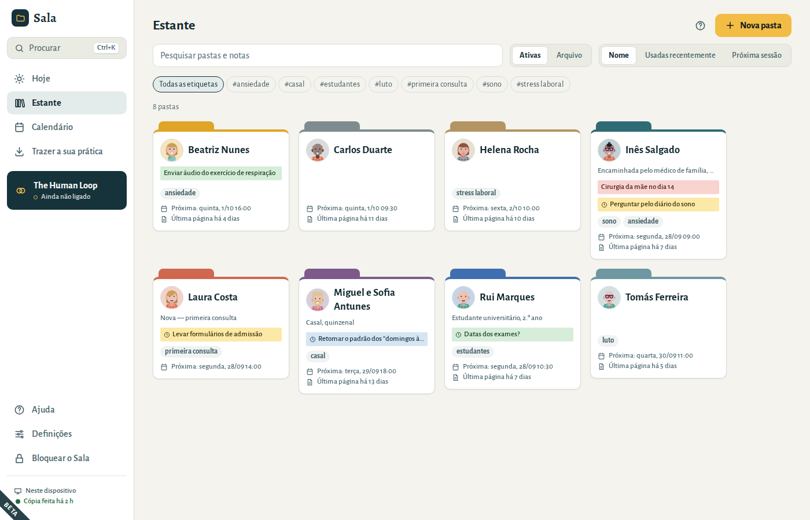
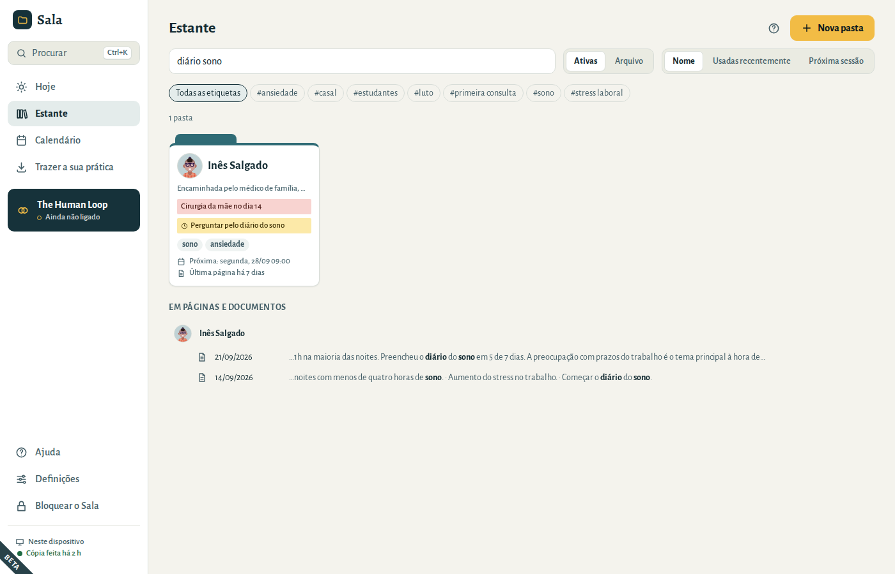
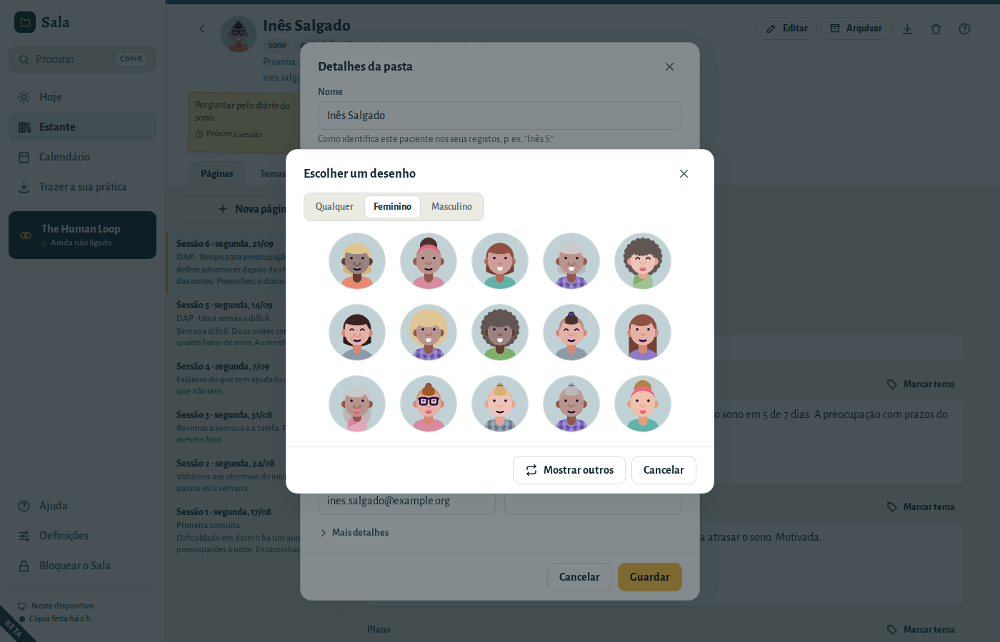
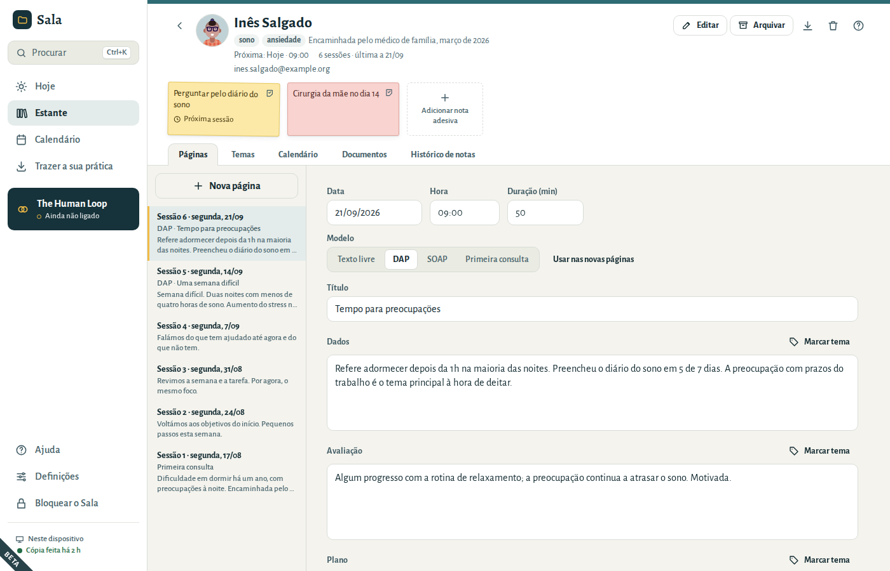
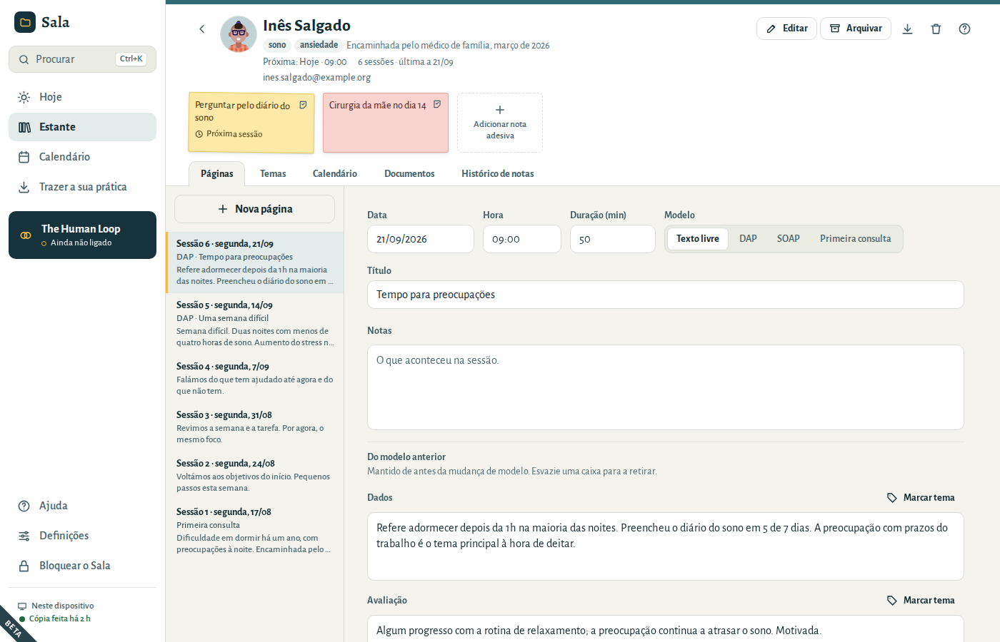
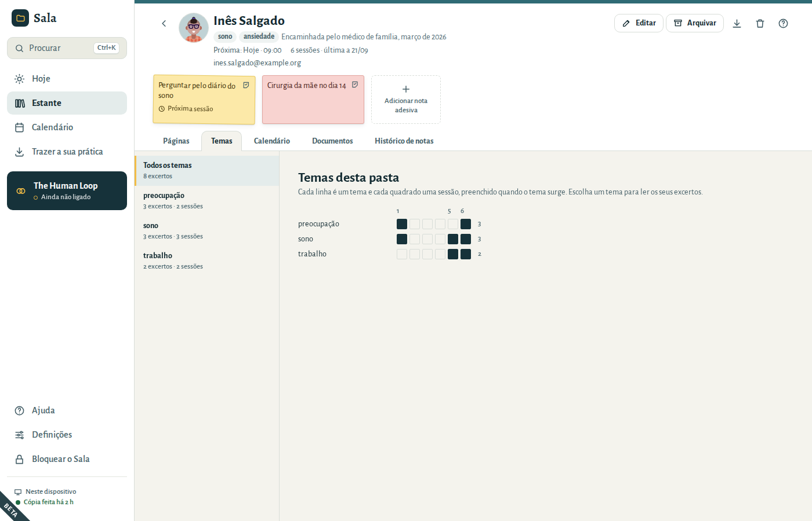
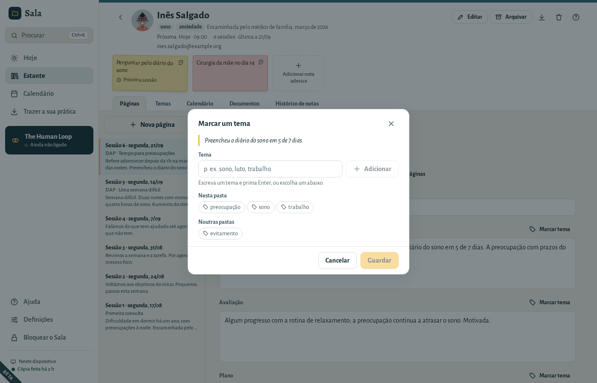
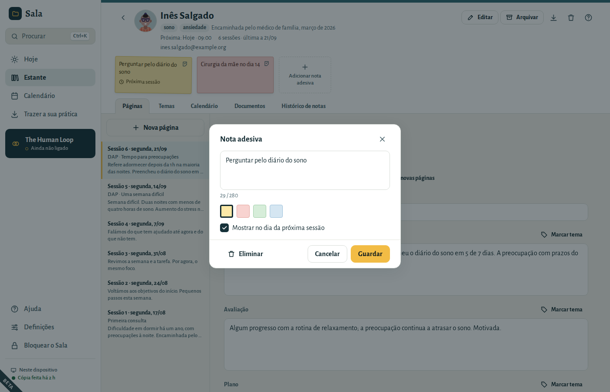
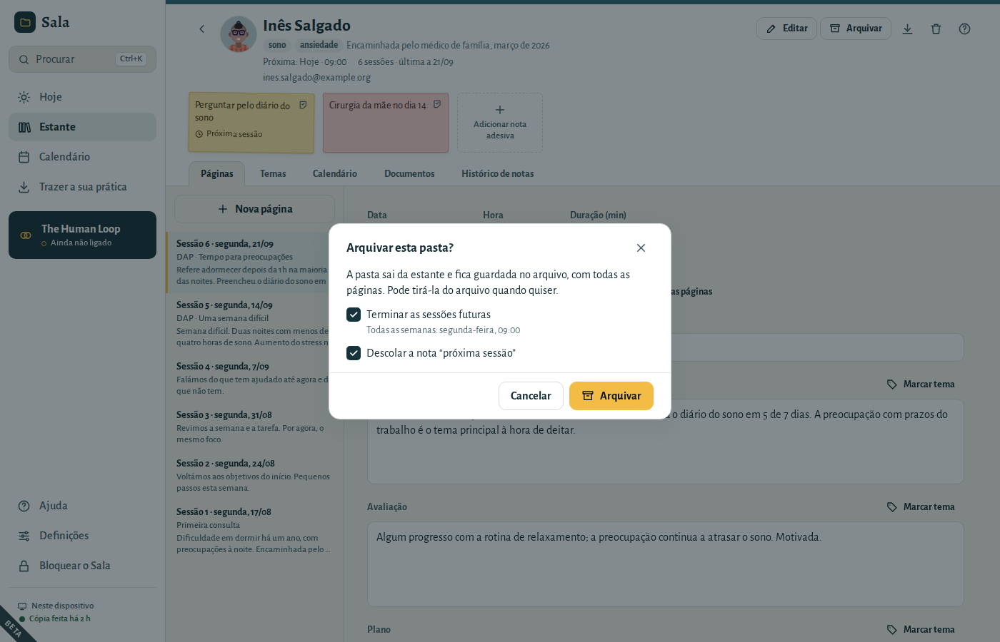

# Pastas, páginas e notas adesivas

O Sala funciona como as pastas de papel da sua secretária: uma **pasta** por paciente, uma **página** por sessão e **notas adesivas** para aquilo de que se quer lembrar.

## A estante

A estante mostra todas as suas pastas. Cada pasta mostra na capa as suas notas adesivas, a próxima sessão do paciente e a data da página de sessão mais recente, como em “Última página há 7 dias”.

- **Pesquisar** encontra pastas pelo nome, etiqueta, nota de capa, nota adesiva, email ou número de telefone, e páginas e documentos que contêm as palavras que escrever — também digitalizações, pelo texto que o Sala leu nelas.
  - Todas as palavras têm de estar lá, por qualquer ordem: *ana sono* encontra as páginas da Ana sobre o sono. Acentos e maiúsculas não fazem diferença.
  - As páginas e os documentos encontrados aparecem por baixo do nome do paciente, com as suas palavras a negrito.
  - As pastas com as suas palavras no nome aparecem primeiro. Prima **Enter** para abrir a primeira.
  - Quando também há pastas no arquivo que correspondem, escolha **Também no arquivo** para as ver.
- As **Etiquetas** (como *ansiedade* ou *casal*) filtram a estante.
- **Ordenar** por nome, usadas recentemente (as pastas onde escreveu por último) ou próxima sessão. O Sala lembra-se da sua escolha.
- **Arquivo** mostra as pastas que fechou.

Abra uma pasta e volte atrás: a estante está como a deixou, com a mesma pesquisa e etiqueta. Para encontrar algo a partir de qualquer ecrã, prima **Ctrl+K** (consulte [Atalhos de teclado](01-getting-started.md#shortcuts)).

## Criar uma pasta

1. Na estante, escolha **Nova pasta**.
2. Escreva um **Nome** — o nome que usa para este paciente nos seus registos, p. ex. “Inês S.”. Use no máximo 120 caracteres.
3. Escolha uma **Cor do separador**. Se quiser, acrescente etiquetas, uma nota de capa, um email e um telefone.
4. Escolha **Criar pasta**.

O idioma e o fuso horário do paciente estão em **Mais detalhes**. Preencha-os só quando forem diferentes dos seus.

## Uma imagem para cada pessoa

Cada pasta tem uma pequena imagem, para encontrar a pessoa num relance na estante, em **Hoje** e na própria pasta. O Sala começa cada pasta com um desenho próprio.

Para a alterar, selecione a imagem no topo da pasta (ou escolha **Editar**):

- As setas ao lado da imagem percorrem os desenhos um a um: **›** mostra outro, **‹** volta ao anterior. Também funciona ao criar uma pasta.
- **Escolher um desenho** mostra um conjunto de desenhos. Escolha **Feminino** ou **Masculino** para os filtrar, ou **Mostrar outros** para ver mais, e selecione um.
- **Usar uma fotografia…** usa uma fotografia do seu computador. O Sala guarda uma pequena cópia quadrada, cifrada na sua prática. **Remover fotografia** volta a um desenho.

Os desenhos são feitos neste computador; nada é transferido. Uma fotografia faz parte da pasta, por isso entra nas cópias de segurança e nas exportações.

## A capa da pasta

O topo de uma pasta mostra o que precisa antes de uma sessão:

- as etiquetas e a nota de capa;
- **Próxima:** com a data e a hora da próxima sessão. Quando não há nada marcado, escolha **Marcar**: o Sala sugere o mesmo dia da semana, a mesma hora e a mesma duração da última sessão (depois de uma primeira consulta, o seu tipo de sessão habitual);
- quantas páginas de sessão existem e a data da última, p. ex. “14 sessões · última a 21/09”;
- o telefone e o email. Selecione-os para os copiar;
- as notas adesivas da capa.

Por baixo da capa ficam os separadores: **Páginas**, **Temas**, **Calendário**, **Documentos** e **Histórico de notas**.

Para dar ao paciente uma cópia da sua pasta, escolha o botão **Exportar esta pasta…** (a seta para baixo). Veja [Dar a um paciente uma cópia da sua pasta](05-your-data.md#folder-export).

## Escrever uma página de sessão

1. Abra a pasta e escolha **Nova página**. (No ecrã **Hoje**, o botão ao lado de uma marcação abre a página dessa sessão, com a data e a hora já preenchidas.)
2. Escolha um **Modelo**:
   - **Texto livre** — uma única caixa para as suas notas.
   - **DAP** — Dados, Avaliação, Plano.
   - **SOAP** — Subjetivo, Objetivo, Avaliação, Plano.
   - **Primeira consulta** — Motivo da consulta, História, Observações, Formulação inicial, Plano.
3. Escreva as suas notas. As caixas crescem à medida que escreve.

A primeira página de uma pasta começa com o modelo **Primeira consulta**. As seguintes começam com o modelo que mais usa: escolha **Usar nas novas páginas** ao lado do modelo, e todas as novas páginas passam a começar com ele.

As páginas aparecem da mais recente para a mais antiga e são numeradas pela data: “Sessão 14 · segunda, 21/09”. O número conta a partir da primeira página, por isso continua certo quando acrescenta uma página com uma data anterior.

Escreva a data como costuma escrever, p. ex. 21/09/2026. As teclas **↑** e **↓** mudam-na um dia de cada vez. Uma data que não existe, como 30/02, fica assinalada e não é guardada.

### O Sala guarda à medida que escreve

Não há botão para guardar. Por baixo da página, o Sala mostra **A guardar…** e depois **Guardado** com a hora. Se não for possível guardar uma página, aparece **Não guardado**: escolha **Tentar novamente**. O que escreveu fica no ecrã até ser guardado.

O Sala também guarda quando sai de uma caixa, quando se bloqueia e quando o fecha.

Se escolher **Nova página** por engano e sair da página sem escrever nada, o Sala retira-a.

### Mudar de modelo

Mudar de modelo nunca faz perder texto. Tudo o que estiver escrito numa secção que o novo modelo não tenha aparece em **Do modelo anterior**, onde o pode continuar a ler e a alterar. Também é mantido nas exportações. Para o retirar, esvazie a caixa.

### A nota de processo privada

Por baixo da página, **Mostrar nota de processo privada** abre uma caixa separada para as suas reflexões pessoais. Fica guardada à parte do registo e é **excluída das exportações**, a não ser que escolha incluí-la.

### Anexar ficheiros a uma página

Escolha **Anexar ficheiro** para acrescentar à página uma digitalização, uma carta ou um formulário. Pode escolher vários ficheiros de uma vez; cada ficheiro pode ter até 200 MB. No fim, o Sala diz quantos ficheiros foram anexados e quantos não foi possível acrescentar.

Os ficheiros anexados são cifrados, como tudo o resto. Para ver um ficheiro, escolha-o: as imagens abrem dentro do Sala; os outros ficheiros podem ser guardados como cópia no local que escolher.

## Temas

Um tema é uma palavra ou duas para algo que vai surgindo na terapia, como *sono*, *trabalho* ou *luto*. Marque as palavras das suas notas onde ele surge, e o separador **Temas** da pasta reúne-as, sessão a sessão.

### Marcar palavras com um tema

1. Numa página, selecione algumas palavras da sua nota, como faria para as copiar.
2. Escolha **Marcar tema**, por cima da caixa.
3. Escreva um tema e prima **Enter**, ou escolha um que já tenha usado: primeiro os temas desta pasta, depois os das suas outras pastas. As mesmas palavras podem ter vários temas.
4. Escolha **Guardar**.

As palavras marcadas aparecem por baixo da nota, em **Temas nesta página**. Escolha uma para selecionar as suas palavras na nota. O botão do lápis altera os seus temas, ou retira a marca com **Retirar marca**.

As marcas acompanham as suas palavras enquanto escreve. O texto que acrescenta antes ou depois das palavras marcadas não altera a marca; as palavras que acrescenta no meio delas passam a fazer parte dela. Se apagar todas as palavras marcadas, a marca também desaparece. Marcar nunca altera o texto da sua nota.

Os temas são palavras suas: o Sala nunca os sugere e nunca marca nada sozinho. Maiúsculas e acentos não contam, por isso *Sono* e *sono* são o mesmo tema. As palavras da nota de processo privada não podem ser marcadas.

### O separador Temas

**Todos os temas** mostra cada tema numa linha e cada sessão num quadrado, preenchido quando o tema surge: vê de relance o que surgiu e quando. Escolha um tema para ler os seus excertos, sessão a sessão, com a data de cada uma. Escolha um excerto para abrir a sua página com as palavras selecionadas.

- **Mudar o nome** muda o nome de um tema em todas as páginas desta pasta. Se já houver aqui um tema com o novo nome, os dois passam a ser um só.
- **Retirar** tira o tema de todas as páginas desta pasta. As palavras das suas notas ficam como estão.

Ambos mostram **Anular** durante alguns segundos.

Os temas fazem parte das suas páginas: estão nas cópias de segurança e nas exportações, e as notas legíveis de uma exportação listam-nos no fim de cada página.

## Notas adesivas

As notas adesivas são lembretes curtos — até 280 caracteres — na **capa** de uma pasta ou numa **página**.

- Escolha **Adicionar nota adesiva** para escrever uma. Escolha uma cor.
- Marque **Mostrar no dia da próxima sessão** e a nota aparece no ecrã **Hoje** no dia da próxima marcação desse paciente.
- Quando já não precisar de uma nota, **descole-a** (o pequeno botão no canto da nota). As notas descoladas passam para o **Histórico de notas** da pasta, onde as pode **Voltar a colar**.
- Para eliminar uma nota, abra-a e escolha **Eliminar**.

Depois de descolar ou eliminar uma nota, aparece **Anular** no fundo da janela durante alguns segundos.

## Documentos

A secção **Documentos** de uma pasta guarda tudo o que não é uma página de sessão: cartas de encaminhamento, consentimentos informados, relatórios, digitalizações. Mostra também os ficheiros anexados às páginas, com a sessão a que pertencem.

- Escolha **Adicionar documento** para acrescentar ficheiros.
- Escolha o botão do olho de um ficheiro para o ver, ou a seta para guardar uma cópia.
- Escolha o botão do caixote para o eliminar. **Anular** volta a trazê-lo.

## Arquivar, tirar do arquivo, eliminar

**Arquivar** fecha uma pasta quando a terapia termina. A pasta sai da estante, mas é mantida com tudo o que contém; encontre-a em **Arquivo**, na estante.

Ao arquivar uma pasta, o Sala pergunta pelo que ainda está para vir:

- **Terminar as sessões futuras** faz terminar uma marcação que se repete depois da última data já passada e cancela as marcações isoladas ainda por vir. Uma marcação que se repete e ainda não teve nenhuma sessão é eliminada; fica em **Eliminados recentemente** durante 30 dias. As sessões passadas nunca são alteradas. Esta opção só aparece quando há sessões por vir, e vem marcada.
- **Descolar a nota “próxima sessão”** retira as notas que eram para uma sessão que já não vai acontecer.

Escolha **Arquivar**. Se mudar de ideias logo a seguir, escolha **Anular**.

Para trazer uma pasta de volta, abra-a a partir do arquivo e escolha **Tirar do arquivo**. As sessões que terminaram continuam terminadas; marque novas sessões a partir da capa.

**Eliminar pasta** (o botão do caixote) remove a pasta e tudo o que ela contém: páginas, notas adesivas, marcações e documentos. Considere antes arquivá-la — pode ter o dever de conservar os registos. Logo a seguir a eliminar, **Anular** traz tudo de volta. Durante os 30 dias seguintes, ainda a pode recuperar em **Definições → Os seus dados → Eliminados recentemente**.

### Eliminar uma página

**Eliminar página**, no fundo de uma página, elimina-a com as suas notas adesivas. Os ficheiros anexados à página não são eliminados: passam para os **Documentos** da pasta. **Anular** traz a página de volta tal como estava.
