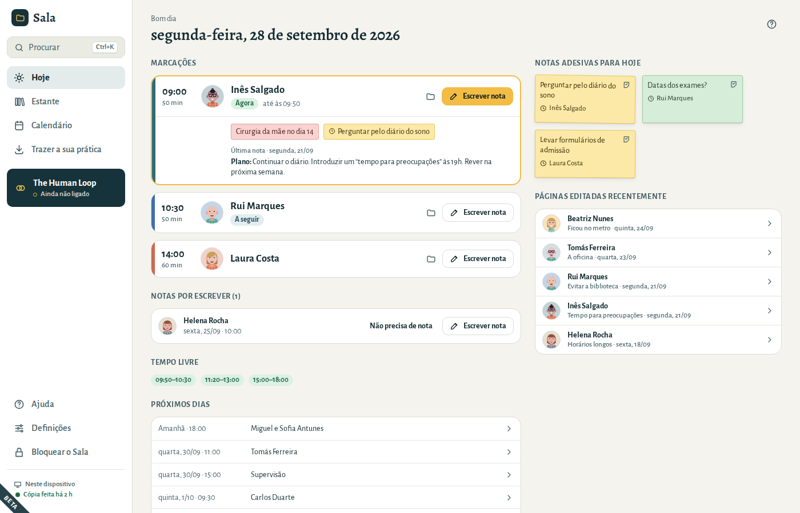
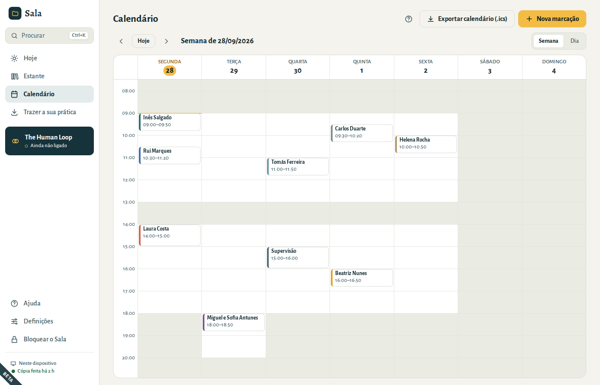
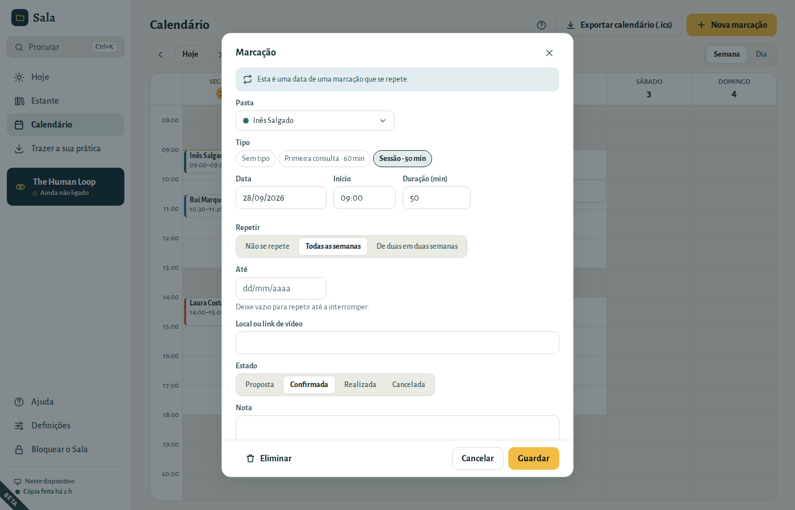
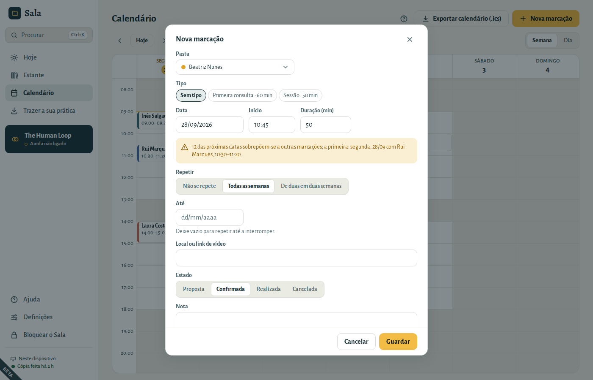
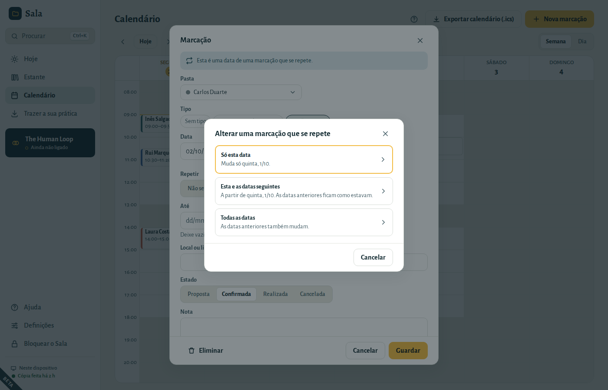
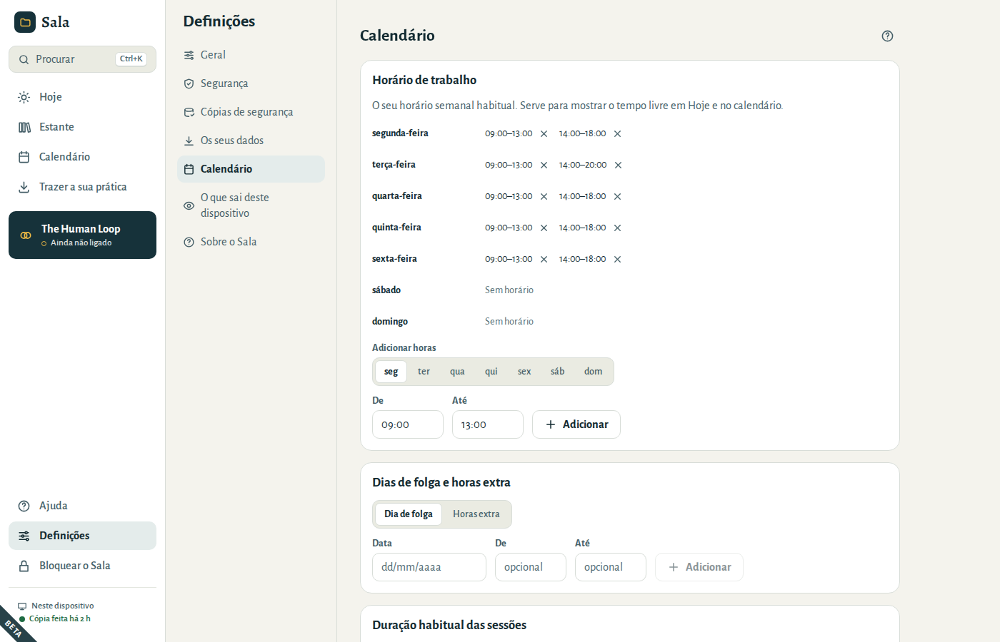

# O seu calendário

## Hoje

O ecrã Hoje é onde cada dia começa: as marcações do dia por ordem e o que ainda precisa de nota.

### Antes de uma sessão

A sessão que está a decorrer, ou a seguinte, abre-se no seu cartão. Vê as notas adesivas da pasta do paciente e algumas linhas da última nota dessa pasta: o plano, ou o fim da nota. Clique nessas linhas para abrir essa página.

Cada cartão mostra em que ponto está o dia: **Agora**, **A seguir** ou **Terminada**. Clique na hora ou no nome para abrir a marcação, por exemplo para a mudar. O botão da pasta abre a pasta do paciente.

### Escrever a nota da sessão

Escolha **Escrever nota** na marcação. O Sala abre a pasta numa página nova, já com a data e a hora. Quando a página já existe, o cartão mostra **✓ Nota escrita** e o botão passa a **Abrir nota**, por isso nunca cria a mesma página duas vezes.

### Marcar a próxima sessão

Quando uma sessão está a decorrer ou já terminou, e esse paciente ainda não tem nada marcado, o cartão mostra **Marcar a próxima**. Abre uma nova marcação no mesmo dia da semana, à mesma hora, do mesmo tipo e com a mesma duração: uma semana depois, ou duas para sessões quinzenais. Depois de uma primeira consulta, escolhe antes o seu tipo de sessão habitual. Confirme a data e escolha **Guardar**.

### Notas por escrever

As sessões das últimas duas semanas que terminaram sem página aparecem em **Notas por escrever**. Escolha **Escrever nota**, ou **Não precisa de nota** quando não há nada a registar (por exemplo, o paciente faltou). As sessões de hoje não se repetem aí: têm o seu próprio botão **Escrever nota**. Quando estiver tudo escrito, a lista desaparece.

### Notas adesivas, tempo livre e próximos dias

- **Notas adesivas para hoje** são as notas marcadas para a “próxima sessão” dos pacientes que vê hoje. Clique numa para abrir a pasta, ou a página onde está colada. Quando já não precisar dela, descole-a com o botão do canto; **Anular** volta a colá-la.
- **Tempo livre** é o que resta do seu horário de trabalho hoje. Sem horário de trabalho, o ecrã Hoje mostra uma ligação para o definir em **Definições → Calendário**.
- **Próximos dias** mostra as marcações seguintes; clique numa para a abrir.
- **Páginas editadas recentemente** levam-no de volta às páginas em que trabalhou por último.

## O calendário

- Alterne entre **Semana** e **Dia**. Use as setas para avançar ou recuar e **Hoje** para voltar.
- O calendário abre na hora atual. As horas a cinzento estão fora do seu horário de trabalho.
- **Clique numa hora livre** para criar lá uma marcação, ou escolha **Nova marcação**.
- Uma sessão cancelada aparece riscada e diz **Cancelada**. Uma data que mudou à parte (só esse dia) diz **Mudada**.

## Criar uma marcação

1. Escolha a **Pasta** (ou **Sem pasta** para supervisão, reuniões e outros compromissos).
2. Se quiser, escolha um **Tipo** de marcação — preenche a duração. Sem tipo, a marcação fica com a duração habitual das suas sessões.
3. Defina a **Data**, o **Início** e a **Duração**. Escreva a data como costuma escrever, por exemplo 28/09/2026.
4. Para sessões regulares, escolha **Todas as semanas** ou **De duas em duas semanas** e, se quiser, uma data de fim.
5. Acrescente um local ou link de vídeo e um estado: **Proposta**, **Confirmada**, **Realizada** ou **Cancelada**.

Se a hora se sobrepuser a outra marcação, ou ficar fora do seu horário de trabalho, aparece um aviso amarelo por baixo da data. Numa marcação que se repete, o aviso verifica as próximas doze datas. Pode guardar na mesma.

As sessões mantêm a hora quando os relógios mudam em março e outubro: uma sessão às 09:00 continua às 09:00.

### Marcar a próxima sessão

Abra a pasta do paciente e o separador **Calendário**. **Nova marcação** começa pela próxima sessão ao ritmo habitual: o mesmo dia da semana, hora, duração e tipo da última, uma semana depois (duas, numa série de duas em duas semanas). Depois de uma primeira consulta, escolhe antes o seu tipo de sessão habitual. Quando ainda não há nada marcado, **Marcar a próxima** mostra essa data: um clique abre-a, pronta a guardar. Enquanto uma série ainda está a decorrer, **Nova marcação** começa amanhã à hora habitual, para uma sessão extra.

O separador Calendário mostra as próximas sessões e todas as anteriores, com o ano nas datas mais antigas.

### Alterar uma data de uma marcação que se repete

Abra essa data no calendário ou no separador Calendário da pasta, faça a alteração e escolha **Guardar**. O Sala pergunta a que datas se aplica:

- **Só esta data** — por exemplo, a sessão de quinta-feira passa para sexta só esta semana.
- **Esta e as datas seguintes** — por exemplo, a partir de agora as sessões são às 18:00. As sessões anteriores ficam como estavam.
- **Todas as datas** — as datas anteriores também mudam.

Para marcar uma sessão como **Realizada** ou **Cancelada**, escolha o estado, **Guardar** e **Só esta data**. As outras datas mantêm o seu estado.

Para passar as sessões a outro paciente, mude a **Pasta**. Com **Esta e as datas seguintes**, todas as sessões a partir dessa data passam para o novo paciente, também as que tinha alterado a partir de uma data posterior, e a série dele começa do zero: as datas que o primeiro paciente mudou ou cancelou ficam com ele. Com **Todas as datas**, a série inteira muda de pasta, com as datas mudadas, realizadas e canceladas. Na primeira data das sessões que tinha alterado a partir de uma data, **Todas as datas** passa essa data e as seguintes: as sessões anteriores ficam com o primeiro paciente, e o Sala avisa antes de escolher. Aparece **Anular** durante alguns segundos. Use-o se escolheu a pasta errada: voltar a mudar a pasta traria de volta, como sessões marcadas, as datas que o primeiro paciente tinha mudado ou cancelado.

Para deixar de repetir a partir de uma data, abra essa data, escolha **Não se repete** e **Guardar**. Essa data fica como uma marcação única e as datas seguintes são removidas. Aparece **Anular** durante alguns segundos.

Para remover datas, escolha **Eliminar**:

- **Só esta data** — para um feriado ou uma sessão que não se vai realizar.
- **Esta e as datas seguintes** — quando a terapia termina ou faz uma pausa. As sessões passadas ficam na pasta.
- **Todas as datas, também as passadas** — para uma série criada por engano.

Depois de eliminar, aparece **Anular** no fundo da janela durante alguns segundos. Uma série eliminada com **Todas as datas, também as passadas** vai para **Eliminados recentemente**, como qualquer outra marcação. Com **Só esta data** e **Esta e as datas seguintes**, a série continua e salta essas datas, por isso não vão para Eliminados recentemente: **Anular** é a única forma de as recuperar. Com **Esta e as datas seguintes**, as datas que tinha mudado à parte, e as sessões seguintes que tinha alterado a partir de uma data, são eliminadas por inteiro: essas vão para Eliminados recentemente.

## Horário de trabalho e tipos de marcação

Em **Definições → Calendário**:

- **Horário de trabalho** — o seu horário semanal habitual, por exemplo segunda-feira 09:00–13:00 e 14:00–18:00. Define o tempo livre mostrado em Hoje.
- **Dias de folga e horas extra** — férias ou feriados, ou uma manhã de sábado extra.
- **Duração habitual das sessões** — a duração com que começa uma nova marcação, por exemplo 50 minutos.
- **Tipos de marcação** — por exemplo “Primeira consulta · 60 min” e “Sessão · 50 min”.

Removeu algo por engano? Escolha **Anular** no fundo da janela.

## Usar o seu calendário noutras aplicações

No calendário, **Exportar calendário (.ics)** cria um ficheiro que pode abrir no Google Calendar, no Outlook ou no Calendário da Apple. Escolha como as marcações aparecem lá — por predefinição, só as iniciais (“Marcação · I.S.”), para que um calendário partilhado ou sincronizado revele o mínimo possível. As sessões canceladas e as datas removidas ficam de fora, e as datas que mudou à parte aparecem no novo dia.
