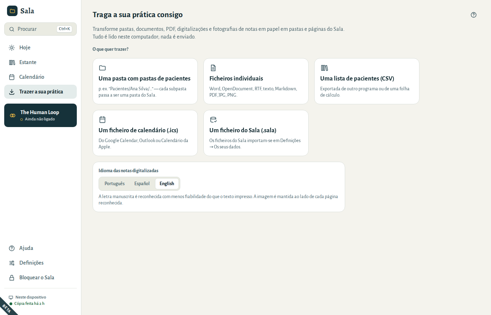
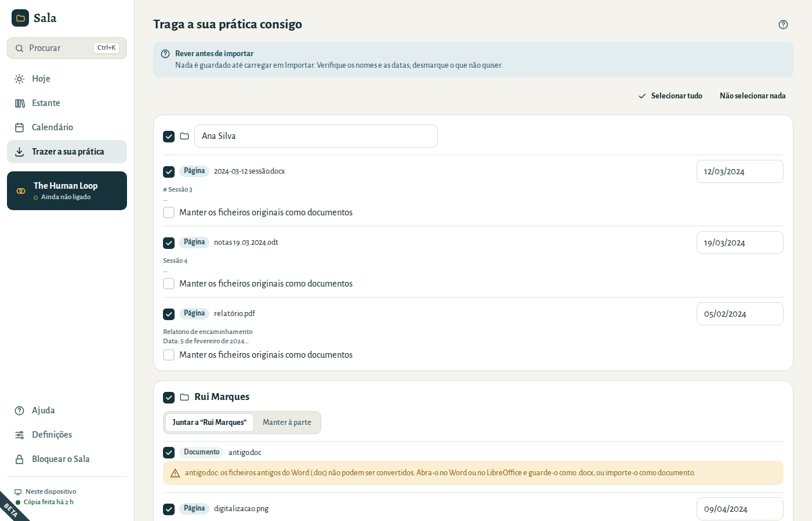
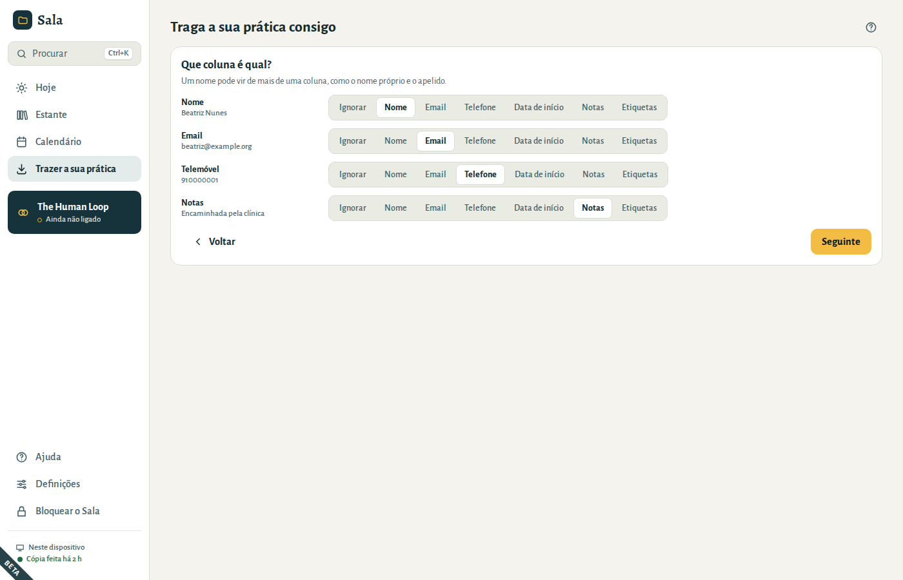
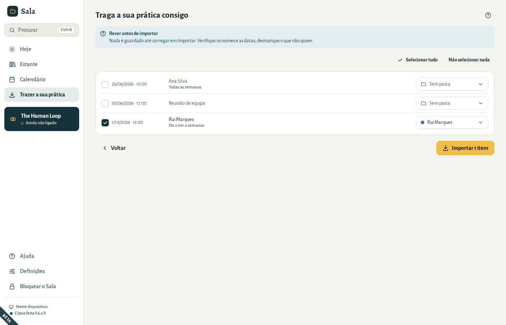

# Traga a sua prática consigo

A maioria das práticas não começa do zero. O Sala consegue transformar o que já tem em pastas e páginas, de uma só vez. **Tudo é lido neste computador — nada é enviado.**

Abra **Trazer a sua prática** no menu e escolha o que tem. Se as suas notas incluírem digitalizações ou fotografias, escolha primeiro o **Idioma das notas digitalizadas**, no fundo do ecrã: o Sala lê os ficheiros assim que os escolhe.

## Uma pasta com pastas de pacientes

Se o seu computador tem uma pasta como `Pacientes/Ana Silva/…`, escolha **Uma pasta com pastas de pacientes** e selecione a pasta principal (`Pacientes`). Cada subpasta passa a ser uma pasta do Sala; os ficheiros lá dentro passam a ser páginas ou documentos:

| O que tem | O que o Sala cria |
|---|---|
| Ficheiros Word (`.docx`), OpenDocument (`.odt`), RTF, texto e Markdown | páginas, mantendo títulos, listas e ênfase |
| PDF com texto | páginas |
| PDF digitalizados, fotografias e digitalizações (JPG, PNG) | páginas com o texto reconhecido, mantendo a imagem ao lado |
| Ficheiros antigos do Word (`.doc`), folhas de cálculo | documentos (guarde um `.doc` como `.docx` para o transformar numa página) |

Os ficheiros com mais de 200 MB aparecem na lista, mas são demasiado grandes para serem importados.

## Ficheiros individuais

Escolha **Ficheiros individuais** para trazer alguns documentos. No passo de revisão, escolha para onde vão: **Nova pasta** (escreva o nome) ou **Pasta existente**.

## Rever antes de importar

Nada é guardado até escolher **Importar**. Verifique:

- **Nomes das pastas.** Uma pasta com exatamente o mesmo nome de uma que já tem (“Silva, Ana” e “Ana Silva”) é acrescentada a essa. Um nome que apenas se parece com outro (“Ana S.” e “Ana Silva”) aparece assinalado *Parece ser a pasta existente “Ana Silva”*: escolha **Juntar a “Ana Silva”** ou **Manter à parte**. O Sala nunca junta sozinho duas pessoas cujos nomes sejam diferentes, nem que seja numa inicial. Cada pasta nova precisa de um nome.
- **Datas.** O Sala tira a data de cada página do nome do ficheiro; se não a encontrar, do texto; e, por fim, da data do próprio ficheiro. As datas tiradas da data do próprio ficheiro ficam assinaladas — confirme-as. Escreva as datas como costuma, por exemplo 12/03/2024.
- **O que manter.** Desmarque o que não quiser, ou uma pasta inteira. **Selecionar tudo** e **Não selecionar nada** estão no topo. Marque **Manter os ficheiros originais como documentos** para guardar também o ficheiro Word ou PDF.

Quando algo precisa de ser revisto — uma pasta sem nome, uma data que não existe —, o Sala assinala-o a vermelho e não importa nada até estar corrigido.

No fim, o Sala mostra o que entrou: pastas novas, páginas, documentos e marcações. Se não conseguir ler um ficheiro (por exemplo, porque a pen USB foi retirada), esse ficheiro aparece numa lista com o motivo e todo o resto é importado na mesma. Escolha **Voltar a estes itens** para tentar novamente, ou volte a eles mais tarde: ficam à espera em **Continuar a importação**.

Se a importação for interrompida — por exemplo, se o Sala for fechado ou bloqueado —, da próxima vez que abrir **Trazer a sua prática** o Sala propõe **Continuar a importação**. Vê o que ainda falta importar, com as escolhas que tinha feito, e pode revê-lo antes de continuar. O Sala não se bloqueia sozinho enquanto lê ou importa; se o bloquear, a importação para em segurança depois do ficheiro em curso.

## Notas em papel: fotografias e digitalizações

Digitalize as suas notas em papel (ou fotografe-as bem planas, com boa luz) e importe as imagens. O Sala reconhece o texto neste computador.

1. Escolha primeiro o **Idioma das notas digitalizadas**, no fundo de **Trazer a sua prática**.
2. Depois escolha a pasta ou os ficheiros.

- O texto impresso ou escrito à máquina é bem reconhecido. **A letra manuscrita é reconhecida com menos fiabilidade** — a imagem é sempre mantida ao lado do texto, com a indicação *Texto reconhecido a partir de uma digitalização — compare-o com a imagem* e a confiança do reconhecimento.
- As fotografias HEIC (do iPhone) não podem ser lidas aqui. Exporte-as primeiro como JPG.

## Uma lista de pacientes (CSV)

Exporte a lista de pacientes do seu programa anterior ou da sua folha de cálculo em formato CSV. Cada linha passa a ser uma pasta.

- O Sala mostra cada coluna e tenta adivinhar o que é cada uma: nome, email, telefone, data de início, notas, etiquetas. Corrija se for preciso.
- Um nome pode vir de mais de uma coluna: escolha **Nome** tanto para a coluna do nome próprio como para a do apelido.
- Uma data de nascimento nunca é tomada como data de início.
- As listas guardadas pelo Excel no Windows são lidas corretamente, com os acentos.

Na revisão, um paciente que já tem uma pasta com o mesmo nome aparece desmarcado. Assinale-o para juntar os dados da lista a essa pasta. O Sala acrescenta e nunca apaga: um telefone ou email só substitui o da pasta quando a lista tem um, as etiquetas são acrescentadas, e as notas e a data de início são acrescentadas à nota de capa (por exemplo *Início: 10/01/2025*).

## Um ficheiro de calendário (.ics)

Exporte o seu calendário do Google Calendar, do Outlook ou do Calendário da Apple em formato `.ics` e importe-o.

- Uma marcação cujo título é exatamente o nome de uma pasta vai para essa pasta.
- As outras aparecem desmarcadas e com **Sem pasta**. Escolha uma pasta para cada uma, ou aceite a que o Sala sugere (**Colocar em “Ana Silva”**). Depois de escolher uma pasta para uma marcação, as outras com o mesmo título passam a sugerir essa pasta (*Outro evento “Sessão” foi para “Ana Silva”*), com um clique cada: um título como “Sessão” pode ser de várias pessoas, por isso o Sala nunca as coloca numa pasta sozinho. Uma marcação que se repete e as suas datas alteradas vão sempre para a mesma pasta. Uma marcação que assinale sem pasta mantém o seu título, como uma reunião.
- As marcações semanais e quinzenais entram com a última data, as datas que foram saltadas e as datas que foram alteradas.
- As marcações canceladas e os eventos de dia inteiro ficam de fora.
- Outras repetições (todos os dias, todos os meses ou em vários dias da semana) ficam assinaladas: só a primeira data seria importada. Crie-as diretamente no Sala.

No fim da importação, escolha **Abrir o calendário** para ver as marcações.
