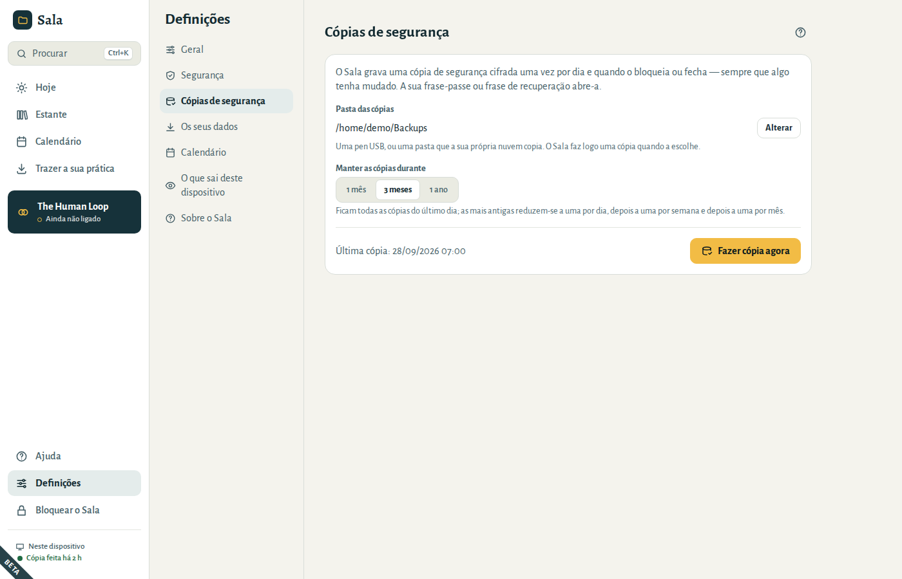
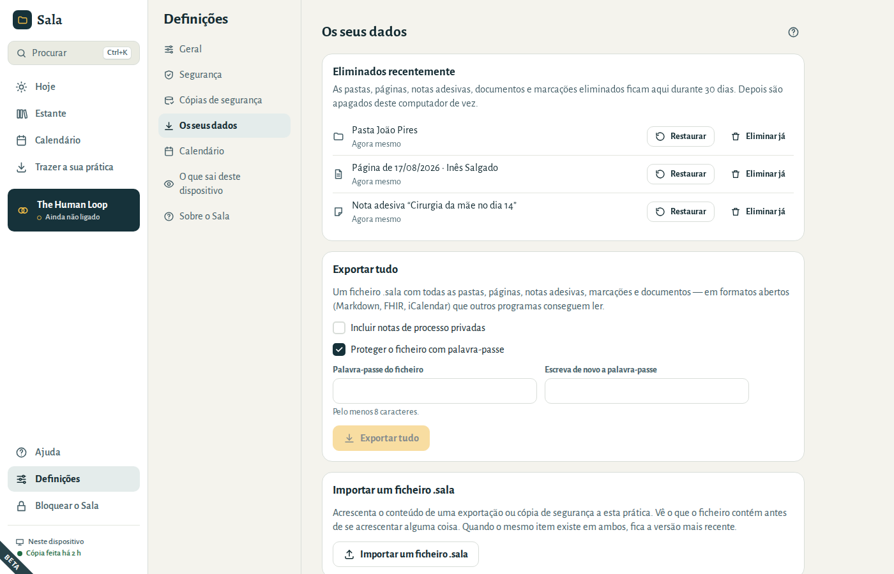
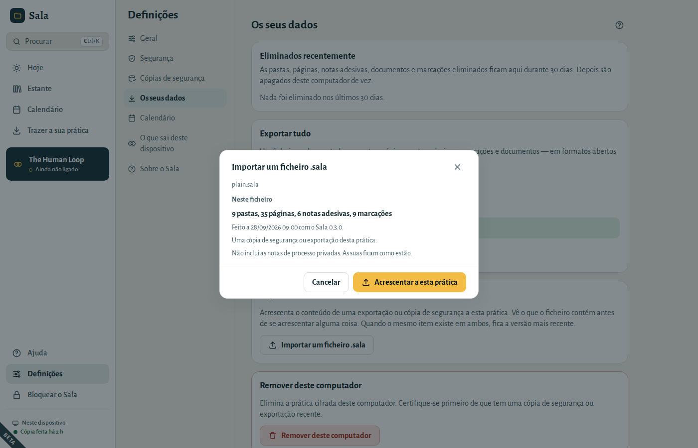
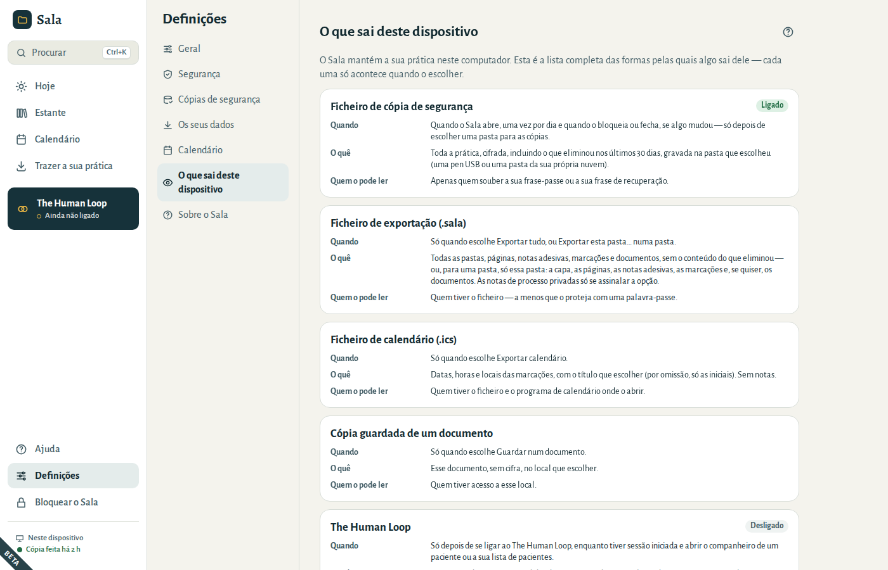
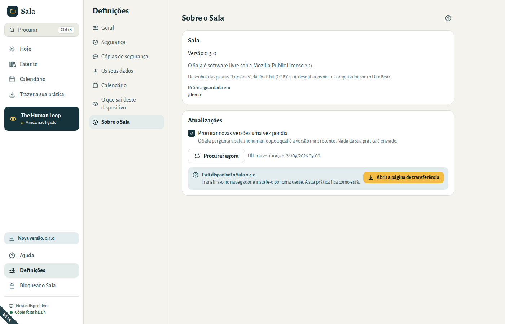
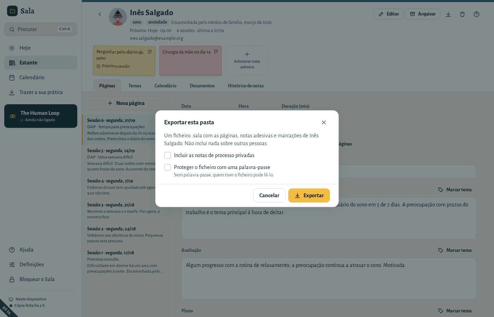

# Os seus dados

## Cópias de segurança

O Sala guarda uma **cópia de segurança cifrada** da sua prática numa pasta à sua escolha: uma pen USB, ou uma pasta que a sua própria nuvem copia. Faz uma cópia uma vez por dia e quando o bloqueia ou fecha, sempre que algo tenha mudado. O fundo do menu mostra quando foi feita a última cópia.

- Para escolher ou mudar a pasta, vá a **Definições → Cópias de segurança** e escolha **Escolher…** (ou **Alterar**, se já tiver uma pasta). O Sala faz logo uma cópia nessa pasta.
- **Fazer cópia agora** faz uma cópia de imediato.
- **Manter as cópias durante** define até onde vão as suas cópias: 1 mês, 3 meses ou 1 ano. Ficam todas as cópias do último dia; as mais antigas reduzem-se a uma por dia, depois a uma por semana e depois a uma por mês, para a pasta não encher.
- Uma cópia abre-se com a sua frase-passe ou com a sua frase de recuperação. Mais ninguém a consegue ler. Quando muda a frase-passe, o Sala faz logo uma nova cópia; as cópias mais antigas continuam a abrir-se com a frase-passe antiga.
- Dois computadores podem partilhar a mesma pasta de cópias: cada prática só arruma as suas próprias cópias, desde que os dois computadores tenham esta versão do Sala.
- A prática de exemplo nunca tem cópias de segurança.

Quando uma cópia falha (por exemplo, porque a pen USB não está ligada), o ecrã **Hoje** diz porquê e oferece **Fazer cópia agora** e **Escolher outra pasta**. Também avisa quando a última cópia bem-sucedida tem mais de três dias. Consulte [“A última cópia falhou”](06-questions.md#backup-failed).

## Eliminados recentemente

Quando elimina uma pasta, página, nota adesiva, documento ou marcação, o Sala guarda-o durante 30 dias em **Definições → Os seus dados → Eliminados recentemente**. O que foi eliminado em conjunto, como uma pasta com as suas páginas, fica junto.

- **Restaurar** devolve-o tal como estava. Se a pasta onde estava já foi apagada com **Eliminar já**, não pode voltar e é apagado também.
- **Eliminar já** apaga-o deste computador de imediato. O Sala pergunta primeiro.
- Passados 30 dias, os itens eliminados são apagados de vez, sem ter de fazer nada.

Logo a seguir a eliminar alguma coisa, **Anular**, no fundo da janela, também a devolve.

Remover datas de uma marcação que se repete (**Só esta data**, ou **Esta e as datas seguintes**) é diferente: a série continua e salta essas datas, por isso essas datas não vão para Eliminados recentemente. **Anular** devolve-as logo a seguir. Com **Esta e as datas seguintes**, as datas que tinha mudado à parte, e as sessões seguintes que tinha alterado a partir de uma data, são eliminadas por inteiro e vão para Eliminados recentemente. Mais tarde, marque a data de novo, ou abra uma data anterior, apague **Até** e guarde para **Todas as datas**.

As cópias de segurança feitas antes de um item ser apagado continuam a contê-lo, até o Sala remover essas cópias à medida que ficam antigas. Para apagar algo de todo o lado de uma vez (por exemplo, quando um paciente lho pede), escolha **Eliminar já**, depois **Fazer cópia agora** em **Definições → Cópias de segurança**, e apague as cópias mais antigas da sua pasta de cópias.

## Exportar tudo

**Definições → Os seus dados → Exportar tudo** cria um único ficheiro `.sala` com todas as suas pastas, páginas, notas adesivas, marcações e documentos, em formatos abertos que outros programas conseguem ler (texto Markdown, registos de saúde FHIR, iCalendar).

- **Incluir notas de processo privadas** fica desligado, a não ser que o marque.
- O que eliminou fica de fora, mesmo o que ainda está em **Eliminados recentemente**.
- **Proteger o ficheiro com palavra-passe** está ligado por predefinição. Escreva a palavra-passe duas vezes; precisa de ter pelo menos 8 caracteres. Sem palavra-passe, qualquer pessoa que tenha o ficheiro o pode ler.

## Mudar para um novo computador

1. Instale o Sala no novo computador.
2. No ecrã de boas-vindas, escolha **Restaurar a partir de uma cópia** e escolha a sua cópia de segurança mais recente (`Sala backup … .sala`).
3. Escreva a frase-passe que usava no computador antigo — ou a sua frase de recuperação.

A sua frase-passe e a sua frase de recuperação mantêm-se iguais depois do restauro.

Para acrescentar o conteúdo de um ficheiro `.sala` a uma prática que já tem, use **Definições → Os seus dados → Importar um ficheiro .sala**. O Sala mostra primeiro o que o ficheiro contém: quantas pastas e páginas, quando foi feito e se inclui notas de processo privadas. Nada é acrescentado até escolher **Acrescentar a esta prática**.

- As suas próprias cópias de segurança abrem-se sem pedir a frase-passe.
- Quando o mesmo item existe em ambos, fica a versão mais recente.
- O que foi eliminado no ficheiro também é eliminado aqui. Durante 30 dias, pode recuperá-lo em **Eliminados recentemente**.
- Se o ficheiro foi feito sem as notas de processo privadas, as suas ficam como estão.

## O que sai deste dispositivo

**Definições → O que sai deste dispositivo** lista todas as formas pelas quais algo pode sair do seu computador: ficheiros de cópia de segurança, exportações, ficheiros de calendário e cópias guardadas de documentos. Cada uma só acontece quando a escolhe. O Sala só se liga à Internet se ativar a procura de novas versões ou carregar em **Procurar agora**. Nunca há estatísticas de utilização, telemetria nem relatórios de erros.

## Remover a prática deste computador

**Definições → Os seus dados → Remover deste computador** elimina a prática cifrada deste computador (por exemplo, antes de oferecer ou vender o computador). As cópias na sua pasta de cópias de segurança não são afetadas. A janela mostra quando foi feita a última cópia e oferece primeiro **Fazer cópia agora**, para poder recuperar a prática mais tarde.

## Novas versões

O Sala pode avisar quando há uma nova versão. **Hoje** pergunta uma vez se pode procurar; pode mudar a resposta quando quiser em **Definições → Sobre o Sala**:

- **Procurar novas versões uma vez por dia** pergunta ao site do Sala, sala.thehumanloop.eu, qual é a versão mais recente. Nada da sua prática é enviado.
- **Procurar agora** pergunta uma vez, quando quiser.

Quando há uma nova versão, aparece **Nova versão** no menu. Escolha **Abrir a página de transferência**, transfira-a no navegador e instale-a por cima da que tem. A sua prática, as cópias de segurança e as definições ficam como estão.

## Dar a um paciente uma cópia da sua pasta

Quando um paciente pede uma cópia do seu registo, ou quando passa o acompanhamento para um colega, exporte só a pasta dessa pessoa:

1. Abra a pasta do paciente e escolha **Exportar esta pasta…**.
2. Escolha o que vai no ficheiro:
   - **Incluir as notas de processo privadas** fica desligado, a menos que o assinale.
   - **Incluir os documentos** fica ligado. Aparece quando a pasta tem documentos.
   - **Proteger o ficheiro com uma palavra-passe** fica desligado.
3. Escolha **Exportar** e depois onde guardar o ficheiro. O nome é o da pasta seguido da data, por exemplo `Ana Silva 2026-10-01.sala`.

O ficheiro contém as páginas, as notas adesivas e as marcações desse paciente, e nada sobre outras pessoas, nos mesmos formatos abertos de **Exportar tudo** (texto Markdown, registos de saúde FHIR, iCalendar).

- **Para o paciente:** deixe a palavra-passe desligada. O ficheiro é um arquivo ZIP comum: num computador sem o Sala, mude o fim do nome de `.sala` para `.zip` e abra-o. Quem tiver o ficheiro pode lê-lo, por isso entregue-o em mão ou numa pen USB, em vez de o enviar por email.
- **Para um colega que usa o Sala:** assinale a palavra-passe e comunique-a em separado, por exemplo por telefone. O colega junta o ficheiro à sua prática em **Definições → Os seus dados → Importar um ficheiro .sala**.
