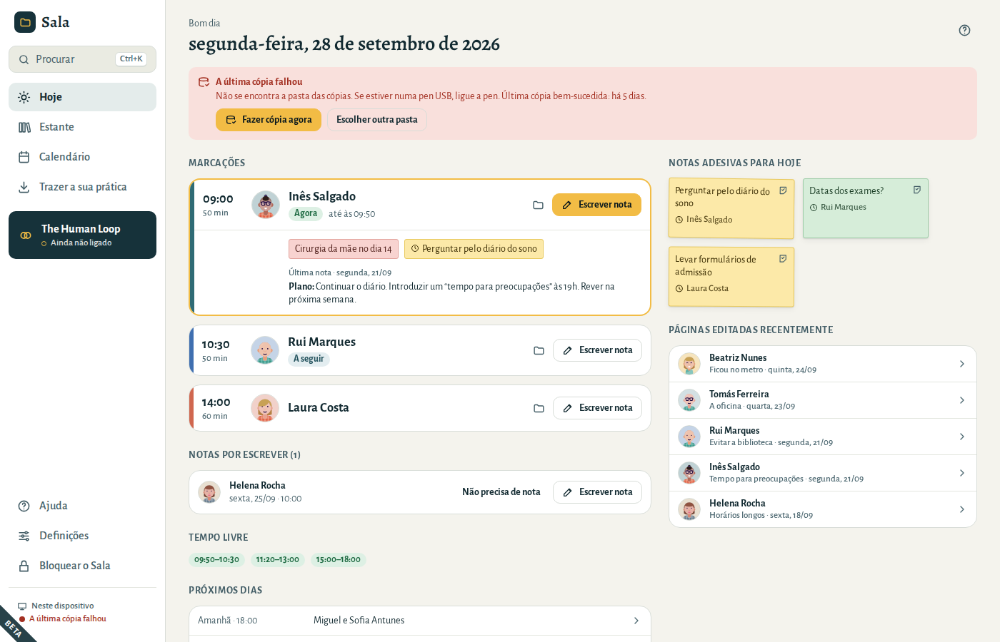

# Perguntas e resolução de problemas

### Esqueci-me da frase-passe

Confirme primeiro que a tecla Caps Lock não está ativa e que o teclado está no idioma habitual. **Mostrar**, ao lado da frase-passe, deixa-o ver o que escreveu.

Se mesmo assim não abrir:

1. No ecrã de abertura, escolha **Esqueci-me da frase-passe**.
2. Escreva a sua frase de recuperação de 12 palavras, a partir do seu papel.
3. Escolha uma nova frase-passe e escreva-a novamente.
4. Escolha **Abrir**.

A partir daí, o Sala abre com a nova frase-passe. As cópias de segurança feitas antes continuam a abrir com a frase-passe antiga, ou com a sua frase de recuperação, que não muda.

### Perdi a frase-passe e a frase de recuperação

Ninguém consegue abrir a prática — nem nós. É isso que mantém as suas notas privadas. Se tiver uma **exportação protegida por palavra-passe**, comece uma nova prática e importe-a com essa palavra-passe.

### “Não é possível abrir esta prática”

O Sala mostra esta mensagem quando a prática deste computador perdeu o ficheiro de chaves, quase sempre porque a restauração de uma cópia de segurança parou a meio (o computador foi desligado, por exemplo). Nem a frase-passe nem a frase de recuperação a conseguem abrir. O Sala nunca a remove sozinho: escolha **Remover esta prática…** e volte a restaurar a cópia de segurança (consulte [Mudar para um novo computador](05-your-data.md#restore)).

### O meu computador avariou ou foi roubado

Instale o Sala noutro computador e **restaure a partir da sua cópia de segurança mais recente** (consulte [Mudar para um novo computador](05-your-data.md#restore)). A prática que estava no computador perdido está cifrada.

### “A última cópia falhou”

O fundo do menu avisa quando não foi possível fazer uma cópia, e o ecrã **Hoje** diz porquê:

- **Não se encontra a pasta das cópias.** Normalmente, uma pen USB que não está ligada, ou uma pasta da nuvem que foi mudada de sítio ou de nome. Ligue a pen e escolha **Fazer cópia agora**.
- **O Sala não tem permissão para gravar na pasta das cópias.** Escolha **Escolher outra pasta** e indique uma pasta sua.
- **O disco das cópias está cheio.** Apague alguns ficheiros dele, ou escolha outra pasta. O Sala remove sozinho as suas cópias mais antigas à medida que envelhecem.

O Sala volta a tentar sozinho de hora a hora e quando o bloqueia ou fecha. Entretanto, as suas notas estão seguras neste computador.

### O texto reconhecido de uma digitalização tem erros

Corrija-o na página; a imagem original é mantida como documento dessa página, para que possa comparar. A letra manuscrita é reconhecida com menos fiabilidade do que o texto impresso.

### Um ficheiro Word (.doc) foi importado como documento e não como página

Os ficheiros `.doc` antigos não podem ser convertidos. Abra o ficheiro no Word ou no LibreOffice, guarde-o como `.docx` e importe esse ficheiro.

### As horas das marcações parecem erradas

Verifique **Definições → Geral → O seu fuso horário**. Cada marcação guarda o seu próprio fuso horário, por isso as sessões mantêm a hora quando os relógios mudam.

### O Sala bloqueou-se sozinho

O Sala bloqueia-se após algum tempo sem utilização, para proteger as suas notas. Altere esse tempo em **Definições → Geral → Bloquear o Sala após**.

O que estava a escrever foi guardado antes de o Sala se bloquear. Escreva a sua frase-passe: no mesmo dia, o Sala abre onde estava, na mesma pasta e na mesma página.

O Sala não se bloqueia sozinho enquanto exporta, importa ou adiciona documentos, mas bloqueia-se se deixar aberta a janela para escolher documentos, ou para guardar uma exportação. Se ficar bloqueado antes de esse trabalho terminar, o ecrã para abrir o Sala diz o que ficou por fazer e o que fazer de novo, por exemplo exportar outra vez. Uma nova frase-passe ou frase de recuperação que estava a ser guardada quando o Sala se bloqueou fica guardada primeiro, e esse ecrã diz isso mesmo. Se uma nova frase-passe não pôde ser guardada, por exemplo porque a frase-passe atual foi mal escrita, esse ecrã também o diz: abra o Sala com a frase-passe antiga e altere-a de novo.
